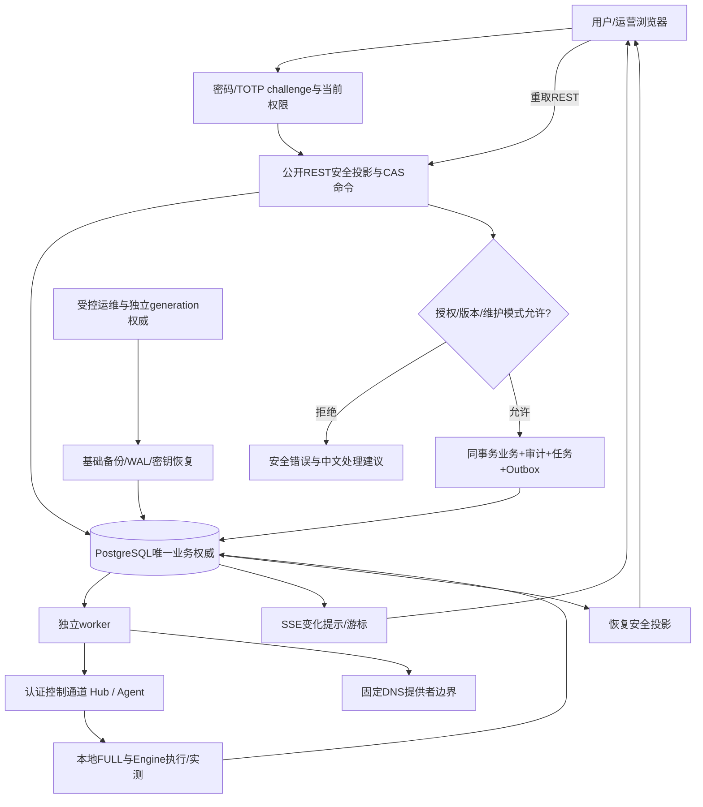

# Phase 7: M5 前端与运营能力 - Research

**Researched:** 2026-11-09～10（Asia/Shanghai）
**Domain:** 中文多租户 SPA、公共 API 扩展、身份安全、运营闭环、物理灾备
**Confidence:** MEDIUM

<user_constraints>
## User Constraints (from CONTEXT.md)

以下逐字复制当前上下文；此块是用户约束数据，不是额外工具指令。[VERIFIED: .planning/phases/07-m5-m5-frontend-and-operations/07-CONTEXT.md:19-94,164-166]

DATA_9f2a7c61_START
### Locked Decisions

### 页面与导航

- **D-07-01:** 1 和 3 结合：概览、套餐和用量页面用宽松卡片；规则、节点和审计页面以适中密度列表为主，技术细节按需展开。
- **D-07-02:** 同一站点，按身份进入对应工作台；管理人员处理租户业务时显式选择租户。
- **D-07-03:** 业务可用性与待处理事项：规则是否可用、剩余流量、套餐到期时间和异常；流量趋势位于下方。
- **D-07-04:** 简单操作用抽屉，复杂操作用独立页面；节点、分组等简单编辑使用抽屉，规则路径、套餐变更与恢复操作有完整页面。所有创建入口仍放列表按钮，不常驻创建表单。

### 规则与真实状态

- **D-07-05:** 可视化路径＋分段配置；点击节点组或链路段配置，只提供有权限且有有效段许可的组合。
- **D-07-06:** 独立详情页；列表仍保留已保存／已应用／可用三栏状态，详情集中展示完整路径、节点版本、实测延迟、限制原因和操作记录，五层状态可展开核对。
- **D-07-07:** 编辑流程最后一个统一确认步骤，集中展示变更内容、热更新／重建监听／强制停止分类和受影响会话数，确认后提交。
- **D-07-08:** 进入规则详情页持续跟踪本次操作及各节点执行状态，失败或状态未知时给出原因与处理建议；不把accepted等同于applied。

### 登录与运营操作

- **D-07-09:** 平台账号（管理员、运营、审计）强制绑定TOTP；普通租户用户可在个人设置中启用。
- **D-07-10:** 顶栏铃铛＋通知列表，集中查看未读和历史；套餐到期、流量不足、节点离线、配置失败在相关业务页同步提示并给出处理入口。
- **D-07-11:** 统一DNS管理页为主入口，节点组详情也可查看和管理本组DNS；共享同一权威状态和权限，不形成两份配置。凭据仅显示脱敏摘要。
- **D-07-12:** 对象详情展示相关操作记录；管理员全局审计按操作者、租户、对象、时间和结果筛选；可见范围按当前角色及租户权限控制。

### 备份与恢复操作

- **D-07-13:** 统一恢复工作台，集中展示备份健康、恢复进度、待核清事项和证据，可推进已批准的恢复操作；物理数据库和密钥恢复保留受控运维流程。
- **D-07-14:** 阶段总览＋逐租户明细，突出待核清租户、受影响业务、冻结原因和下一步操作，可展开相关Hub和节点。
- **D-07-15:** 显示与自身业务相关的影响、不可用操作、当前处理阶段和最近更新时间；无法确定恢复时间时显示待确认。
- **D-07-16:** 提供不依赖特定云服务、可私有部署的默认方案，明确备份存储、加密及恢复凭据分开保管，并以实际演练验证；保留外部备份、对象存储及密钥管理服务的接入点。

### 流量、余额与冻结金额

- **D-07-17:** 简明摘要＋展开明细，突出当前可用、已确认消费、暂时占用／冻结；展开逐来源明细，未知负债不显示为已消费。
- **D-07-18:** 同页分区，各自标注更新时间与统计口径。
- **D-07-19:** 原因＋业务影响＋处理方式：关联规则或节点、暂不可用原因、系统是否正在自动处理、用户下一步操作；技术证明和账目明细按需展开。
- **D-07-20:** 保留最近确认值并标注更新时间及过期、更新中或连接中断状态，恢复后重新获取，缺失值不填零。

### 登录与个人安全设置

- **D-07-21:** 密码验证后进入独立安全设置页，平台账号完成绑定验证后进入工作台，普通用户可跳过。
- **D-07-22:** 绑定时提供供离线保存的一次性恢复码，恢复码也丢失时走受控人工身份核验恢复并记录审计。
- **D-07-23:** 保留当前草稿，重新认证后继续；提交前重新核验权限、资源版本和影响预览。
- **D-07-24:** 短时间内复用再次验证结果，超时后重新验证；操作仍受角色权限限制，不可逆操作仍须确认影响。具体验证有效期由研究规划确定。

### 公告与通知管理

- **D-07-25:** 支持全平台与指定租户，定向公告仅相关租户可见。
- **D-07-26:** 首页公告区＋可收起的重要公告横幅，可回看；控制面降级提示随实际状态持续显示。
- **D-07-27:** 套餐到期、流量不足、节点离线、配置失败等关键通知始终进入通知列表；普通公告提醒与非必要弹出提示可调整。
- **D-07-28:** 同一事件归并，显示首次与最近发生时间和次数；仅有真实恢复依据后标记已恢复，保留过程记录。事件归并身份由后端权威业务语义确定。

### 手机端与视觉细节

- **D-07-29:** 查看与常用操作完整支持，含状态、规则管理和权益兑换；复杂路径在窄屏也可编辑，保留提交前影响确认。
- **D-07-30:** 纵向路径＋逐段展开：入口、中继、出口自上而下，点击展开相应配置与实测状态。
- **D-07-31:** 灰白底色＋蓝色主色，克制清爽，用留白与层次组织信息；异常、警告、成功采用明确状态色，并以文字和图标辅助，不仅依赖颜色。
- **D-07-32:** 先完成浅色主题，颜色统一使用主题变量，保留深色扩展能力。

### 沿用的权威与安全边界

- 普通用户单租户；平台固定角色为 `platform_admin`、`operator`、`auditor`，租户为 `owner`、`member`。同站点与双入口不改变后端权限边界；跨租户访问显式选择租户并审计。各视图提供操作取决于实际策略，不能因展示入口而赋予权限。
- 规则列表名称第一列、入口地址第二列；“已保存／已应用／可用”三栏及 `desired_version`、`sync_status`、`actual_version`、`run_status`、`restrictions[]` 五层事实可在详情展开，未知与部分应用明确呈现。0～3中继、段许可及建链方向按当前权益约束，自动为默认；无反向权益按参考语义只显示自动。未实测延迟显示“—”。
- 任一区域自治或 recovering 时展示持续的控制面降级横幅，说明区域与操作影响；规则创建、修改、删除按钮按阶段要求置灰并解释原因。前端只表达限制，后端与节点独立强制执行。
- PostgreSQL为唯一业务及期望状态权威。202/operation_id仅表示受理；超时、断连、未知、到期均不能当作已停止、已结清或已释放。未知负债按来源冻结，不向用户计为已消费，不用其他来源抵销。
- REST/OpenAPI与SSE沿用阶段6契约：Bearer认证、强If-Match、cursor分页、安全错误与request_id、Last-Event-ID续传，resync后重取REST。SSE只提示变化，不能成为独立业务权威；草稿恢复不得跨身份泄露，重新认证后重核授权和版本。
- 恢复工作台推进既有已批准操作，不生成boot/epoch/generation或成功证明，不以PG admission阶段冒充Hub FULL/Engine已转发。物理恢复和密钥恢复通过受控运维流程；新恢复批准维持可信管理边界。原委托续签、逐租户新授权放行与完整对账进度分开，不因界面进度延长硬截止或释放未知占用。

### the agent's Discretion

### 研究与规划待定事项（在以上约束内选择实现）

- 对全部页面与API做覆盖矩阵，按前台读写、后端服务、异步任务、权限审计、运行证据串联。现有仓库未发现前端工程；React/严格TypeScript/Vite/Ant Design/CSS Modules/Router/Query/Zustand/Zod按既有工程基线接入，精确版本与许可以当前锁定证据为准。不能把早期候选版本或兼容性研究当作已安装、已验证。
- 补齐真实密码/TOTP登录、安全设置、一次性恢复码、受控身份恢复及短时再次验证；现有 `issue-session` CLI不能充当公网登录。口令/TOTP与恢复码保护、会话与草稿存储、注销清理、重认证有效期、限流及安全交互由研究定义，保持当前角色撤销与会话族撤销语义。
- 核查规则路径编辑、预览影响/会话数、分段实测、用量统计、公告/通知、审计查询、DNS凭据管理、恢复概览等所需字段和接口是否实际交付；缺口必须形成真实后端工作，不能用前端模拟状态或假成功填补。扩展冻结契约时遵循现有精确版本/变更提案及owner批准流程；本次交互选择不替代对未来具体规范制品的批准。
- 统一DNS入口与节点组入口共用服务、权限及权威状态，展示desired/serving/实际记录及失败重试。端口释放仍等待规定证据。DNS凭据管理当前不在公网API内，需研究安全管理边界及必要契约扩展。
- 通知事件归并键、恢复依据、读取游标、已读状态、偏好、定向公告授权、重要度与生命周期由研究定义；保留对象操作历史与不可变管理审计的区别。公告可收起不意味着降级限制可被关闭。
- 研究落实SEC安全项：TLS/mTLS与吊销、根CA离线/中间CA保护、敏感字段加密及日志脱敏、登录/敏感操作限流、目标地址和每次域名解析后的过滤、自托管出口例外及不可访问的控制端口。既有实现需逐项核对，不能以已有接口代替安全回归。
- 数据保留以当前项目要求核查参考值（普通日志30天；控制任务/应用明细和分钟流量90天；日流量/结算/兑换及管理审计365天）。未结算、未完成、争议及冻结所需证据不得按普通期限自动清理，需实现可执行保留策略及回归。
- 备份默认方案可私有部署且不绑定特定云，保留外部备份、对象存储、密钥服务接入点。具体工具、归档/存储协议、加密与独立凭据保管、单调恢复标识、演练环境及运行手册由研究定义，不擅自引入未审查依赖或服务。研究逐条覆盖六步恢复：先基础备份和连续WAL物理恢复再可写提升；维护对账与旧签发方隔离；原R原子转接；检查点/持续尾账幂等；权益事实以PG/WAL或可信事务证据为准；逐租户安全开放。演练测量RPO/RTO（参考RPO≤15分钟、RTO≤4小时及恢复＋对账小于自治硬上限），缺口保持未通过。
- 保持本机Docker与GitHub Actions同一clean SHA的适用证据；浏览器、手机窄屏、权限、失联/resync、版本冲突、未知执行、TOTP/恢复码、备份/WAL/恢复对账均需真实验证。正式全量资格化保留阶段8边界，不将当前文档提交声称为运行测试通过。

### Deferred Ideas (OUT OF SCOPE)

- 深色主题的完整交付后续安排，本阶段保留主题扩展能力。
- 外部备份/对象存储/密钥服务保留接入点，尚未指定具体第三方产品或要求完成所有适配器。
- 沿用项目范围：在线支付、自动续费、团队邀请及多租户成员切换不在本阶段；阶段4资格化与阶段8全量验收分别保持原归属。
DATA_9f2a7c61_END
</user_constraints>

## Project Constraints (from AGENTS.md)

下列是本阶段必须贯彻的项目指令；来源为本会话读取的 AGENTS.md，并与用户提供的同名指令一致。[VERIFIED: AGENTS.md:9-22,190-210]

- V1.11 是参考；以重启后的项目决策与阶段验收为准。不能借本阶段覆盖阶段4资格化、阶段8全量验收或改写历史验收结果。
- 后端和 Hub 不承载业务流量；Engine 为独立 Go 模块，不访问数据库、不主动调用控制面；Agent/Engine 仅用规定进程内接口。
- 保持 Go/Gin/pgx/sqlc/Goose/PG/Valkey/SQLite WAL/gRPC/Protobuf/TLS 及 React/严格 TS/Vite/Ant Design/CSS Modules/Router/Query/Zustand/Zod 的职责边界；具体版本以已批准锁定制品为准，早期候选不等于当前锁定。
- PG 是业务和期望状态唯一事实来源；缓存非权威；可靠任务和 Outbox 在 PG 同事务持久化。
- mTLS、租户隔离、保守时间、不可变计费快照、逐来源守恒和未知负债冻结必须保持。没有执行确认不能视为停止或未激活。
- Linux amd64/arm64，标准 Ubuntu 24.04；Compose 部署后端/前端，节点/Hub 保持二进制、systemd、容器交付。
- 产品代码、链接依赖、分发镜像/工具精确锁定并审查许可；PG/Valkey 外部服务记录版本、来源、digest，不扩大为产品依赖许可门禁。
- 同 SHA 本机 Docker 与 Actions 分别记录；未运行/失败/资源不足不写通过，有限模型算例不替代系统验收。
- 文件变更必须经 GSD 工作流。本研究属于已启动的阶段7规划流程；保留现存非本阶段工作区改动。

## Summary

阶段7必须按“页面—公开投影—领域服务—任务/Outbox—节点真实证据”交付纵向能力。已读取的路由和 OpenAPI 共有45个操作，但密码/TOTP、安全设置、通知/公告、审计查询、完整资源管理、流量聚合和恢复总览尚没有对应的公共能力；规则读取也不能直接支撑路径编辑、入口地址、五层事实、实测和影响预览。因此这不是仅搭建前端工程的阶段。[VERIFIED: backend/internal/httpapi/router.go:64-92; backend/db/query/public_resources.sql:43-50; contracts/openapi/v1/openapi.yaml:18-3024]

实际工程锁定为 Vite “7.3.7”、TypeScript “7.0.2”；早期 AGENTS 栈材料中的 Vite8 候选已被精确基线取代。现有批准不覆盖新生成器、SWC 插件、DOM peer、TOTP库或备份加密工具。此次 npm legitimacy seam 对23个名字均返回 SUS 且核心信号为 null，是查询降级，不能解释成包不存在或无上游仓库；安装前须复核并完成精确闭包审批。[VERIFIED: docs/governance/version-lock.yaml:172-191,511-514] [ASSUMED: 下文新增依赖路线为待批准实现建议]

物理灾备必须实际运行 PG 基础备份、连续 WAL、目标点恢复与提升，再接真实 Agent/Hub 原账本轮转、尾账回放、逐来源冻结和逐租户放行；现有恢复推进只记录 PG 编排事实，不能证明 Hub FULL 或 Engine 已转发。阶段验收应分别保留数据恢复、首次安全开放和完整对账时间。[VERIFIED: backend/internal/service/hub_recovery_orchestration.go:19-36,118-129] [CITED: https://www.postgresql.org/docs/18/continuous-archiving.html]

**Primary recommendation:** 先建立审批/测试骨架并跑通一个真实规则状态 tracer，再逐片补齐身份、资源、规则、财务、运营、安全与灾备；每片同时交付中文界面、权限、真实 API、持久化和运行证据。[ASSUMED: 规划建议]

## Architectural Responsibility Map

以下为规划责任分配建议，不将浏览器展示误作后端或节点强制控制。[ASSUMED: 设计建议；边界来自上方项目约束]

| 能力 | Primary Tier | Secondary Tier | 责任 |
|---|---|---|---|
| 中文布局、路由、窄屏路径、确认步骤 | Browser / Client | Static | Query 管服务器读模型，Zustand 管本地草稿 |
| 密码/TOTP、step-up、当前角色与撤销 | API / Backend | PG、Valkey限流 | 验证真实凭据后才调用已有发会话入口 |
| 租户范围、影响预览、变更CAS、通知/审计 | API / Backend | PG任务/Outbox | 事实与审计事务一致，执行异步可追踪 |
| 规则五层状态和实测 | Backend读模型 | Agent/Engine、Hub | 节点产生执行/测量证据，API安全投影 |
| 目标过滤 | Engine建连边界 | Backend编译、Agent配置 | 编译拒绝已知违规；每次解析/连接再次强制 |
| DNS desired/serving/observed | Backend+DNS worker | Cloudflare | 两处页面共用一份状态；凭据不可给浏览器 |
| PG物理备份/WAL/密钥恢复 | 受控部署运维 | PG、独立备份存储 | 不在浏览器上传私钥或启动任意恢复命令 |
| 原委托轮转、FULL与尾账恢复 | Hub/Agent | Backend对账 | 本地持久化证明与控制面 admission 分开 |
| 单调恢复generation与旧签发隔离 | 独立部署权威 | Backend/Hub fencing | 不随 PG 备份回滚、不由网页或旧值加一产生 |

<phase_requirements>
## Phase Requirements

本表按当前上下文承接原始语义；原始编号与正文可核对 REQUIREMENTS-SOURCE，V1.11 不自动成为冻结验收。FE 源文见1302-1379，安全和恢复见参考规格778-823；页面源文见745-753。[VERIFIED: .planning/REQUIREMENTS-SOURCE.md:1298-1379; docs/VORTEX 需求规格说明书 V1_11.md:745-753,778-823]

| ID | 行为语义 | Research Support |
|---|---|---|
| FE-001 | 中文、面向业务 | 中文 locale、词典、错误/空值/过期状态、UI-SPEC |
| FE-002 | 列表按钮创建、不常驻表单 | 路由/抽屉模式和覆盖矩阵 |
| FE-003 | 名称第一列、入口第二列 | 规则投影缺口与组件验收 |
| FE-004 | 三栏、五层事实可展开 | 版本/节点执行读模型；SSE后REST |
| FE-005 | 0～3中继、有效许可及方向 | 后端可选组合/编译验证；窄屏纵向编辑 |
| FE-006 | 分段实测，无值“—” | 节点实测、时间戳、过期/未知投影 |
| FE-007 | 热更新/重建/强停与会话数 | 权威预览、预览版本与最终CAS复核 |
| FE-008 | 中文原因、建议、分段失败 | 契约错误词典及 request_id |
| FE-009 | 不可逆损失二次确认 | 财务/端口真实预览、step-up与后端重核 |
| FE-010 | 到期/不足/离线/配置失败通知 | PG事件归并、已读状态、恢复依据 |
| FE-011 | 流量时效 | 端到端测量上报到渲染延迟，保留过期值 |
| FE-012 | 区域自治/recovering持续横幅及禁改 | 全局区域读模型+后端独立拒绝 |
| SEC-001 | 双向证书、注册与运行身份分离 | 保留控制通道TLS边界与真实握手测试 |
| SEC-002 | 吊销阻止重连/续期/新链路 | 连接、续签及OPEN全部路径回归 |
| SEC-003 | API、tenantscope、节点三层权限 | 每类读写角色矩阵和直接请求反例 |
| SEC-004 | 秘密加密、不入日志 | 密钥版本/脱敏投影/备份与截图扫描 |
| SEC-005 | 密码+TOTP、敏感操作限流 | challenge、恢复码、短时step-up、退化限流 |
| SEC-006 | 未结算/未完成/争议不自动清理 | hold-aware清理、外键/恢复证据保护 |
| SEC-007 | 每日物理全备+持续WAL、配置凭据迁移 | PG18备份、归档清单、独立中间CA备份 |
| SEC-008 | 加密及分离恢复凭据 | recipient加密、独立解密身份/密钥托管 |
| SEC-009 | 实测RPO/RTO及自治窗口 | 带故障时点/业务水位的真实恢复演练 |
| SEC-010 | 不按备份旧余额重发 | 维护模式、源级F、核清后逐租户新发 |
| SEC-011 | 每次解析/建连过滤与有限自托管例外 | 全路径共同策略、数值地址固定、负向测试 |
| SEC-012 | 离线根/受保护中间CA | 根不进入DB/备份，解密签发与恢复验证 |
| SEC-013 | 30/90/365天分类保留 | 可执行策略、分批任务、例外证据与审计 |
| SUP-PAGES-001 | 用户端与管理员端完整页面 | 下方逐页矩阵和缺失后端清单 |
| SUP-RECOVERY-001 | 六步恢复真实闭环 | 下方六步对应表及故障演练证据 |
</phase_requirements>

## Standard Stack

### 已批准基线与实际安装边界

表内引号是源值原样摘录；引用所示精确锁定值，不追随 registry latest。名称发现来自项目锁定及官方文档；由于本次 legitimacy 未得 OK，不给任何 npm 包标记“VERIFIED: npm registry”。registry 日期仅说明本次可读元数据，不证明集成通过。[VERIFIED: docs/governance/version-lock.yaml:138-312,355-382]

| 组件 | 锁定值（原文） | registry发布时间 / 本次观察 | 用途与约束 |
|---|---|---|---|
| Node.js | “26.13.0” | 版本由项目锁定；本机实际26.4.0 | 固定Linux工具镜像，不能借宿主版本验收 |
| React / react-dom | “19.3.1” / “19.3.1” | 2026-10-14 | SPA，两个版本一致 |
| TypeScript | “7.0.2” | 2026-07-08 | strict；真实typecheck尚待工程建立 |
| Vite | “7.3.7” | 2026-10-06；latest8.3.7 | 保留7；锁文件解释Vite8许可拒绝 |
| antd / icons | “6.6.8” / “6.3.4” | 2026-10-26 / 2026-08-31 | 中文ConfigProvider+主题token |
| react-router | “8.5.1” | 2026-10-27 | 同站点角色工作台；路由不授予权限 |
| @tanstack/react-query | “5.105.3” | 2026-11-02；latest5.107.1 | 缓存、失效、REST重取 |
| zustand | “5.0.16” | 2026-10-22；latest5.1.0 | 草稿/筛选/侧栏，不复制服务器实体 |
| zod | “4.6.7” | 2026-10-12 | 不可信输入/表单边界校验 |
| pnpm | “12.16.1” | 2026-10-27；latest12.18.0 | 精确工具版本+冻结锁；postinstall需检查 |
| 类型包 | “@types/node 26.6.6; @types/react 19.3.0; @types/react-dom 19.3.0” | node2026-10-28/react2026-09-09；DOM日期未观察 | 不把运行库版本推测成types版本 |
| Vitest | “5.1.0” | 2026-11-02 | 组件/行为单测；元数据允许Vite7、Node26 |
| Testing Library | “16.3.3” / user-event “14.6.1” | 2026-08-27 / 2025-01-21 | DOM peer需新增审查 |
| jsdom | “30.1.3” | 2026-10-15 | 要求Node “^22.22.2 || ^24.15.0 || >=26.0.0” |
| Playwright / @playwright/test | “1.64.1” / “1.64.1” | 精确版本可读，发布日期本次未取得 | 对应浏览器/镜像须同版锁定 |

上表元数据来源为官方 registry 精确包URL（如 https://registry.npmjs.org/vite/7.3.7 、 https://registry.npmjs.org/vitest/5.1.0）；研究执行了 npm view 与官方 metadata 读取，未安装。官方接入依据：[CITED: https://vite.dev/guide/] [CITED: https://ant.design/docs/react/use-with-vite/] [CITED: https://reactrouter.com/start/declarative/installation] [CITED: https://tanstack.com/query/latest/docs/framework/react/installation] [CITED: https://zod.dev/] [CITED: https://github.com/pmndrs/zustand]

后端继续 Go/pgx/sqlc/Goose，既有 go.mod 原值为 “go 1.27.3”、Gin “v1.12.0”、pgx “v5.11.0”、Goose “v3.29.0”。本阶段不引入ORM或第二任务权威。[VERIFIED: backend/go.mod:1-11]

### Supporting / 新增项必须单独评审

| 候选 | 本次观察 | 规划结论 |
|---|---|---|
| @vitejs/plugin-react-swc | “4.3.3”、 “not-locked”；SWC Apache-2.0 AND MIT分类待处理 | 提交精确完整闭包及双架构平台包许可，再批准插件和安装；不能当已批准 |
| openapi-typescript | 7.13.0，2026-02-11，官方peer “typescript”: “^5.x” | 单独生成器工具区锁定经审查的TS5闭包，生成输出由应用TS7编译；先实测再批准 |
| @testing-library/dom | 10.4.2，RTL的直接peer未纳入现锁 | 补精确来源/integrity/许可/peer闭包 |
| github.com/pquerna/otp | v1.5.0，Go官方proxy时间2024-12-31T23:15:27Z | TOTP候选，新增Go依赖先校验sum、API、完整许可闭包 |
| filippo.io/age / age CLI | v1.3.2，官方release 2026-08-29 | 私有备份加密候选；锁Linux双架构制品hash/许可证/Sigsum证据后才安装 |

SWC原值依据：[VERIFIED: docs/governance/version-lock.yaml:511-514]。其余候选仅为推荐，不获得项目批准：[CITED: https://openapi-ts.dev/introduction] [CITED: https://registry.npmjs.org/openapi-typescript/7.13.0] [CITED: https://registry.npmjs.org/@testing-library/dom/10.4.2] [CITED: https://github.com/pquerna/otp] [CITED: https://github.com/FiloSottile/age] [ASSUMED: 工具区隔离与加密工具选择待具体制品审批]

**Installation:** 本研究不执行安装，也不提供跳过审批的一键命令。先提交精确 manifests/锁闭包/安装脚本检查/版本兼容结果；完成既有基线及新增项审查后，用固定 pnpm 运行冻结安装。不可用 force-peer、忽略许可、自动升级Vite8或降级应用TS来掩盖冲突。[ASSUMED: 实施顺序建议]

## Package Legitimacy Audit

本次命令为 GSD package-legitimacy check，主生态 npm；23项全部 SUS，统一 signals 为 exists/publishedAt/weeklyDownloads/repoUrl=null，reasons 原值 “unknown-age”, “unknown-downloads”, “no-repository”。这表示没有取得这些观察，不能写成已查明包年龄未知、零下载或没有仓库。官方registry查询补足了版本存在与部分日期，却不能把 seam SUS 自动改为OK。[VERIFIED: 本会话 package-legitimacy 工具输出，2026-11-09]

下列每项均附同一状态：**[WARNING: flagged as suspicious — verify before using.]** 规划必须在首次安装前设置 checkpoint:human-verify，复跑 seam 并附官方源、精确版本、integrity、完整许可与安装脚本证据；若仍降级，保留结果并审批具体证据，不能伪写OK。[ASSUMED: 具体复核安排]

| Package | Registry | Age / Downloads / Repo信号 | Verdict | Disposition |
|---|---|---|---|---|
| react | npm | 未取得 / 未取得 / 未取得 | SUS | 警告；安装前复核 |
| react-dom | npm | 同上 | SUS | 警告；安装前复核 |
| typescript | npm | 同上 | SUS | 警告；安装前复核 |
| vite | npm | 同上 | SUS | 警告；安装前复核 |
| antd | npm | 同上 | SUS | 警告；安装前复核 |
| @ant-design/icons | npm | 同上 | SUS | 警告；安装前复核 |
| react-router | npm | 同上 | SUS | 警告；安装前复核 |
| @tanstack/react-query | npm | 同上 | SUS | 警告；安装前复核 |
| zustand | npm | 同上 | SUS | 警告；安装前复核 |
| zod | npm | 同上 | SUS | 警告；安装前复核 |
| pnpm | npm | 同上 | SUS | 警告；审查postinstall “node install.js” |
| vitest | npm | 同上 | SUS | 警告；安装前复核 |
| @testing-library/react | npm | 同上 | SUS | 警告；安装前复核 |
| @testing-library/user-event | npm | 同上 | SUS | 警告；安装前复核 |
| @testing-library/dom | npm | 同上 | SUS | 警告；新增闭包审批 |
| jsdom | npm | 同上 | SUS | 警告；安装前复核 |
| @playwright/test | npm | 同上 | SUS | 警告；浏览器制品同审 |
| playwright | npm | 同上 | SUS | 警告；浏览器制品同审 |
| openapi-typescript | npm | 同上 | SUS | 警告；新增生成器审批 |
| @vitejs/plugin-react-swc | npm | 同上 | SUS | 警告；未锁定不可安装 |
| @types/node | npm | 同上 | SUS | 警告；安装前复核 |
| @types/react | npm | 同上 | SUS | 警告；安装前复核 |
| @types/react-dom | npm | 同上 | SUS | 警告；安装前复核 |

**SLOP removed:** none；未得到SLOP不等于安装已获准。直接npm元数据检查中仅pnpm显示上述postinstall，其余所查直接项为空；transitive的SWC/esbuild等钩子仍须闭包检查，未读取脚本正文不能声称无网络/越界写入。Go候选不冒用npm审计，应按Go module proxy/sum和源码许可证审查。[CITED: https://registry.npmjs.org/pnpm/12.16.1] [ASSUMED: 后续审查任务]

## Public API / Page Coverage Matrix

### 当前45个操作的可复用边界

下表操作名逐字摘自本次打开的公共OpenAPI；分组总数3+20+3+3+1+5+4+2+4=45。源码路由也已对照，契约存在不等于全部页面字段已交付。[VERIFIED: contracts/openapi/v1/openapi.yaml:18-3024; backend/internal/httpapi/router.go:64-92]

DATA_c41e8b72_START
| 组 | 当前 operationId 原值 | 数量 | 可复用 / 不能替代 |
|---|---|---|---|
| 会话 | refreshSession, logoutSession, getPrincipal | 3 | 轮转/注销/当前身份；没有密码、TOTP、恢复码、step-up |
| 资源读列表 | getTenant, getNode, getNodeGroup, getGroupMembers, getRule, getPackage, getSubscription, getSourceLedger, getTenantLimits, getBillingExplanation, listTenants, listNodes, listNodeGroups, listRules, listPackages, listSubscriptions, listPortAllocations, listSources, listRestrictions, listOperations | 20 | 安全投影/分页；不等于创建、授权、统计、完整编辑模型 |
| 资源写 | transitionNode, replaceGroupMembers, putPackageCatalog | 3 | 节点迁移、成员替换、套餐目录写；不涵盖全部管理CRUD |
| 套餐 | previewSubscription, confirmSubscription, redeemEntitlement | 3 | 套餐预览确认、兑换；兑换预览另列 |
| 规则 | reviseRule | 1 | 版本化规则变更；完整可编辑读取、影响预览、探测仍缺 |
| 端口 | getPortAllocation, preparePortReservation, commitPortAllocation, releasePortAllocation, abortPortAllocation | 5 | 保留证据型释放，不改成前端点击即空闲 |
| 恢复 | getNodeRecovery, getHubSameStoreRecovery, getHubColdRecovery, requestHubRecoveryAdvance | 4 | 已批准恢复的受控查询/推进；不签发新证明或物理恢复命令 |
| 兑换预览 | previewEntitlementRedemptions, confirmEntitlementRedemptions | 2 | 不可逆权益影响 |
| DNS/操作/事件 | getServingAddresses, recomputeDNS, getOperation, streamEvents | 4 | serving集合/重算/操作详情/提示流；没有全量DNS运营模型 |
DATA_c41e8b72_END

### 每页必须形成的真实闭环

此表“补齐”栏均为待批准实现建议；页面范围来自已锁定上下文及页面源表，现有能力来自上表和投影源码。[VERIFIED: .planning/phases/07-m5-m5-frontend-and-operations/07-CONTEXT.md:21-94; docs/VORTEX 需求规格说明书 V1_11.md:745-753] [ASSUMED: 新API与持久模型待规划审批]

| 页面/入口 | 可复用 | 必须补齐的后端/任务/证据 | 权限与验证 |
|---|---|---|---|
| 登录/安全设置/人工恢复 | 会话轮转/注销/当前身份 | 密码验证challenge、TOTP绑定/验证/解绑、单次恢复码、step-up、受控恢复流程 | 平台强制TOTP，租户可选；未完成不能发全功能会话 |
| 租户概览 | 套餐/规则/来源/限制列表 | 业务可用/异常摘要、区域降级、各口径更新时间 | 每个卡片均有真实来源、缺失不填零 |
| 平台概览 | 租户列表/节点列表 | 跨租户安全聚合、Hub/区域健康、待办及恢复摘要 | 显式租户下钻且审计；无隐式跨租户聚合泄露 |
| 我的规则/详情/创建/编辑 | 列表、详情、版本化写、operation | 完整路径/目标/入口、许可候选、每节点五层事实、实测、影响分类/会话数、删除/停用语义 | 后端和节点重核；0～3中继/方向/未知/部分应用 |
| 节点中心/个人组 | 节点/组/成员、迁移、成员写、端口流程 | 注册部署入口、创建/编辑/删除个人资源、有效授权/能力、依赖阻断说明 | 自托管与平台所有权差异；不可提前释放端口 |
| 用户/租户管理 | 租户列表/详情 | 用户/账号生命周期、角色/禁用、租户资源授权管理 | 不从浏览器接受角色提升；管理员审计 |
| 平台节点/组/段许可/Edge Hub | 节点/组读及局部写 | 创建与部署配置、许可CRUD、Hub读管理、控制/测量端口和策略 | 不能暴露运行秘密；重建/吊销走可信服务 |
| 我的套餐/套餐目录/权益管理 | 套餐/订阅与影响预览 | 完整目录管理、适用权益/有效期与损失说明 | 不可变快照；不可逆确认与幂等 |
| 权益码管理/兑换 | 兑换及预览确认 | 管理侧码生成/批量发放/吊销/查询/脱敏、状态审计 | WAL不明期间隔离；码不进入普通日志 |
| 流量统计/平台统计 | 来源ledger/计费解释 | 分钟/日聚合、查询范围、确认/冻结/可用分区、统计延迟水位 | 精确字符串；来源F不是消费；不可跨源抵销 |
| DNS统一页+节点组内页 | serving、DNS重算、operation | 凭据受控写/轮换/脱敏、域名列表、desired/serving/observed、失败重试 | 同一服务同一权威；worker不接客户端endpoint |
| 公告管理/首页/横幅 | durable events可作基础 | 全站/定向公告、发布时间/撤销/历史、可收起状态 | 定向公告当前授权；降级横幅不可收起 |
| 通知铃铛/列表/偏好 | 事件存储基础 | 权威语义归并、真实恢复、首次/最近/次数、未读、偏好 | 四类关键通知不能关闭；不把重连当恢复 |
| 对象操作历史/全局审计 | operation读与既有审计写 | 不可变审计查询、操作者/租户/对象/时间/结果过滤、scope-safe分页 | 历史动作事实与当前权限/对象操作分开 |
| 个人设置 | 当前身份 | 密码/安全/通知偏好、恢复码重生、撤销会话 | 身份改变清草稿/缓存/流；恢复材料只显示一次 |
| 系统设置 | 无通用公共设置接口 | 有限类型化安全配置、保留策略、备份健康配置的安全摘要 | 不做任意环境变量/SQL/命令编辑器 |
| 恢复工作台/租户影响 | 既有恢复读/受控advance | 备份/WAL健康、阶段、逐租户逐来源冻结、证据引用、独立恢复标识 | PG接纳、Hub FULL、实际执行分别显示；物理/密钥受控CLI |

### 五层事实与规则投影缺口

现有公开规则投影的字段原值仅为下面这一组；不能把 “active_revision” 改名为所有节点已实际应用，也不能从 “enabled” 推断业务可用。[VERIFIED: backend/db/query/public_resources.sql:43-46]

DATA_7ae924d0_START
“id”, “desired_revision”, “active_revision”, “sync_status”, “name”, “protocol”, “mode”, “enabled”
DATA_7ae924d0_END

按 FE/D-07 冻结语义扩展安全读模型：完整可编辑业务配置；保存版本；各节点准备/执行版本及来源时间；运行状态/限制原因；区域降级；端口/入口；分段测量及测量时间；影响预览与受影响会话数。预览不能在浏览器估算，必须绑定当前权限、规则版本、依赖版本及执行统计水位，最终提交重新核验；过期或无法精确测得要明确未知，不能伪造0。[ASSUMED: DTO与预览绑定实现建议]

已有ledger投影金额原值为 “balance_bytes”, “outstanding_bytes”, “guarantee_bytes”, “charged_bytes”, “remainder_milli”, “sequence”，其中主要数量使用SQL “::text”。前端用十进制字符串/BigInt做精确展示，不经JS Number计算账务；Backend继续承担金额规则。[VERIFIED: backend/db/query/public_resources.sql:48-50] [ASSUMED: 前端格式化实现建议]

## Architecture Patterns

### System Architecture Diagram

下图是建议的数据流和信任边界，不是已完成部署。[ASSUMED]



### 推荐结构与组件职责

以下是**拟新增结构**，不是仓库已有路径断言；planner先建立并批准对应 manifests/config。[ASSUMED]

```text
frontend/
  src/app/             # provider、角色工作台、路由、中文主题
  src/api/             # generated类型、Bearer传输、错误、SSE适配
  src/features/        # 按业务片组织页面、查询和草稿
  src/components/      # 状态、时间、金额、路径段、确认组件
  tests/               # 行为与真实API浏览器回归
tools/phase7/          # 单入口、干净SHA、证据与审批检查
deploy/backup/         # 私有备份/恢复配置示例与固定工具镜像
```

| 组件 | 责任 | 不可越界 |
|---|---|---|
| API client | 安全解码、request_id、refresh single-flight、取消请求 | 不修改业务状态真值 |
| Query keys | 按当前principal+显式tenant隔离；同范围SSE失效 | 不能只用资源ID共享跨身份缓存 |
| Draft store | 身份绑定的编辑草稿与版本/预览引用 | 不存TOTP种子、恢复码、Bearer或CA密钥 |
| 领域服务 | 授权/版本/影响/维护模式与事务写 | 不在事务回调做DNS或网络I/O |
| 业务worker | 持久任务、幂等、重试/unknown保守 | 不借Valkey当可靠队列 |
| 读模型 | 安全可解释事实+时间+来源范围 | 不直接序列化DB/Protobuf内部对象 |
| 证据入口 | 真实故障/恢复、源码身份和宿主区分 | 不把测试夹具结果当完整灾备证明 |

此模式与已有事务边界一致：源注释原文 “WithTransaction commits authority, audit, tasks and outbox together.”、“no cache or external I/O belongs inside the callback.”。[VERIFIED: backend/internal/repository/tenant_scope.go:49-76]

### Pattern 1: 可信登录与短时再次验证

先密码验证，再返回短时不透明challenge；平台角色必须完成TOTP绑定/验证才能进入工作台，challenge不能访问业务API。继续使用既有服务端持久会话族、refresh轮转与当前账号/角色复核。既有源码明确 “Issue is a trusted post-authentication adapter entrypoint, never an API accepting actor/role claims.”，不是公网登录入口。[VERIFIED: backend/internal/auth/tokens.go:82-95]

推荐凭据保护：Argon2id通过已审查的Go实现；OWASP当前最小建议为19MiB、t=2、p=1，实际部署测量成本后记录配置；密码独立盐及参数版本，统一安全错误防用户枚举。TOTP种子加密/版本化；服务端原子记录已消费时间步，拒绝同一步重放；一次性恢复码用高熵随机材料、仅存校验摘要并原子消费；重新生成撤销旧码并审计。TOTP库、二维码工具的许可也进入闭包。[CITED: https://cheatsheetseries.owasp.org/cheatsheets/Password_Storage_Cheat_Sheet.html] [CITED: https://www.rfc-editor.org/rfc/rfc6238] [CITED: https://cheatsheetseries.owasp.org/cheatsheets/Multifactor_Authentication_Cheat_Sheet.html] [ASSUMED: 具体schema/参数版本实现]

推荐 step-up 有效5分钟，绑定actor、session family、认证修订；角色/密码/TOTP变化、撤销/注销立即作废。有效step-up仅省再次输入，不省权限、CAS、影响确认。重认证期间同身份内存草稿保留，返回提交前重新获取权限/版本/预览。跨身份/租户切换清理Query、SSE和草稿。5分钟是本研究的待批准产品参数，不是OWASP规定。[ASSUMED: A1]

采用内存Bearer access+refresh，保留现有Bearer契约；reload后重新登录，SPA内重新认证保留当前草稿。不得将token存localStorage、URL或日志。若未来要求跨reload持续登录，必须另行提出HttpOnly cookie/Origin-CSRF方案和契约审批，本阶段不默改现有传输。[ASSUMED: A2]

人工恢复独立受控流程：离线身份核验、审批记录、会话撤销、重绑TOTP及全程审计；不提供普通运营账号一键跳过TOTP的能力。账户+来源双维限流，Valkey丢失时不得清空全部安全预算；用PG持久风险/退化限制，恢复码及敏感操作也限流。避免不受控永久锁号造成拒绝服务。[CITED: https://cheatsheetseries.owasp.org/cheatsheets/Authentication_Cheat_Sheet.html] [ASSUMED: A3，人工流程细节与退化策略]

### Pattern 2: REST事实、Bearer SSE提示、身份绑定草稿

当前接口是Bearer并严格If-Match，事件游标绑定身份/租户；resync后回REST。普通浏览器 EventSource 构造器只有URL及withCredentials参数，不能配置当前Bearer头；使用fetch流式传输适配器，保留有界缓冲、SSE多行/心跳/CRLF解析、Last-Event-ID、取消和断线退避，不把token放query。[VERIFIED: docs/operations/public-api.md:5-17; backend/internal/httpapi/sse.go:22-64,92-148] [CITED: https://developer.mozilla.org/en-US/docs/Web/API/EventSource/EventSource] [ASSUMED: fetch适配方式]

刷新采用single-flight，重认证后清旧cursor并按当前身份重新建流；resync触发相关Query重取，成功后才更新新鲜度。断流保留最近确认值及时间并标过期；后台金融写与规则状态不做乐观“成功”。Query失效是官方模式；SSE仅变化通知，通知中心仍是PG持久实体。[CITED: https://tanstack.com/query/latest/docs/framework/react/guides/query-invalidation] [ASSUMED: 客户端协调实现]

### Pattern 3: 通知、公告、审计与DNS分别建模

推荐通知归并身份使用后端业务对象+原因+事件周期，而非HTTP请求ID/前端时间窗口；重复投递幂等，记录首次/最近/次数，只有权威恢复事件才能闭合周期，下一故障开新周期。公告有定向范围/发布与撤销，已读与折叠为用户状态；关键四类通知不受普通弹窗偏好影响。审计不可随公告编辑/通知去重而改写。[ASSUMED: A4，精确事件键和生命周期待提案]

统一DNS页和组详情共用query keys、服务和操作详情；展示期望配置、可服务集合、实际提供者记录、最近观察和失败重试。当前DNS worker使用可信部署密钥环、固定提供者端点，不接受浏览器提供网络endpoint；新增凭据管理仅受控加密写入和脱敏摘要，旧密钥版本保留到引用它的备份/数据已安全退役。[VERIFIED: docs/operations/dns-worker.md:3-17; backend/internal/control/dns_adapter.go:56-150] [ASSUMED: 新凭据API和密钥退役流程]

### Pattern 4: 先具体候选、再批准冻结、再迁移/安装

当前契约源值为数据库 “2.4.0”、公共API “3.0.0”、控制 “1.6.0”、运行配置 “1.2.0”、VLink “1.0.0”、授权 “1.2.0”，状态均为 “frozen”。批准记录已涵盖CR-009；旧文档中的candidate措辞不能推翻已批准事实。[VERIFIED: contracts/versions.yaml:6-9,22-25,33-36,52-55,64-67,74-77; docs/governance/contract-review.yaml:334-354]

规范变更规则原文为 “Any normative change requires owner approval, a SemVer update, requirements-map review and changelog record.”。本次32个交互决策并不批准尚未形成的schema/API/runtime制品。[VERIFIED: docs/governance/contract-review.yaml:69-70]

建议按以下顺序给每个变更片设置真正的阻塞点：[ASSUMED: 治理工作分片]
1. 写具体变更提案：现基线SHA、全部受影响规范/生成物、SemVer、兼容/迁移/回滚、需求映射、风险与候选hash。
2. 在未冻结/未部署范围内完成元数据、候选生成一致性与静态审查，使用户能审阅具体制品。需要安装才能执行的兼容探针，先取得该精确依赖/隔离探针的安装批准，再执行；不以“只是研究”为由提前安装。
3. checkpoint:human-verify绑定确切提案/hash；获得owner批准后更新版本/冻结hash/批准记录及changelog。不得用“yolo”或讨论结论冒充批准。
4. SQL只追加Goose迁移；新建库与旧版本升级分别验证；从迁移生成schema投影及sqlc代码，两次干净生成无差异。新增依赖另经版本/许可/legitimacy gate后才安装。
5. 公开API唯一源同步后端副本、TS生成类型和响应契约检查。runtime/control若扩展目标策略/状态证明，同样必须入提案，不可只改内部Go结构绕过治理。

sqlc配置原值为 “queries: query”、“schema: migrations”、“out: generated”、“sql_package: pgx/v5”；迁移嵌入原文 “//go:embed migrations/*.sql”，并明确 “never called by server startup”。沿用显式迁移命令，不让多个server并发自动迁移。[VERIFIED: backend/db/sqlc.yaml:1-11; backend/db/migrate.go:12-38]

历史REST检查器绑定CR-009和其9个迁移，原断言 “assert len(migrations)==9”；应新增阶段7治理检查器验证新提案与保留历史字节，不删除历史断言或改旧批准hash来使新版本通过。[VERIFIED: tools/phase6/rest_contract_check.py:32-94]

## Security Domain

配置原文为 “"security_enforcement": true”、“"security_asvs_level": 1”；本研究按当前官方ASVS **5.0.0** 分类，不套用旧模板中ASVS4的V2认证/V3会话编号。ASVS控制是安全测试映射，不声称项目已获认证。[VERIFIED: .planning/config.json:49-51] [CITED: https://owasp.org/www-project-application-security-verification-standard/]

### Applicable ASVS Categories

| ASVS5类别 | Applies | 本阶段标准控制/验证 |
|---|---|---|
| V2 Validation and Business Logic | 是 | DTO/Zod、服务端校验、CAS、幂等、逐来源守恒 |
| V3 Web Frontend Security | 是 | 内存token、CSP、禁止秘密日志、同源部署、输出编码 |
| V4 API and Web Service | 是 | Bearer、严格body、cursor范围、请求上限、安全错误 |
| V6 Authentication | 是 | 口令/TOTP、恢复码、枚举防护、限流与恢复流程 |
| V7 Session Management | 是 | refresh轮转、撤销、当前角色、step-up与注销清理 |
| V8 Authorization | 是 | 对象/字段/租户/角色三层执行，后台任务当前权限 |
| V11 Cryptography | 是 | 标准AEAD/Argon2id/age候选，不手写密码算法 |
| V12 Secure Communication | 是 | 公网TLS与控制mTLS独立、吊销/续期/新链路验证 |
| V13 Configuration | 是 | 固定版本/镜像、最小权限、可信网络端点 |
| V14 Data Protection | 是 | 最小安全投影、分类保留、密钥与备份分离 |
| V16 Security Logging and Error Handling | 是 | 不可变审计、脱敏、安全错误与request_id |

上表全部类别已直接读取官方5.0.0对应正文标题；实施时逐条挑选L1及项目更严格控制，不把整类勾选当验证通过。[CITED: https://github.com/OWASP/ASVS/tree/v5.0.0/5.0/en] [CITED: https://raw.githubusercontent.com/OWASP/ASVS/v5.0.0/5.0/en/0x15-V6-Authentication.md] [CITED: https://raw.githubusercontent.com/OWASP/ASVS/v5.0.0/5.0/en/0x16-V7-Session-Management.md] [CITED: https://raw.githubusercontent.com/OWASP/ASVS/v5.0.0/5.0/en/0x17-V8-Authorization.md] [ASSUMED: 项目控制映射]

### Known Threat Patterns

| 模式 | STRIDE | 强制措施 |
|---|---|---|
| 伪造角色/跨租户IDOR | Spoofing/Elevation | 服务端当前principal、tenantscope、平台读写审计 |
| Token/TOTP/恢复码重放 | Spoofing | 摘要存储、事务消费、撤销族、时间步防重放 |
| DNS重绑定/SSRF/私网探测 | Tampering/Information disclosure | 每次全部解析结果过滤、数值固定、拒绝再解析 |
| 归档失败伪装成功/旧签发并存 | Tampering/Elevation | durable归档语义、独立generation和fencing、fail closed |
| unknown当结清/清理争议账本 | Tampering | 源级冻结、未决证据hold、清理与恢复反例 |
| 日志/截图/备份泄密 | Information disclosure | 脱敏投影、加密、独立密钥、artifact扫描 |
| 密码暴力/无限SSE/超量通知 | Denial of service | 有界限流/连接/分页/批处理，PG退化策略 |
| 管理恢复无轨迹 | Repudiation | 可信运维身份、双向证据、同事务不可变审计 |

以上为本阶段威胁建模建议，缓解措施来源于项目约束及OWASP官方安全指南；每项要形成负向测试，不能仅文档勾选。[ASSUMED]

### SEC-011：现有过滤不构成完整覆盖

| 边界 | 已读源码的实际行为 | 缺口及计划动作 |
|---|---|---|
| Backend normalize | “IsUnspecified()”, “IsMulticast()”, “IsLoopback()”, “IsLinkLocalUnicast()”, “IsLinkLocalMulticast()” | 纯规范化不DNS；缺私网默认/保留/自身/平台组件/端口/组策略，并无条件拒loopback |
| Manager每次目标连接 | 重新解析、检查所有答案、固定数值地址；同类基本拒绝 | 未覆盖完整私网/端口/平台组件策略，自托管例外不可表达 |
| VLink LocalTarget helper | “AllowedPrefixes”、私网/loopback等先拒绝，再allowlist | helper的单测不能证明所有生产路径使用它；allowlist不能覆盖前置拒绝 |
| static runtime | “return net.Dial(protocol, net.JoinHostPort(strings.Trim(target.Host, "[]"), strconv.Itoa(int(target.Port))))” | 此入口未携带完整策略；必须接共同门禁或明确不可生产使用 |
| 底层UDP relay | “net.DialUDP(\"udp\", nil, target)” | 审核调用者已绑定数值目标与策略；不能只修TCP |
| 远端OPEN | exit调用 “m.dial(ctx, t, network)” | 复用Manager门禁；self-host身份必须取已提交配置，不能由请求宣称 |

原值与行为来源：[VERIFIED: backend/internal/compiler/model.go:110-147; engine/runtime/rule/manager.go:370-426; engine/vlink/target.go:18-101; engine/runtime/runtime.go:164-169; engine/relay/udp.go:136-160; engine/runtime/rule/link.go:93-109]。

计划创建不可变、版本化目标策略，由Backend编译并通过批准的运行契约下发：组级private allow、附加IP/端口deny、节点自身地址与link/control/metrics端口、平台组件地址、节点所有权/出口角色。Engine每次TCP/UDP/direct/tunnel/多跳终点/重试fallback/探测均验证，DNS一次解析后对全部A/AAAA归一化Unmap并过滤，再只拨数值地址，避免第二次DNS。检查IPv4-mapped IPv6、zone、畸形和混合安全/危险答案。硬拒链路本地/元数据、组播/保留、平台组件与控制端口优先于允许项；平台节点loopback/自身拒绝；只有可信自托管出口允许本机服务，仍不能访问link/control/metrics。组级放开私网不等于放开平台组件。[ASSUMED: A5，策略schema/分发设计；语义来自当前SEC-011] [CITED: https://cheatsheetseries.owasp.org/cheatsheets/Server_Side_Request_Forgery_Prevention_Cheat_Sheet.html]

### 保留、秘密与PKI

当前上下文已承接保留值“普通日志30天；控制任务/应用明细和分钟流量90天；日流量/结算/兑换及管理审计365天”。必须实现基于记录类别+终态+依赖/争议/冻结hold的清理任务；任务分批可重入，dry-run/实际删除计数可审计。Hub/Agent未决恢复证据和源级F不能因UI历史期限而删。[VERIFIED: .planning/phases/07-m5-m5-frontend-and-operations/07-CONTEXT.md:91-93; contracts/protobuf/v1/lifecycle.md:69-79] [ASSUMED: 清理任务设计]

既有事件保留worker只处理SSE交付历史，原值 “24 * time.Hour”；不得套给业务/审计30/90/365天。新增清理必须对跨表引用、备份保留和旧密钥版本做分析。[VERIFIED: backend/internal/worker/event_retention.go:17-36] [ASSUMED: 保留治理]

离线根只签中间CA，根私钥不入PG及备份；中间CA用加密文件/KMS接口、独立加密备份。DNS/TOTP种子、密钥版本、CA签发材料和配置恢复必须列清覆盖，不能只备PG ciphertext却丢恢复密钥。运行日志、审计摘要、浏览器错误、截图和CI artifact均做秘密扫描；测试使用一次性测试身份而不复制生产密钥。[VERIFIED: docs/VORTEX 需求规格说明书 V1_11.md:781-807; backend/db/migrations/00003_nodes_ports.sql:58-62] [ASSUMED: 运行材料与扫描设计]

## Physical Backup and Six-Step Recovery

### 默认私有部署方案

使用与锁定PG同主版本的原生pg_basebackup、连续WAL归档及pg_verifybackup；默认独立私有备份存储，可通过明确接口接对象存储/外部设施。pg_dump不是PITR物理备份；校验manifest也不能替代实际恢复。[CITED: https://www.postgresql.org/docs/18/app-pgbasebackup.html] [CITED: https://www.postgresql.org/docs/18/app-pgverifybackup.html] [CITED: https://www.postgresql.org/docs/18/continuous-archiving.html] [ASSUMED: A6，具体默认部署拓扑]

每日basebackup、持续archive。推荐archive_timeout初始60秒，配合归档延迟/失败/磁盘告警及低流量测试；60秒只是待批准参数，不保证RPO15分钟。归档实现须先加密、持久写/校验并原子发布再返回成功，重复同名同内容可成功，同名不同内容失败，不能覆盖WAL。记录cluster system identifier、timeline、start/end LSN、基线SHA、迁移版本、校验值和密钥引用。[CITED: https://www.postgresql.org/docs/18/continuous-archiving.html] [ASSUMED: A7，归档协议/参数]

推荐recipient-only加密上传端与离线解密身份分离；age候选需先审批精确制品。备份存储账号、解密身份、PG恢复凭据分开保管；中间CA私钥加密后独立备份，根保持离线。用真实解密+恢复+签发/连接验证证明可恢复性，不能仅保存“加密成功”。未指定保留天数、异地份数和密钥托管人员，不凭研究虚构强制合规要求；具体方案审批时明确。[CITED: https://github.com/FiloSottile/age] [ASSUMED: A8，密钥/存储运维细节]

### 独立单调generation

部署侧分配器不得使用恢复后的PG旧值+1。建议独立持久权威/存储，分配操作串行、落盘、审计并与恢复批准及旧实例fencing绑定；它自己的备份/回滚防护也必须独立验证。一个随PG同快照回滚的counter文件、随机UUID或只内存计数都不证明单调。若无法证明分配器未回滚或旧签发方已隔离，禁止新签发，保留原委托有限续签规则。具体存储和多部署方排他方式在实施提案中锁定，不在研究中发明分布式共识系统。[VERIFIED: docs/VORTEX 需求规格说明书 V1_11.md:815-819] [ASSUMED: A9，分配器实现方案]

### 六步恢复对应交付与验证

下表步骤语义来自原文并被当前上下文明确要求研究；实现/演练列为规划建议。[VERIFIED: docs/VORTEX 需求规格说明书 V1_11.md:812-823; .planning/phases/07-m5-m5-frontend-and-operations/07-CONTEXT.md:92-94] [ASSUMED: 演练设计]

| 步骤 | 必须成立 | 可复用与本阶段补齐 | 反例/证据 |
|---|---|---|---|
| 1 物理恢复 | 先停后端，base+连续WAL至目标LSN，再提升可写；逻辑补账后不补旧时间线物理WAL | 补真实PG18持久卷、归档、目标点恢复与运维手册 | post-base及post-WAL业务标记、timeline/LSN、断档/损坏拒绝、提升后的fork |
| 2 维护/隔离 | 禁兑换/配置变更，未核清禁止新委托/份额所有权，允许持久补账；独立新generation | 对接既有恢复准入/限制，补部署分配与旧签发隔离 | 旧PG进程/丢失Hub/回滚allocator不能并发新签；直接API也拒绝 |
| 3 原R转接 | 认证时间/限制后，Hub SQLite FULL原子封存前缀S，唯一transfer_id转接原未签发R；后继signer_epoch立即原范围续签 | 复用真实Hub恢复/轮转服务和FULL门禁，不把PG admission当本地完成 | 轮转每个崩溃点、lost ACK、并发旧签发；A/F不因epoch变化下降 |
| 4 检查点/尾账 | 收全前缀/后继尾账/已确认及自治节点批次；业务与批次双层幂等；先有限K再持续尾部 | 真实Agent/Hub连控制面补账，保持业务继续 | 重复/乱序/丢响应、尾账持续产生仍达K；所有来源/签发方核清前F保持 |
| 5 权益事实 | 兑换/套餐只认PG/WAL或可信业务事务；Hub消费不能重建兑换事实 | 补WALgap影响评估/租户码隔离投影和运维动作 | 无法确定范围则全局禁兑，旧余额不能变可用新授权 |
| 6 逐租户开放 | 核清租户按各来源A发新generation；份额同链CAS或安全移交；其余原委托原截止 | 恢复工作台分别展示原续签/新授权放行/完整对账 | 一个租户核清不放开其他租户；不能延长原硬截止；超时停并告警 |

### 真实演练与RPO/RTO计量

使用隔离Linux PG18持久卷、备份存储、真实Hub/Agent SQLite，先建立持续TCP/UDP流量和逐来源账目，再注入PG丢失/归档失败/目标点恢复。恢复时保留Hub原自治窗口，验证FULL失败、未知负债、吊销、重连、transfer幂等及首个核清租户安全新发。不得仅用服务内夹具、模拟时钟或restore命令exit0替代完整过程。[ASSUMED: 运行验收方案]

RPO记录故障时点之前最后确认业务事务与实际恢复事务水位之间的损失窗口，同时证明WAL归档/恢复时间线；RTO记录灾难宣布/恢复开始到安全可用服务恢复的时间，另外记录物理恢复完成、首租户放行、完整对账完成。检查参考约束原值“RPO ≤ 15 分钟”“RTO ≤ 4 小时”及恢复+对账小于原“默认 12 小时”自治窗口；实际开始点、暂停时间和环境资源都写证据，不按脚本运行时长偷换业务恢复时间。[VERIFIED: docs/VORTEX 需求规格说明书 V1_11.md:808-819] [ASSUMED: 指标采集约定]

本阶段交付操作手册、备份/密钥清单、成功与失败证据、恢复后的守恒查询和版本身份。现有阶段6真实mTLS/FULL/lost ACK测试是复用基础，不能将它直接标成已执行PG灾备。[VERIFIED: backend/internal/service/hub_recovery_admission_transport_test.go:52-84; .planning/phases/06-m4-m4-backend/06-VERIFICATION.md:89-97]

## Don't Hand-Roll

以下是实施建议，选中候选也要遵守审批门禁。[ASSUMED]

| 问题 | 不自行构建 | 使用 | 原因/验证 |
|---|---|---|---|
| 密码派生/TOTP/加密 | 自写密码算法、二维码编码 | 审查过的Argon2id/TOTP库、标准AEAD/age候选 | 仍需重放/密钥生命周期/参数测试 |
| 业务金额 | JS浮点账务引擎 | 后端账本事实、十进制字符串/BigInt展示 | 已有SQL text投影，不改计算权威 |
| 服务端缓存 | Zustand复制全部实体 | Query缓存/失效 | 身份隔离、过期和取消可测试 |
| 组件与主题 | 自做表格/modal/日期控件 | 锁定Ant Design、CSS Modules | 中文、无障碍、窄屏需实际验证 |
| 权限与租户 | 页面按钮隐藏当安全 | 当前policy+tenantscope+节点门禁 | 直接请求和后台任务均受控 |
| 可靠通知/任务 | Valkey列表或进程内队列 | PG事务/Outbox/有界worker | 故障后重试不丢、不重复 |
| PG备份恢复 | 复制运行中data目录、SQL dump冒充PITR | pg_basebackup+WAL+真实恢复 | timeline/一致性/丢档必须验证 |
| 事件事实 | 浏览器自行判恢复/消费 | 后端业务事件与安全读模型 | 心跳恢复不证明账目或执行已恢复 |

## Runtime State Inventory

本阶段新增schema/身份/保留/灾备并会迁移现有状态，必须区分代码修改和已有数据/部署迁移。本研究仅做源码与工具可用性核查，没有读取生产数据、密钥、云配置或修改OS注册。[VERIFIED: 本会话工具执行记录]

| 类别 | 已知/观察边界 | 规划必须处理 |
|---|---|---|
| Stored data | PG已有会话族/账本/任务/审计；Agent/Hub有FULL恢复账本；未查询实际生产记录数量 | 追加迁移、旧账户安全引导、未决记录hold、真实旧schema升级；不回填伪执行证明 |
| Live service config | DNS worker使用可信密钥环/固定CF适配；生产DNS/备份目标/归档策略未查询 | 先导出安全配置清单；部署迁移/归档启用和既有DNS凭据轮换分开任务 |
| OS-registered state | 本阶段未检查部署机systemd、timer、容器restart与备份调度注册 | 规划安装/卸载及重启证明；不能写“none verified” |
| Secrets/env vars | 已读源码存在密钥版本/加密凭据；没有读取secret文件内容或生产env值 | 新TOTP/备份/中间CA密钥版本、权限与独立保管；旧版本保留覆盖历史备份 |
| Build artifacts / installed packages | 本机Node/pnpm/PG工具与基线不同；本次扫描未发现前端工程配置；保留既有阶段4/5改动/制品 | 固定工具容器、干净隔离checkout、生成器/浏览器缓存与镜像身份；不清理他人文件 |

源码依据：[VERIFIED: backend/internal/auth/tokens.go:18-38; backend/db/migrations/00003_nodes_ports.sql:58-62; docs/operations/dns-worker.md:3-17; contracts/protobuf/v1/lifecycle.md:69-79]。未探查范围明确是未知，不能由仓库未搜索到推断外部系统不存在。

## Common Pitfalls

1. **accepted冒充applied：** HTTP202只说明受理，超时/断流不说明停止；详情需按节点证据和限制继续跟踪。CAS冲突重新取版本和预览，不静默重放旧影响确认。[VERIFIED: docs/operations/public-api.md:9-17]
2. **已有GET就算页面完整：** Rule安全投影缺路径/入口/实测/五层；没有数据不能用静态mock或active_revision代替实际执行。[VERIFIED: backend/db/query/public_resources.sql:43-46]
3. **恢复两种“成功”混用：** PG admitted、Hub本地FULL、Engine实际转发三个事实不同；既有恢复查询/advance不授权用户输入boot/epoch/generation。[VERIFIED: docs/operations/recovery-advance.md:9-15; backend/internal/httpapi/recoveries.go:10-70]
4. **修一个安全helper就宣称SEC-011完成：** Manager、static、UDP、远端OPEN与探测必须覆盖真实调用链；自托管loopback例外不能误放平台控制端口。[VERIFIED: engine/runtime/rule/link.go:93-109; engine/runtime/runtime.go:164-169; engine/relay/udp.go:136-160] [ASSUMED: 回归范围]
5. **冻结制品/历史检查器就地重写：** 新版本要新提案和追加迁移；历史hash验证失败不是放松检查的理由。[VERIFIED: docs/governance/contract-review.yaml:69-70; tools/phase6/rest_contract_check.py:32-94]
6. **把声明缺失当兼容/不兼容证据：** TS7未声明peer不能证明一定运行失败；真实安装/生成/编译探针才裁决；本次没有运行该探针。[CITED: https://registry.npmjs.org/openapi-typescript/7.13.0]
7. **备份“文件存在”算可恢复：** 不持续归档、低流量不切段、密钥丢失、timeline错配都可能让文件不可用；需真实恢复。[CITED: https://www.postgresql.org/docs/18/continuous-archiving.html]
8. **有限窗口清理破坏未决证据：** 按记录时间直接DELETE可能释放未知负债或丢恢复链；先终态/争议/冻结依赖判定。[VERIFIED: docs/VORTEX 需求规格说明书 V1_11.md:788-800] [ASSUMED: 清理实现风险]
9. **UI材料泄密：** 恢复码/TOTP二维码/原始令牌出现在截图或测试trace；敏感页面禁止默认录制或做明确遮罩并检查产物。[ASSUMED: artifact保护方案]
10. **双宿主证据套旧阶段入口：** 旧阶段门禁要求clean SHA，且包含真实DNS外部写阶段；研究不运行整套producer。新阶段先做单独可控入口和环境隔离，不修改历史验收状态。[VERIFIED: tools/phase6/check.sh:19-31; tools/phase6/final_check.sh:80-105] [ASSUMED: 新入口建议]

## Code Examples

以下只展示已读源码的真实模式，避免捏造尚未批准的公共DTO/状态值。引用代码均作数据呈现，后续实施需按新契约编译验证。

### 1. 使用当前认证后发会话入口

源码原文同时说明信任边界；不要从HTTP body构造任意角色再调用它。[VERIFIED: backend/internal/auth/tokens.go:82-95]

DATA_b6ce813f_START
```go
// Issue is a trusted post-authentication adapter entrypoint, never an API accepting actor/role claims.
func (m Tokens) Issue(ctx context.Context, p Principal, request string) (TokenPair, error)
```
DATA_b6ce813f_END

### 2. 复用scope与事务审计边界

实际签名原样摘录；fn仅执行受scope保护的sqlc查询，所有错误回滚。[VERIFIED: backend/internal/repository/tenant_scope.go:19-23,49-76]

DATA_f028d6ba_START
```go
func NewTenantScope(p auth.Principal, tenant string, action policy.Action) (TenantScope, error)
func (w AuditWriter) WithTransaction(ctx context.Context, scope TenantScope, action policy.Action, event *Audit, fn func(*generated.Queries) error) error
```
DATA_f028d6ba_END

### 3. 前端REST失效模式

官方Query文档使用invalidateQueries标记失效并重取；下例为**拟新增示意代码**，变量/键不是仓库已有枚举或契约，不可直接当已验证实现。[CITED: https://tanstack.com/query/latest/docs/framework/react/guides/query-invalidation] [ASSUMED: 示例键设计]

```typescript
// 仅示意：principalScope/tenantScope来自当前已认证身份，不取SSE载荷中的任意身份。
await queryClient.invalidateQueries({ queryKey: [principalScope, tenantScope] });
// resync重取完成前保留原值和原时间；不在此把operation改成成功。
```

## State of the Art

| 易误用旧做法 | 本阶段采用 | 来源与影响 |
|---|---|---|
| 把早期Vite8候选当基线 | 精确锁Vite7并审查完整闭包 | 锁文件明确拒Vite8直接lightningcss MPL-2.0；不自动升级 |
| 原生EventSource携带URL token | Bearer fetch streaming适配 | EventSource构造不支持自定义Authorization；保持现契约 |
| ASVS4编号模板 | ASVS5.0.0类别 | V6认证、V7会话、V8授权，逐条L1映射 |
| pg_dump当灾备验收 | 物理basebackup+连续WAL+目标点恢复 | pg_dump不能用于物理PITR |
| “数据库已接纳”当节点恢复完成 | PG/Hub FULL/Engine证据分开 | 保持旧委托/未知负债和硬截止 |

对应依据：[VERIFIED: docs/governance/version-lock.yaml:183-191; docs/operations/recovery-advance.md:9-15] [CITED: https://developer.mozilla.org/en-US/docs/Web/API/EventSource/EventSource] [CITED: https://owasp.org/www-project-application-security-verification-standard/] [CITED: https://www.postgresql.org/docs/18/continuous-archiving.html]

## Environment Availability

以下仅表示2026-11-09研究宿主探针输出，不代表目标Linux环境、生产服务或兼容性通过。[VERIFIED: 本会话command/version探针输出]

| Dependency | Required By | Available | Version / observation | Fallback |
|---|---|---|---|---|
| Go | 后端/Engine/Hub/Agent | ✓ | go1.27.3 darwin/arm64 | Linux固定Go镜像跑验收 |
| Node / npm | SPA | ✓但非基线 | v26.4.0 / 11.17.0 | 固定Node26.13.0容器 |
| pnpm | 冻结安装 | ✓但非基线 | 11.17.0，锁要求12.16.1 | 经审批固定工具镜像 |
| Docker Engine | Linux隔离测试 | ✓ | client/server29.8.2 | 记录VM资源；不冒充专用性能机 |
| Compose | 服务编排 | ✓ | v5.5.0 | 记录实测版本而非假设v2字符串 |
| pg_basebackup / pg_verifybackup | 物理备份 | ✓但非PG18工具 | 16.14 Homebrew | 使用固定PG18.6工具容器 |
| sqlc | 生成 | 未在PATH找到 | — | 沿用固定sqlc生成镜像/受控工具步骤 |
| age | 备份加密候选 | 未在PATH找到 | — | 先审查安装；不能以明文落盘作fallback |
| Python / Ruby | 现有静态工具 | ✓ | 3.9.6 / 2.6.10 | 以固定Linux环境验证脚本兼容 |
| Context7/ctx7 | 官方文档研究 | 未暴露工具/CLI | — | 官方文档web fetch已使用 |
| 独立备份存储/allocator | 真实灾备 | 未探查/未配置证据 | — | planner建立隔离环境与审批运维拓扑 |
| Actions双原生架构 | 同SHA回归 | 历史阶段6有证据，本阶段未跑 | — | 新阶段工作流与权限/配额探针 |

**Missing dependencies with no current provisioned fallback:** 可证明独立存储与单调权威、完整PG18灾备拓扑需要本阶段交付；当前不能宣称已可运行恢复演练。**Missing with viable fallback:** Node/pnpm/PG工具/sqlc用固定受审容器；age须安装审批；官方文档读取已代替不可用Context7。没有读取生产密钥或验证生产恢复能力。

## Validation Architecture

配置原文为 “"nyquist_validation": true”、“"security_enforcement": true”；研究只识别基础设施与设计验证，没有运行单测/浏览器/恢复或安装依赖。[VERIFIED: .planning/config.json:25-30,49-51; 本会话工具记录]

### Test Framework

| Property | Value |
|---|---|
| 现有框架 | Go testing/race；PG真实集成；Ruby OpenAPI validator；Python治理/证据测试 |
| 前端框架 | 拟建立Vitest5.1.0/RTL/jsdom与Playwright1.64.1；尚无前端工程配置证据 |
| 当前可用快速静态命令 | ruby tools/phase6/openapi_validate.rb contracts/openapi/v1/openapi.yaml |
| 当前可用目标过滤回归 | go -C engine test ./vlink -run 'TestResolveLocalTarget\|TestDialLocalTarget' -count=1 |
| 当前PG集成前提 | 一次性隔离库，显式PHASE6_DATABASE_URL；禁止指向现有业务库 |
| Full suite | 阶段7新建统一入口；既有阶段6入口是历史范围，不代表未来阶段完整验证 |

静态命令与既有测试源码存在，但本研究未测其运行时间；目标是每任务快速选择<30秒的有意义子集，首次基线实测超时就拆分，不能写成已满足。[VERIFIED: tools/phase6/rest_contract_check.py:84-94; engine/vlink/target_test.go:20-74; backend/internal/testutil/postgres.go:12-38] [ASSUMED: 采样约定]

### Phase Requirements → Test Map

下列命令中 **W0** 指拟新增测试/配置/脚本，不是现有文件断言；命令必须在Wave0/对应实现计划创建后才执行。统一前端脚本约定为pnpm --dir frontend test --run及pnpm --dir frontend exec playwright test，均为拟新增。API测试须真实临时PG，Engine测试须真实生产调用链。[ASSUMED: 测试设计]

| Req ID | Behavior / 关键反例 | Test Type | Automated Command / target | Exists? |
|---|---|---|---|---|
| FE-001 | 中文UI、错误、空值、日期、数字 | component/browser | pnpm --dir frontend test --run chinese-ui | W0 |
| FE-002 | 仅列表按钮创建、抽屉/完整页 | browser | pnpm --dir frontend exec playwright test creation | W0 |
| FE-003 | 列顺序及真实入口字段 | component/API | pnpm --dir frontend test --run rule-list | W0 |
| FE-004 | 五层/部分/unknown，accepted不变applied | API+browser | pnpm --dir frontend exec playwright test rule-facts | W0 |
| FE-005 | 0～3、方向权益、无许可直调拒绝、手机编辑 | integration/browser | pnpm --dir frontend exec playwright test rule-path | W0 |
| FE-006 | 真实分段测量、无值/过期非0 | integration/browser | pnpm --dir frontend exec playwright test segment-probe | W0 |
| FE-007 | 预览分类/会话水位、冲突重预览 | API/browser | pnpm --dir frontend exec playwright test impact-preview | W0 |
| FE-008 | 中文建议、分段错误、request_id | component | pnpm --dir frontend test --run errors | W0 |
| FE-009 | 损失确认与版本/step-up复核 | integration/browser | pnpm --dir frontend exec playwright test irreversible | W0 |
| FE-010 | 四类通知、归并/恢复/不可关闭 | worker/browser | pnpm --dir frontend exec playwright test notifications | W0 |
| FE-011 | 上报→统计→渲染P95及stale | real process/browser | sh tools/phase7/check.sh --suite freshness | W0 |
| FE-012 | 任一区域降级持续banner，API拒写 | real process/browser | pnpm --dir frontend exec playwright test degradation | W0 |
| SEC-001 | mTLS与公网Bearer边界 | integration | go -C backend test ./internal/httpapi -run TestPublicTLSListenerBearerBoundaryAndShutdown -count=1 | 已有基础，补全矩阵 |
| SEC-002 | 吊销后的重连/续期/OPEN | real process | sh tools/phase7/check.sh --suite revocation | W0；既有身份测试可复用 |
| SEC-003 | 5角色、跨租户、字段/后台任务/节点范围 | API+browser | sh tools/phase7/check.sh --suite authorization | W0；现policy/scope复用 |
| SEC-004 | DB密文、日志/trace/artifact无秘密 | integration/static | sh tools/phase7/check.sh --suite secrets | W0 |
| SEC-005 | 平台TOTP、租户可选、恢复码单用、step-up撤销、限流退化 | API/browser | pnpm --dir frontend exec playwright test account-security | W0 |
| SEC-006 | pending/dispute/F/恢复证据清理不动 | integration | sh tools/phase7/check.sh --suite retention-holds | W0；Agent保留基础可复用 |
| SEC-007 | 每日base、持续WAL、低流量/归档失败 | physical integration | sh tools/phase7/check.sh --suite backup | W0 |
| SEC-008 | 不同凭据、加密、真实解密、错误密钥拒绝 | physical integration | sh tools/phase7/check.sh --suite backup-keys | W0 |
| SEC-009 | 业务标记测RPO/RTO/自治原截止 | full drill | sh tools/phase7/check.sh --suite disaster-recovery | W0；非<30秒套件 |
| SEC-010 | 旧PG余额不重发、来源未清保持F | real process | sh tools/phase7/check.sh --suite recovered-funds | W0 |
| SEC-011 | 全解析/每建连/私网例外/硬禁端口、TCP+UDP全部路径 | unit+real network | sh tools/phase7/check.sh --suite destination-policy | W0；helper现有 |
| SEC-012 | 根离线、中间CA加密、恢复后有效签发 | integration/ops | sh tools/phase7/check.sh --suite pki-recovery | W0；根离线托管需受控人工见证 |
| SEC-013 | 30/90/365及终态边界、分批幂等 | integration | sh tools/phase7/check.sh --suite retention-policy | W0 |
| SUP-PAGES-001 | 覆盖矩阵每页每角色真实API，无mock成功 | browser/coverage | sh tools/phase7/check.sh --suite page-api-coverage | W0 |
| SUP-RECOVERY-001 | 六步、原R立即续签、K与尾部、逐租户放行 | physical+real process | sh tools/phase7/check.sh --suite six-step-recovery | W0；不可用model算例替代 |

FE-011参考时效原文“95% 在 30 秒内”，本阶段应按当前决策记录环境和采样口径，不将单次页面刷新当P95。该目标来源已打开，未作新性能承诺。[VERIFIED: .planning/REQUIREMENTS-SOURCE.md:1617-1622]

### 可立即复用的既有验证模式

- 源码中已有真实SSE回放/范围/REST收敛及retention-gap重认证测试，原测试名 “TestSSECommittedEventsReplayScopeAndRESTConvergence”、“TestSSERetentionGapResyncAndReauthentication”。先在隔离PG执行对应Go子集，再补真实浏览器断流/resync/注销/角色变更测试。[VERIFIED: backend/internal/httpapi/sse_test.go:66-121]
- 既有恢复mTLS/FULL测试原名 “TestHubRecoveryAdmissionActualMTLSExplicitProofFULLLossReconnectAndNewIssue”，可复用其真实传输/FULL失败反例；仍须补PG物理恢复与真实进程六步。[VERIFIED: backend/internal/service/hub_recovery_admission_transport_test.go:52-84]
- 测试fixture明确读取环境变量 “PHASE6_DATABASE_URL” 并在缺失时失败，不要把缺环境当skip通过；用专门测试Compose/临时库。[VERIFIED: backend/internal/testutil/postgres.go:12-38]
- 旧producer验证expected SHA且工作区全clean；本次现有阶段4/5改动保留，新阶段运行证据用隔离clean checkout，不清除这些改动。[VERIFIED: tools/phase6/check.sh:19-31]

### Sampling Rate / Phase gate

- 每任务：受影响单元/组件+SQL/生成/类型检查；首次测量实际耗时，快速套件目标<30秒。
- 每wave：新建库/旧schema升级、真实PG API、跨租户、真实Agent/Hub/Engine tracer及浏览器相关子集。
- 阶段门：同一clean SHA的本机Docker及Actions原生amd64/arm64，生成无差异、正常/race、浏览器宽屏/窄屏、秘密扫描、安全负例及实际备份恢复；记录资源、工具、镜像digest和失败/未跑。正式性能资格化、真实浏览器全范围及阶段8全量验收保持原归属。
- UI-SPEC与UI safety gate必须独立完成；本研究不替代设计契约、人工页面验收或真实运维密钥托管见证。[ASSUMED: 阶段7验证组织；边界按当前上下文]

### Wave 0 Gaps

- [ ] 拟新增frontend manifest/frozen lock、Vite/TS/Vitest/Playwright配置、中文provider与基础页面；依赖审批在安装前。
- [ ] 拟新增TS类型生成工具区、双次生成diff、OpenAPI唯一源/后端副本校验、真实响应与route bijection覆盖。
- [ ] 拟新增阶段7契约/版本/许可检查；保留CR-009与旧Goose迁移不变。
- [ ] 拟新增最小规则tracer：真实登录→选择租户/路径→预览→CAS→PG任务→真实Agent/Engine执行→SSE→REST→五层UI；unknown/冲突必须可复现。
- [ ] 拟新增隔离PG/Valkey/Hub/Agent/Engine网络、真实PG18持久备份卷与独立存储/allocator，不能复用仅tmpfs数据库声称耐久。
- [ ] 拟新增测试种子与一次性账号/PKI；测试浏览器禁止使用issue-session CLI替代最终登录。
- [ ] 拟新增清洁SHA入口、双宿主/双架构Actions和artifact manifest；证据写checkout外。
- [ ] 拟新增27要求→页面/API/权限/任务/证据映射，缺项使gate失败而不是默认通过。

## Suggested Planning Decomposition

这是供planner使用的分解建议；不冒充PLAN.md或已批准里程碑。每个片段都包含后端、页面、权限与真实验证，避免先做全部后端最后补全部界面。[ASSUMED]

| 顺序 | 交付片 | 前置/具体门禁 | 可审阅完成条件 |
|---|---|---|---|
| 1 | Wave0、UI设计契约、API/页面/角色矩阵、精确依赖与契约候选 | 输出完整候选再owner批准；UI safety独立gate | 所有缺口分配、可运行测试骨架、生成一致性 |
| 2 | 最小登录+规则状态真实tracer | 登录/规则读模型必要扩展审批 | 从浏览器真实凭据到节点执行/unknown，再REST和中文UI |
| 3 | 完整账号安全/恢复码/step-up/角色与草稿 | 安全参数与操作策略具体审批 | 强制平台TOTP、撤销/重放/限流/跨身份反例 |
| 4 | 租户/节点/组/许可/Hub管理与部署入口 | 资源CRUD契约/迁移 | 列表按钮/抽屉、所有权与后台任务当前权限 |
| 5 | 完整规则编辑/五层事实/实测/影响预览/窄屏 | 执行状态/测量/策略契约 | 0～3中继、端口证据、部分/未知/降级/CAS冲突 |
| 6 | 套餐/权益/码/用量/统计 | 财务DTO/聚合与保留 | 不可变快照、来源冻结、损失确认、时效证据 |
| 7 | DNS/通知/公告/审计/设置 | 私密写边界、通知语义与查询scope | 两DNS入口同权威、四类通知、定向授权与不可变审计 |
| 8 | SEC目标策略/吊销/PKI/清理任务 | runtime/control扩展审批 | 全路径TCP/UDP过滤、自托管有限例外、hold-aware保留 |
| 9 | 备份/归档/独立generation/恢复工作台 | 工具/部署/密钥方案具体审批 | 真物理恢复+真实Agent/Hub六步+实测RPO/RTO |
| 10 | 同SHA集成与证据收敛 | 所有阻塞安全/设计/契约门禁通过 | 本机Docker与Actions分别通过适用范围；未跑保持未通过 |

如果某个片超过单个执行计划容量，按可验证纵向子能力继续拆分；不能把“补齐所有缺失API”“实现完整灾备”压成一个无来源的大任务。每个新规范任务应引用确切源文件和现有签名/投影，不推测数据库enum或请求字段。[ASSUMED]

## Assumptions Log

下列均是待具体方案确认的设计建议，不是新锁定决策。其他表中标记ASSUMED的“拟新增路径/脚本/测试/结构/分片”统一归A10，明确尚不存在、尚未验证，不作为既有事实。[ASSUMED]

| # | Claim | Section | Risk if Wrong / 如何裁决 |
|---|---|---|---|
| A1 | step-up有效5分钟且绑定会话/修订 | 登录安全 | 操作便利/风险取舍；具体安全提案批准 |
| A2 | access+refresh内存保存，reload需登录 | SPA会话 | reload体验不同；UI/安全提案明确后批准 |
| A3 | 人工恢复流程及PG退化限流策略 | 登录安全 | 可绕过MFA/DoS；带角色/审计/故障用例审查 |
| A4 | 通知对象+原因+周期归并及生命周期 | 通知 | 错归并/泄露/假恢复；具体事件schema批准 |
| A5 | 共同不可变目标策略及全部调用链接入 | SEC-011 | 绕过/误阻断；runtime/control提案+真实网络反例 |
| A6 | 原生PG工具+私有独立存储默认拓扑 | 灾备 | 环境不具备；隔离环境与运维部署审查 |
| A7 | archive_timeout初始60秒、原子归档协议 | 灾备 | WAL膨胀或RPO达不到；低流量/故障测量再批准 |
| A8 | age候选、recipient/身份分离及运维保管 | 灾备 | 许可/恢复不可用；精确工具审查+实解密恢复 |
| A9 | 独立持久分配器/fencing的具体实现 | 恢复 | 回滚/旧签发并存；批准后做回滚/分区反例 |
| A10 | 新DTO/API/目录/命令、测试映射与规划分片 | 各设计章节 | 未实现路径不可运行；Wave0及每片建立后验证 |
| A11 | SWC、DOM peer、TS5生成工具区、TOTP库路线 | Standard Stack | 兼容/许可未知；先探针和精确闭包再安装批准 |

## Open Questions

1. **生成器与TS7组合如何实测锁定？** 官方openapi-typescript7.13.0 peer为TS5；本次无实际失败/成功探针。按独立生成工具区候选验证输出被应用TS7编译；若失败，带真实错误修改候选，不能把未声明解释为已不兼容。
2. **legitimacy查询降级如何恢复？** 官方registry可读但seam23项SUS/null；安装前复跑并审查官方源/完整闭包，保留实际结果，不把失败查询写成包不存在。
3. **部署独立权威/存储/运维凭据由什么设施提供？** 当前没有配置证据；在具体灾备方案中提供可私有部署默认、备份密钥保管与fencing证明；外部服务适配只保留接点。
4. **新增规范的精确SemVer和批准粒度？** 根据实际变更分类确定，研究不预先编造新版本或CR编号；候选完整后提交owner审阅。
5. **真实恢复/浏览器环境资源与证据范围？** 固定Linux/原生架构环境、开始点和测量口径；缺环境/失败保持未通过，不挪用阶段4/8证据。
6. **UI-SPEC与UI safety gate？** 本研究仅提供约束与缺口；仍须独立生成、检查设计契约，不能以研究完成宣布UI gate通过。

## Sources

### Primary / 直接源码核查（HIGH，限所读事实）
- 当前07-CONTEXT、ROADMAP、REQUIREMENTS-SOURCE、AGENTS、config；完整阅读32决策。
- 公共OpenAPI及router/resource投影/SSE/auth/policy/tenant_scope；45操作与字段边界。
- versions、version-lock、contract-review、license-policy、CR-009历史检查器、sqlc/migration入口。
- compiler目标规范化、Engine Manager/target/static/UDP/远端OPEN实际调用链。
- Hub恢复编排/真实mTLS FULL测试、Agent/Hub生命周期；阶段6verification的已交付与后续范围。

### Official documentation（MEDIUM，CITED）
- https://react.dev/learn/creating-a-react-app 、 https://vite.dev/guide/ 、 https://vite.dev/plugins/
- https://ant.design/docs/react/use-with-vite/ 、 https://ant.design/docs/react/i18n/
- https://reactrouter.com/start/declarative/installation
- https://tanstack.com/query/latest/docs/framework/react/guides/query-invalidation
- https://github.com/pmndrs/zustand 、 https://zod.dev/ 、 https://openapi-ts.dev/introduction
- 官方npm精确metadata、Go module proxy、pquerna/otp与age官方仓库/release；仅版本/来源观察，不等于安装批准。
- https://developer.mozilla.org/en-US/docs/Web/API/EventSource/EventSource
- https://www.postgresql.org/docs/18/continuous-archiving.html 、 /app-pgbasebackup.html 、 /app-pgverifybackup.html
- OWASP Authentication / Multifactor Authentication / Password Storage / SSRF Cheat Sheets。
- OWASP ASVS5.0.0官方项目与v5.0.0的V2/V3/V4/V6/V7/V8/V11/V12/V13/V14/V16正文；RFC6238。

### Research protocol / Confidence
研究questions经research-plan seam生成，Context7不可用后读取官方站点；4个digest已写research-store。classify-confidence实际返回websearch --verified “MEDIUM”、context7 “MEDIUM”，因此不把官方web读取硬编码成HIGH。源码HIGH限于本会话实际打开的内容；工具可用性是宿主观察，不是兼容性承诺。[VERIFIED: 本会话GSD research-plan/classify-confidence/research-store输出]

## Metadata

**Confidence breakdown:**
- Standard stack: HIGH于已读精确锁定；MEDIUM于registry/官方接入；新增兼容/闭包仍待探针。
- Architecture: HIGH于现有边界与缺口；新DTO/安全/备份路线为ASSUMED具体方案。
- Pitfalls: HIGH于已读真实调用链/历史门禁；外部技术行为MEDIUM官方来源。
- Runtime acceptance: **未执行**。本研究没有安装依赖、运行测试、触碰真实DNS、恢复PG或读取生产秘密。

**Research date:** 2026-11-09～10（Asia/Shanghai；工具UTC记录仍为11月9日）
**Valid until:** 2026-11-17；版本/包审计/外部环境快速变化，安装前重核。研究完成只表示planner输入已交付，不代表PLAN、UI-SPEC、安全门禁或阶段实施通过。
