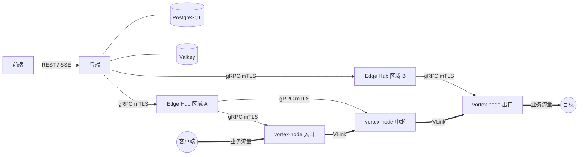

# VORTEX 流量转发平台 · 需求规格说明书 V1.11

2026-11-01 · 状态：**已冻结，开发基线**（V1.11；G01～G02 技术复审通过；经用户确认冻结）

## 0. 文档说明

| 项 | 内容 |
| --- | --- |
| 文档名称 | VORTEX 流量转发平台需求规格说明书 |
| 版本 | V1.11（已冻结，开发基线） |
| 修订日期 / 冻结日期 | 2026-11-01 / 2026-11-01 |
| 适用范围 | 首个可交付版本的产品范围、业务规则、组件需求、技术基线与验收标准 |
| 读者 | 产品、研发、测试、运维 |

### 0.1 需求编号

每条需求使用 `域代码-三位序号` 编号，序号在域内递增、不复用。

| 域代码 | 范围 | 域代码 | 范围 |
| --- | --- | --- | --- |
| GEN | 总体与边界 | ENG | Engine（转发引擎） |
| TEN | 用户、租户与权限 | AGT | Agent |
| NOD | 节点与节点组 | HUB | Edge Hub |
| PRT | 端口与 DNS | BE | 后端 |
| RUL | 转发规则 | PLN | 套餐与权益 |
| MTR | 计量与额度 | LIM | 授权、速率与连接数 |
| FE | 前端 | SEC | 安全、审计与恢复 |
| NFR | 非功能与验收 | ENGR | 工程规范 |

### 0.2 用词约定

| 用词 | 含义 |
| --- | --- |
| **必须 / 不得** | 强制要求，未满足即验收不通过 |
| **应 / 不应** | 推荐要求，偏离须记录原因 |
| **可** | 可选能力 |
| **默认** | 系统初始值，管理员可在允许范围内调整 |

### 0.3 变更管理

本文档冻结后，任何修改必须记录版本号、变更原因、影响的需求编号与验收项，并重新评审；评审留痕与生效判据见 0.4。

### 0.4 生效方式

本版本已完成需求文档层面的技术复审，并于 2026-11-01 经用户确认冻结为开发与验收基线。冻结仅同步治理状态，不修改任何规范性需求，不代表实现或系统验收通过。原评审快照、哈希与差异边界见 [V1.11 冻结记录](VORTEX%20V1_11%20冻结记录.md)。V1.9、V1.10 的技术评审均未通过，其对象快照及评审证据保留。V1.8 的历史冻结声明随原文保留，但当前交付包缺少其评审附件，不能据此核验历史基线生效。

某版本成为实现与验收基线，必须同时满足：

1. 0.5 存在该版本记录，写齐版本、日期、变更原因、影响需求与验收项；
2. 存在该版本的“（冻结）”确认行，且没有未覆盖的后续变更；
3. 本地决策记录状态为“已通过”，具有实际评审日期、评审人、评审结论，以及非空的证据文件清单；证据文件必须实际存在。不得以自动生成的修复说明替代真实评审证据。

当前评审与冻结入口：[V1.11 修订决策记录](VORTEX%20V1_11%20修订决策记录.md)。修订依据：[V1.10 未通过评审](VORTEX%20需求规格说明书%20V1_10%20评审报告.md)。交付清单见附录 C。V1.11 的规范性要求以本文件正文及附录 B 为完整来源；历史 C1/C1a/C2b/C3 等外部附件编号仅存在于历史变更记录，不作为本修订稿的隐含依赖。实现前仍须按 ENGR-004 交付并锁定可执行契约，不能把需求修复等同于实现完成。

从仓库根目录运行 `python3 tools/version_record_check.py` 检查记录完整性及当前修订状态；运行 `python3 tools/version_record_check.py --require-frozen` 检查是否具备有效冻结基线；待评审或未冻结版本必须返回非零退出码。脚本核验记录、引用、证据文件存在性并显示实际评审状态，不能代替人工判断评审真实性或质量。`--version V1.9` 或 `--version V1.10` 可检查历史包。条款级回归算例运行 `python3 tools/revision_scenarios.py`，它不代表完整 ENGR-006 模型或系统验收。

未来修改继续按 0.3 升版并评审；D-04 的 M2 参数确认、ENGR-006 的完整模型验证仍是后续工程交付要求。

### 0.5 变更记录

| 版本 | 日期 | 变更原因 | 影响的需求编号 |
| --- | --- | --- | --- |
| V1.0 | 2026-10-30 | 初稿 | — |
| V1.1 | 2026-10-30 | 评审修订：① 明确 Edge Hub 在后端失联时的有限自治与对账机制；② 补充目标地址安全限制、自托管入口的限制执行、UDP 隧道鉴权；③ 计费授权改为小额起步并回收闲置；④ 修正建链方向、调度层级、套餐流量重置与扣减顺序；⑤ 证书有效期与 CA 分级；⑥ 恢复流程改为账本重放；⑦ 去除重复需求、规范性表格编号、引用勘误；⑧ 新增附录 A 默认参数表 | 1.3、2.1、2.2、3.1、3.3、GEN-006、TEN-006、NOD-005、NOD-009、NOD-013、PRT-003、PRT-016、RUL-001、RUL-004、RUL-007、RUL-012、7.5、ENG-017、ENG-019、ENG-025、ENG-031、ENG-032、ENG-037、ENG-041、ENG-047～ENG-050、AGT-005～AGT-007、AGT-012、HUB-002、HUB-006～HUB-013、BE-006、PLN-006～PLN-008、10.3、MTR-004、MTR-009～MTR-011、LIM-004、LIM-009、FE-004、FE-011、FE-012、SEC-006、SEC-007、SEC-009～SEC-013、12.4、NFR-007、NFR-016、NFR-018、NFR-022～NFR-025、14.4、14.6、14.7、附录 A |
| V1.2 | 2026-10-30 | 第二轮评审修订：① Edge Hub 改为运行授权与计费授权的唯一签发方，计费授权取自区域额度，消除余额冻结与自治触发空窗；② 份额不再委托，自治时冻结并在所辖执行点间再平衡；③ 自治期间允许为重启节点签发新授权；④ 自治时计量本地落盘即确认；⑤ 引入“执行点”统一自托管入口的限制执行；⑥ 闲置授权保留常驻额度，新会话无需等待；⑦ DGRAM 独立队列与优先调度；⑧ 份额按需求信号分配；⑨ 自治上限 6 小时，与 RTO 和对账时间留出余量；⑩ 自托管出口可访问本机服务；⑪ 双重故障与自治期间月度重置的说明 | 1.3、2.1、2.2、HUB-002、HUB-003、HUB-006～HUB-011、HUB-013、ENG-026、ENG-027、ENG-037、ENG-048～ENG-050、MTR-004、MTR-007、LIM-002～LIM-004、LIM-009、SEC-009、SEC-011、12.4、NFR-022、NFR-025、14.6、14.7、附录 A |
| V1.3 | 2026-10-30 | 第三轮评审修订：① 单实例分区与宕机：Edge Hub 声明模式，Agent 优先连接在线实例，失联实例额度冻结至可证明安全再回收，期间用空闲余额补发；② 重启节点立即转移授权与份额；③ 常驻额度 24 小时回收，无授权时最多同步等待 200 毫秒；④ 计费版本提前 24 小时同步；⑤ 自治起算时刻持久化；⑥ HUB-002 份额表述、LIM-005、ENG-037 文字修正；⑦ 新增额度记账模型验证并列入 M4 退出标准 | HUB-002、HUB-006～HUB-008、HUB-014～HUB-018、AGT-009、ENG-037、ENG-050、MTR-003、LIM-005、LIM-010、NFR-007、NFR-025、NFR-026、ENGR-006、14.4、14.6、14.7、附录 A |
| V1.4 | 2026-10-30 | 待确认事项逐项确认：Q-01 自治上限调整为 12 小时；Q-03 计费方式调整为“执行点流量 × 路径系数”，新增组倍率；其余按推荐值确认；14.7 改为评审确认事项 | 1.3、10.3、10.4、NOD-014、ENG-024、ENG-037、HUB-008、MTR-001、MTR-008、MTR-010、MTR-011、SEC-009、NFR-022、14.6、14.7、附录 A |
| V1.5 | 2026-10-30 | 倍率只在节点组配置，组内节点统一继承，节点不再设倍率；组倍率修改须走计费版本；补充“路径系数”术语，“执行点”定义加入计费；ENG-039 区分执行点与其他节点的累计口径；后端 metering 模块职责更正 | 2.2、NOD-001、NOD-014、MTR-003、10.3、ENG-039、9.3、14.6 |
| V1.5（冻结） | 2026-10-30 | 四轮评审完成，14.7 全部确认，冻结为实现与验收基线 | — |
| V1.6 | 2026-10-30 | 冻结后第 1 次变更（来源：开发方案评审）。① 新建平台组的初始倍率立即生效，修改仍须提前 24 小时；② 明确“租户余额”“未委托余额”的定义及结算后区域额度同步扣除，消除重复扣减与额度漂移。影响验收项：NFR-021、NFR-022、NFR-026 | NOD-014、MTR-003、MTR-004 |
| V1.7 | 2026-10-30 | 冻结后第 2 次变更（来源：开发方案复审）。① 新增 MTR-013：余额被动减少时立即重算并收回区域额度，已签发超出部分正常结算不追缴；② MTR-004 去除对设计文档的引用。影响验收项：NFR-021、NFR-022 | MTR-004、MTR-013 |
| V1.7（冻结） | 2026-10-30 | V1.6、V1.7 两次变更经变更评审通过，V1.7 成为实现与验收基线 | — |
| V1.8 | 2026-10-30 | 冻结后第 3 次变更（来源：文档集审查）。① ENG-037 的“每个节点”改为“每个执行点”，消除与“计费授权只在执行点存在”的自相矛盾；② LIM-010 明确运行授权与计费授权恒由 Edge Hub 签发，份额租约在线由后端生成、自治由 Edge Hub 在冻结总量内续租；③ 10.3 新增“记账单位”，明确区域额度/租户余额/基础流量/流量包以计费字节记账，节点授权以原始字节计，换算只在签发与结算两处发生；④ 13.5 验证清单补 5 项（PRT-003、PRT-007/PRT-012/PRT-013、TEN-006、RUL-015、MTR-004/MTR-013、SEC-009），使本轮承接的六条需求具备验收判据；⑤ ENG-014 明确 `OPEN` 不含 `session_id`，会话标识由 `stream_id` 承载，与 C1 §5 及 C1a R12 一致；⑥ 附录 A 新增“可调参数的允许范围”（自治上限、探测参数、份额保底比例、补充水位、排空与超时的硬性约束），并补入 SEC-013 的保留期参数；⑦ 10.4 授权字段补“计费版本 + 生效时刻”，新增 MTR-014 规定到点停止消费与余量释放机制，使 MTR-003 的“旧版本授权不得跨越生效时间继续消费”具备可执行定义；⑧ SEC-003 由一句断言拆成 API／查询／节点执行三层，每层给出强制点、错误码与验收归属，并补入 13.5 用例；⑨ 取消 0.4 的线下签字环节，生效判据改为「0.5 变更记录写齐四项 + 对应评审留痕」（治理简化，不改任何功能要求）。影响验收项：NFR-016、NFR-021、NFR-022、NFR-025、ENGR-006 | ENG-014、ENG-037、LIM-010、MTR-002、MTR-003、MTR-014、HUB-008、SEC-003、SEC-009、SEC-013、AGT-007、10.3、10.4、13.5、附录 A |
| V1.8（冻结） | 2026-10-30 | 第 3 次变更经变更评审通过，V1.8 成为实现与验收基线（替换 V1.7） | — |
| V1.9 | 2026-11-01 | 修复审查 R01～R12：版本有效区间、失联负债冻结、逐节点份额所有权、存量承诺、不确定用量封账、WAL 优先恢复、请求绑定 TTL、冷启动、月度续费、自治硬边界与全自托管例外；补齐本地交付入口和检查脚本。状态：待评审。验收项：NFR-007、NFR-018、NFR-021～NFR-026、NFR-027～NFR-038、ENGR-006 | GEN-004、GEN-006、NOD-014、8.2、ENG-014、ENG-024、ENG-025、ENG-027、ENG-028、ENG-037、ENG-039、AGT-005、AGT-006、AGT-009～AGT-011、HUB-002、HUB-006～HUB-018、PLN-006、PLN-008、MTR-002～MTR-004、MTR-007、MTR-009、MTR-011、MTR-013～MTR-015、LIM-001～LIM-010、SEC-003、12.4、13.5、ENGR-004、ENGR-006、附录 A～C |
| V1.10 | 2026-11-01 | 根据V1.9未通过的技术评审修订F01～F05：租约TTL与绝对边界独立计算；份额先预备后CAS切换；恢复封存账本前缀并连续签发；按期望状态分配启动份额；可新委托额按资金来源计算。状态：待评审。验收项：NFR-027、NFR-029、NFR-030、NFR-032、NFR-034、NFR-039～NFR-043、ENGR-006 | ENG-025、ENG-028、ENG-050、AGT-010、HUB-006、HUB-008、HUB-010、HUB-011、HUB-013、HUB-014、HUB-015、HUB-016、HUB-017、HUB-018、MTR-003、MTR-004、MTR-013、MTR-014、LIM-001、LIM-004、LIM-006、LIM-007、LIM-008、LIM-009、LIM-010、FE-004、FE-012、NFR-022、NFR-023、NFR-024、NFR-027、NFR-029、NFR-030、NFR-032、NFR-034、NFR-038、NFR-039、NFR-040、NFR-041、NFR-042、NFR-043、ENGR-004、ENGR-006、0.4、8.2、12.4、13.5、13.7、14.6～14.7、附录 A～C |
| V1.11 | 2026-11-01 | 根据V1.10未通过评审修订G01～G02：计费授权绑定不可变路径/系数快照，隔离新旧会话及回滚；首次Commit回执未知时保留占用，以未激活证明或全部可能数据权限/续租权安全终结回收。状态：待评审。验收项：NFR-042、NFR-044、NFR-045、ENGR-006 | NOD-014、ENG-024、ENG-032、ENG-037、ENG-039、ENG-050、MTR-016、LIM-008、LIM-009、ENGR-006、2.2、10.3、10.4、13.8、附录 A～C |

| V1.11（冻结） | 2026-11-01 | G01～G02技术复审通过；用户确认冻结为开发与验收基线。仅同步治理状态，不改变需求语义。验收项：NFR-038、ENGR-004、ENGR-006仍按工程门槛执行 | GEN-001～GEN-007、ENGR-001～ENGR-006、NFR-001～NFR-045；完整范围同V1.11 |

## 1. 产品概述

### 1.1 定位

VORTEX 是商业级、多租户、多节点、支持多跳、可私有部署的 TCP / UDP 流量转发与管理平台。平台的核心资产是自研的**转发引擎**，其余组件围绕引擎提供管理、调度、计量与运营能力。

### 1.2 业务闭环

**部署节点 → 组织节点组 → 分配套餐与权益 → 创建规则 → 执行转发 → 计量扣减 → 故障处理**

### 1.3 产品目标

1. 提供四种转发方式：**直接转发、正向隧道、反向隧道、多跳中转**，全部同时支持 TCP 与 UDP。
2. 转发性能优先：直接转发走零拷贝，隧道首包不增加额外往返。
3. 多租户隔离：租户之间配置、凭据、用量互不可见。
4. 可信计量：正常消费只计业务载荷、先预扣后提交；故障不可确认量单列上界负债，不能静默丢弃或按上界向用户收费（MTR-015）。
5. 安全默认开启：组件间双向证书认证，节点间链路加密且抗重放。
6. 控制面故障不立即中断业务，分两级自治：
   - 后端失联：额度与份额有效时继续服务，默认在最后成功心跳后 12 小时硬截止；所有授权裁剪到该边界（HUB-006～HUB-018）；
   - Agent 与 Edge Hub 均失联：节点在已持有的运行授权与计费授权有效期内自治，最长 5 分钟（GEN-006）。
   自治期间不接受规则与配置变更，不跨节点再平衡份额；后端恢复后按账本对账，未确认负债继续冻结。

### 1.4 V1.0 范围

| 包含 | 不包含（后续版本） |
| --- | --- |
| 四种转发方式，TCP / UDP | 在线支付、自动续费、财务结算 |
| 多租户隔离与角色权限 | 团队成员与组织邀请 |
| 平台节点与自托管节点、节点组 | 流量伪装与抗主动探测（完整 VTP） |
| 规则编排、两阶段下发、状态反馈与对账 | QUIC、WebSocket 等其他承载协议 |
| 套餐、权益、流量包、权益码 | 用户上传引擎插件 |
| 计量、运行授权、速率与连接数控制 | 跨地域数据库多活 |
| DNS 接入、站内通知、审计、备份恢复 | 必须依赖 Kubernetes 的部署方式 |

## 2. 术语与命名规范

全文、代码、接口、界面必须使用本节术语；界面显示中文名，代码与接口使用英文标识。

### 2.1 组件

| 名称 | 英文标识 | 定义 |
| --- | --- | --- |
| 前端 | `frontend` | 用户与管理员使用的浏览器应用 |
| 后端 | `backend` | 业务与期望配置的唯一事实来源，提供对外 API |
| Edge Hub | `edge-hub` | 按区域部署的边缘控制器：接入节点、下发配置、签发运行授权与计费授权、聚合状态与计量；后端失联时有限自治 |
| 节点端 | `vortex-node` | 部署在转发服务器上的单一可执行文件，由 Agent 与 Engine 组成 |
| Agent | `agent` | 节点端的控制模块：与 Edge Hub 通信、本地持久化、驱动 Engine |
| Engine（转发引擎） | `engine` | 节点端的数据面模块：监听、转发、计量、门控 |

### 2.2 业务对象

| 中文名 | 英文标识 | 定义 |
| --- | --- | --- |
| 租户 | `tenant` | 资源隔离单位；V1.0 一个普通用户对应一个租户 |
| 用户 | `user` | 登录主体，角色为管理员或普通用户 |
| 节点 | `node` | 一台运行节点端的服务器，归属平台或租户 |
| 自托管节点 | `self_hosted_node` | 租户自行部署并接入的节点，仅供该租户使用 |
| 节点组 | `node_group` | 同用途节点的集合，用途为入口、中继或出口 |
| 用户角色 | `role` | 用户的权限角色：管理员 `admin`、普通用户 `member` |
| 跳位角色 | `hop_role` | 节点在某条规则中的位置：入口 `entry`、中继 `relay`、出口 `exit`；正文简称“角色”时，在计量、授权语境下均指跳位角色 |
| 规则 | `rule` | 一条转发配置：协议、入口、路径、目标、调度与限制 |
| 转发方式 | `forward_mode` | `direct` 直接转发、`tunnel` 正向隧道、`multi_hop` 多跳中转；反向隧道见“建链方向” |
| 路径 | `path` | 规则内有序的节点组序列：入口组 → 中继组（0～3 个）→ 出口组 |
| 段 | `segment` | 路径上相邻两个节点组之间的一段 |
| 建链方向 | `dial_direction` | 段的连接发起方：auto 自动判断（默认）；`forward` 上游拨下游；`reverse` 下游拨上游（即反向隧道） |
| 跳位 | `hop_index` | 节点在路径中的序号，入口为 0 |
| 目标 | `target` | 出口（或直接转发的入口）最终连接的地址 |
| 会话 | `session` | 一条 TCP 连接或一个 UDP 会话，是计数、选路与计量的基本单位 |
| VLink | `vlink` | 节点间的加密链路协议 |
| 链路 | `link` | 两节点间一条已认证的 VLink 连接 |
| 流 | `stream` | 链路上承载一个 TCP 会话的逻辑通道 |
| 运行配置 | `runtime_config` | 后端为单个节点编译的内部配置，带单调版本号 |
| 期望版本 / 实际版本 | `desired_version` / `actual_version` | 后端要求的配置版本 / 节点已生效的版本 |
| 运行授权 | `run_grant` | 允许节点在一段时间内继续执行规则的凭证 |
| 计费授权 | `billing_grant` | 允许节点消费一定额度的凭证 |
| 份额租约 | `share_lease` | 从用户速率或连接数上限中分给某节点的一份，分 `rate` 与 `conn` 两类 |
| 套餐 | `plan` | 时长、基础流量、规则数、速率、连接数的组合 |
| 权益 | `entitlement` | 可使用的资源与能力（节点组、协议、多跳、自托管等） |
| 流量包 | `traffic_pack` | 独立于套餐的额外流量，有自己的到期时间 |
| 权益码 | `redeem_code` | 可兑换套餐、时长或流量包的码 |
| 倍率 | `multiplier` | 节点组的计费系数，组内节点统一继承；节点本身不设倍率 |
| 路径系数 | `path_coefficient` | 规则路径上各平台节点组倍率之和，计费流量 = 执行点流量 × 路径系数 |
| 计费版本 | `billing_version` | 组倍率等计费政策的版本，带生效时间；不代表规则路径修订 |
| 计费快照 | `billing_snapshot_id` | 不可变路径与计费政策/系数记录的唯一标识，绑定租户/规则/执行点，见MTR-016 |
| 规则路径修订 | `rule_path_revision` | 租户/规则内单调且不复用的路径修订，路径变更及配置回滚须取得新修订 |
| 启动标识 | `boot_id` | 节点端每次启动生成的唯一标识 |
| 代次 | `generation` | 平台授权代次，恢复或身份重置时递增 |
| 排空 | `drain` | 停止接受新会话并等待已有会话结束 |
| 区域额度 | `regional_budget` | 后端委托给某个 Edge Hub 实例的“租户 × 实例”计费流量额度，Edge Hub 只能在其中签发计费授权；不含速率与连接份额 |
| 执行点 | `enforcement_point` | 规则路径上执行速率、连接数、门控，并作为计费计量点的节点：入口为平台节点时为入口，入口为自托管节点时为路径上第一个平台节点 |
| 自治模式 | `autonomous_mode` | Edge Hub 与后端失联后的受限运行状态 |
| 控制面降级 | `control_degraded` | 任一区域处于自治或recovering模式时，平台对用户与管理员呈现的状态 |

### 2.3 命名与格式规范

| 对象 | 规则 | 示例 |
| --- | --- | --- |
| Go 包 / 文件 | 小写单词，不用下划线；类型 PascalCase | `engine/vlink`、`RuntimeConfig` |
| HTTP API | `/api/v1/` 前缀，资源名复数 kebab-case；用户端 `me`，管理端 `admin` | `/api/v1/me/rules`、`/api/v1/admin/node-groups` |
| JSON / YAML 字段 | snake\_case | `rule_id`、`desired_version` |
| 枚举值 | 小写 snake\_case，界面映射中文 | `partially_applied` → 部分应用 |
| 数据库 | 表名复数 snake\_case；主键 `id`（UUIDv7）；租户字段 `tenant_id`；时间 `*_at` | `rules`、`created_at` |
| Protobuf | 包名 `vortex.<组件>.v1`；服务 PascalCase；字段 snake\_case | `vortex.edgehub.v1.NodeControl` |
| 错误码 | `域_原因`，全大写 | `RULE_PORT_UNAVAILABLE` |
| 指标 | `vortex_<组件>_<名称>_<单位>`，计数器以 `_total` 结尾 | `vortex_engine_payload_bytes_total` |
| 日志字段 | snake\_case，固定关联字段 `trace_id`、`tenant_id`、`rule_id`、`node_id`、`boot_id` | — |
| 时间 | 接口与存储用 RFC 3339 UTC；界面按用户时区显示 | `2026-10-30T02:43:00Z` |
| 数量单位 | 流量用整数字节；速率用 bit/s；界面按 GiB / Mbps 显示 | — |
| 版本号 | 组件发布用语义化版本；配置与授权用单调递增整数 | `v1.0.0`、`desired_version=42` |

## 3. 总体架构与技术栈

### 3.1 组件与关系



管理链路为 前端 → 后端 → Edge Hub → Agent → Engine；业务流量只在客户端、节点与目标之间流动。

### 3.2 边界要求

| 编号 | 要求 |
| --- | --- |
| GEN-001 | 后端与 Edge Hub **不得**承载任何业务转发流量。 |
| GEN-002 | Agent 与 Engine**必须**编译为同一个可执行文件 `vortex-node`，二者只通过第 8.2 节定义的进程内接口交互。 |
| GEN-003 | 转发引擎**必须**为自研独立 Go 模块，可脱离 Agent 单独测试与压测。 |
| GEN-004 | 转发引擎**不得**访问数据库或主动请求控制面；输入为运行配置、授权、份额租约及已验证的时间锚点，输出为应用结果、计量与事件。 |
| GEN-005 | 入口、中继、出口是同一节点端在不同规则中的角色，不是独立产品。 |
| GEN-006 | 后端失联而 Edge Hub 在线时按 HUB-006～HUB-018 有限自治；节点与全部 Edge Hub 失联时，仅在配置与运行授权有效时运行，存在平台执行点的规则还须执行点的计费授权及份额有效；全自托管规则按 MTR-011 豁免计费与份额。任一必需条件先失效即停止，所有期限受 HUB-008 硬截止约束。 |
| GEN-007 | 对外 API 只暴露平台自己的业务模型；运行配置与 VLink 协议属内部契约，不对外承诺兼容。 |

### 3.3 技术栈

| 范围 | 技术 | 约束 |
| --- | --- | --- |
| 前端 | React、TypeScript（严格模式）、Vite | 单页应用 |
| UI | Ant Design、CSS Modules | 统一主题、中文界面 |
| 前端状态 | React Router、TanStack Query、Zustand | 按角色组织路由；服务端状态与本地状态分离 |
| 表单 | Ant Design Form、Zod | 前后端同一套校验规则 |
| 后端 | Go、Gin | Gin 只负责 HTTP 接入 |
| Edge Hub | Go | — |
| 节点端 | Go | 引擎自研，依赖以标准库为主 |
| 前端通信 | REST（OpenAPI 契约）、SSE | 查询与状态推送分离 |
| 控制通信 | gRPC、Protobuf | 后端 ↔ Edge Hub ↔ Agent |
| 节点间链路 | VLink over TLS 1.3 | 第 8.4 节 |
| 通信安全 | TLS、组件间 mTLS | 注册凭据与运行身份分离 |
| 主数据库 | PostgreSQL | 业务与期望配置唯一事实来源；支持外置部署 |
| 数据访问 | pgx/v5、sqlc | SQL 优先 |
| 数据迁移 | Goose | 纳入版本控制 |
| 缓存 | Valkey | 只做缓存、限流、短期通知；数据丢失不得影响余额与已确认业务 |
| 本地持久化 | SQLite（WAL） | Edge Hub 与节点端的恢复数据、待上报记录、自治账本 |
| 可靠任务 | PostgreSQL 任务表 + Transactional Outbox | 不引入独立消息中间件 |
| 日志 | Go slog，JSON | 统一字段、脱敏 |
| 指标与追踪 | Prometheus、OpenTelemetry | — |
| 部署 | 后端与前端：Docker Compose；Edge Hub 与节点端：二进制 + systemd，另提供容器镜像 | 不依赖 Kubernetes |

### 3.4 平台支持

- 服务端与节点：Linux amd64、arm64；标准验收系统 Ubuntu 24.04 LTS。
- 浏览器：Chrome、Edge、Safari 当前稳定版及前一主版本。

## 4. 用户、租户与权限

### 4.1 隔离模型

| 编号 | 要求 |
| --- | --- |
| TEN-001 | 数据模型**必须**区分 `user_id` 与 `tenant_id`；V1.0 一个普通用户对应一个租户，为后续团队能力预留。 |
| TEN-002 | 私有规则、自托管节点、个人节点组、用量与消费记录**必须**带租户归属。 |
| TEN-003 | 平台节点与平台节点组归平台所有，通过权益授权给租户使用。 |
| TEN-004 | 普通用户**不得**访问其他租户的配置、凭据与用量；隔离在数据访问层强制执行，不依赖界面。 |
| TEN-005 | 管理员跨租户操作**必须**进入审计。 |

### 4.2 角色与能力

| 角色 | 能力 |
| --- | --- |
| 管理员 `admin` | 用户、节点、节点组、Edge Hub、规则、套餐与权益、权益码、DNS、公告、审计、系统设置 |
| 普通用户 `member` | 使用已授权资源创建与管理自己的规则；查看套餐、用量与状态；兑换权益码；在权益允许时部署自托管节点；管理个人资料与账号安全 |

| 编号 | 要求 |
| --- | --- |
| TEN-006 | 管理员对自托管节点的管理权限**不等于**可以把它分配给其他租户。 |

### 4.3 账号状态与业务限制

| 编号 | 要求 |
| --- | --- |
| TEN-007 | 账号状态只有 `active` 正常、`suspended` 暂停、`banned` 封禁。 |
| TEN-008 | 套餐到期、流量耗尽、数量超限等作为独立的**业务限制** `restriction` 记录，不写入账号状态。 |
| TEN-009 | 多个限制同时存在时，全部解除后才恢复业务。 |

## 5. 节点与节点组

### 5.1 节点

| 编号 | 要求 |
| --- | --- |
| NOD-001 | 节点记录名称、区域、归属（平台 / 租户）、所属 Edge Hub、能力（可作入口 / 中继 / 出口、是否有公网地址）、对外地址、程序版本、健康状态、端口范围、容量。节点不单独配置倍率，计费倍率由所在节点组决定（NOD-014）。 |
| NOD-002 | 节点生命周期：`pending` 待注册 → `online` / `offline` → `draining` 排空中 → `disabled` 已停用 → 删除；停用可恢复。 |
| NOD-003 | 维护排空：停止接受新会话，默认等待已有会话最多 300 秒后关闭；管理员可调整期限，并在操作前看到受影响的规则与会话数。 |
| NOD-004 | 删除前**必须**检查规则依赖、端口占用与待结算记录；删除不清除必要历史。 |
| NOD-005 | 无公网地址的节点只能作为反向建链段的下游（见 RUL-004）。入口组成员与反向建链段的上游组成员**必须**有公网地址并开放 `link` 端口；入口组加入无公网地址节点时拒绝。 |

### 5.2 节点组

| 编号 | 要求 |
| --- | --- |
| NOD-006 | 节点组用途为入口 `entry`、中继 `relay`、出口 `exit` 之一；节点可加入多个与其能力相符的组。 |
| NOD-007 | 平台组只含平台节点；个人组只含同一租户的自托管节点；V1.0 不混合。 |
| NOD-008 | 一条规则可组合已授权的平台组与自己的个人组。 |
| NOD-009 | **组内成员调度**：中继组与出口组配置成员选择方式，加权轮询 `weighted_round_robin` 或主备 `primary_backup`，并配置健康探测参数；上游节点按此选择下一跳成员。入口组成员由 DNS 解析分配（PRT-011），不配置调度方式，只配置健康探测参数。 |

### 5.3 段许可

| 编号 | 要求 |
| --- | --- |
| NOD-010 | 两个节点组之间是否允许相连，由管理员通过**段许可** `segment_permit` 显式配置；拥有两个组的使用权不自动代表允许它们相连。 |
| NOD-011 | 租户自己的个人组之间默认允许相连；个人组与平台组相连需平台允许。 |
| NOD-012 | 段许可在后端创建规则时检查，并编译进运行配置，由转发引擎在每条会话上再次执行（ENG-020）。 |

### 5.4 入口组成员状态

| 状态 | 英文标识 | 含义 |
| --- | --- | --- |
| 待加入 | `joining` | 校验端口、准备全量配置，不进入 DNS |
| 有效接入 | `serving` | 满足全部应运行规则与端口保留要求 |
| 排空中 | `draining` | 停止新接入，处理已有会话 |
| 不可用 | `unavailable` | 不满足健康或配置要求 |

| 编号 | 要求 |
| --- | --- |
| NOD-013 | 入口组至少有一个 `serving` 成员才显示可用。 |
| NOD-014 | **组倍率**：计费倍率只在节点组上配置，组内节点统一继承组倍率，节点本身不设倍率。节点加入多个组时，在每条规则中按其所在的那个组计算。平台组的组倍率由管理员设定，最小 0.001、步长 0.001（MTR-002）；个人组（自托管）组倍率固定为 0。新建平台组时设定的初始组倍率随组创建**立即生效**（该组尚无任何计费授权，无需提前同步）；此后的修改**必须**通过新计费版本生效（MTR-003），不得直接改写；节点加入或退出组不影响组倍率。因组内节点倍率一致，执行点在会话开始时按已批准的不可变计费快照确定路径系数；路径变化与组倍率政策变化分别产生新快照，不得通过会话建立时读取可变最新配置重算（MTR-016）。 |

## 6. 端口与 DNS

### 6.1 端口分类与分配

| 编号 | 要求 |
| --- | --- |
| PRT-001 | 节点端口分为业务端口 `service`、VLink 端口 `link`、控制端口 `control`、监控端口 `metrics` 四类，分别管理。 |
| PRT-002 | 冲突检查按“监听地址 + 协议 + 端口号”，并处理通配地址与具体地址的交叉冲突。 |
| PRT-003 | 同一规则在入口组内所有成员使用同一业务端口。用户可指定端口，也可留空由系统按 PRT-004 自动分配；指定的端口不可用时创建失败并提示可用端口。 |
| PRT-004 | 分配流程：固定有效成员集合及其版本 → 计算各成员允许范围内的共同可用端口 → 后端事务预留 → 节点实际占用（ENG-031）→ 全部成功后提交，任一失败则撤销。 |
| PRT-005 | 无共同端口时创建失败，**不得**静默排除成员。 |
| PRT-006 | 同时启用 TCP 与 UDP 时使用相同端口号，分别预留。 |
| PRT-007 | 入口组成员变化后，必须对该组全部规则重新检查端口。 |

### 6.2 端口状态与保留

端口状态：`reserved` 已预留 → `occupied` 已占用 / `held` 保留中 → `releasing` 释放中 → `released` 已释放。

PRT-016：规则停止时端口按下表处理。

| 触发原因 | 转发 | 端口 |
| --- | --- | --- |
| 用户手动停用规则 | 停止 | 保留，直到删除或主动释放 |
| 账号暂停、封禁 | 停止 | 保留 7 天 |
| 套餐到期、流量耗尽、降级超限 | 停止受限规则 | 保留 7 天 |
| 删除规则 | 停止 | 立即发起释放 |
| 主动释放 | 先停止 | 发起释放 |

| 编号 | 要求 |
| --- | --- |
| PRT-008 | 7 天保留期从限制首次生效起算；重复下发或原因变化不重置；解除后再次受限重新起算。 |
| PRT-009 | 节点未确认释放前端口保持隔离，不得重新分配；DNS 摘除或控制断开不算释放证明。 |
| PRT-010 | 恢复端口已释放的规则时重新分配，并提示入口地址可能变化。 |

### 6.3 DNS

| 编号 | 要求 |
| --- | --- |
| PRT-011 | 每个入口组一个统一入口域名，解析到全部 `serving` 成员。 |
| PRT-012 | 进入解析集合的成员**必须**已具备该组全部应运行规则的配置和全部应保留端口的占用。 |
| PRT-013 | 新规则创建失败不得导致摘除仍在服务其他规则的成员；实际失去接入能力的成员按健康策略退出解析。 |
| PRT-014 | DNS 不保证即时切换与已有连接迁移；旧解析仍可能引流，节点必须自行执行授权与限制。 |
| PRT-015 | DNS 服务商通过适配接口接入；V1.0 交付 **Cloudflare** 适配器并经真实增删改验证；入口记录 TTL 默认 60 秒、仅 DNS 模式（不开启代理）；API 令牌按域名最小授权并加密存储。 |

## 7. 转发规则

### 7.1 转发方式

| 转发方式 | 标识 | 路径 | 说明 |
| --- | --- | --- | --- |
| 直接转发 | `direct` | 入口组 → 目标 | 入口节点直接连接目标，不经过 VLink |
| 正向隧道 | `tunnel` | 入口组 → 出口组 → 目标 | 入口与出口之间走 VLink |
| 多跳中转 | `multi_hop` | 入口组 → 1～3 个有序中继组 → 出口组 → 目标 | 逐段走 VLink |
| 反向隧道 | 段属性 `dial_direction=reverse` | 任一段 | 下游节点主动连接上游，数据方向不变；用于无公网地址的出口或中继 |

全部转发方式同时支持 TCP、UDP 或二者同时启用。

### 7.2 规则内容与合法性

| 编号 | 要求 |
| --- | --- |
| RUL-001 | 规则包含：名称、协议（`tcp` / `udp` / `tcp_udp`）、转发方式、入口组、业务端口（可留空自动分配）、路径、各段建链方向、一个或多个目标及权重、目标调度方式、PROXY protocol 选项（`off` / `v1` / `v2`，UDP 仅 `v2`，见 ENG-009）、规则级限制（可低于套餐）、启用状态。目标可为 IP 或域名；域名由出口（直接转发时为入口）解析，解析结果须再次通过 SEC-011 检查。 |
| RUL-002 | 界面统一称“规则”；规则不得绑定单个固定节点，只引用节点组。 |
| RUL-003 | 同一规则不得重复选择同一节点组；实际路径不得重复经过同一节点。 |
| RUL-004 | 每段建链方向取值 `auto`（默认）/ `forward` / `reverse`。`auto` 按段判定：下游组全部成员有公网地址时取 `forward`；任一成员无公网地址时整段取 `reverse`（含混合组）。取 `reverse` 时上游组全部成员必须有公网地址，否则创建失败（`RULE_SEGMENT_UNREACHABLE`）；上下游均存在无公网成员的段不可创建。`auto` 判定为 `reverse` 不需要额外权益；下游全部有公网地址时手动设为 `reverse`（不开入站端口、隐藏出口地址）需权益包含“反向建链”。组成员变化导致判定结果变化时，按 RUL-014 作为变更重新应用。 |
| RUL-005 | 每段必须有段许可（NOD-010）。 |
| RUL-006 | 任一组没有可用成员时拒绝新会话，**不得**跳过指定的中继。 |

### 7.3 调度

| 编号 | 要求 |
| --- | --- |
| RUL-007 | 规则级调度只用于在多个目标之间选择：加权轮询或主备。组内成员的选择由节点组配置决定（NOD-009），规则不覆盖。 |
| RUL-008 | TCP 按连接选择路径与目标；UDP 按会话选择，默认空闲 60 秒失效。 |
| RUL-009 | 会话存续期间路径与目标保持不变；故障后新会话可重新选择；不承诺已有会话无损迁移。 |

### 7.4 应用流程

| 编号 | 要求 |
| --- | --- |
| RUL-010 | 新建或修改规则采用两阶段应用：① 校验权限、额度、端口、路径 → ② 在固定成员集合上**准备**（占用资源但不对外开放）→ ③ 全部准备成功后**提交** → ④ 各成员激活并确认 → ⑤ 全部确认后显示“运行中”。 |
| RUL-011 | 准备失败只撤销本次准备，不影响已有规则。 |
| RUL-012 | 提交后部分成功显示“部分应用”并重试收敛；默认 120 秒仍未完成则触发回滚。回滚以上一已生效配置的内容生成**新的递增版本**，按 RUL-016 重新校验后走同一两阶段流程；回滚自身失败时 `sync_status` 置为 `failed` 并告警，由管理员处理，不再自动重试回滚。 |
| RUL-013 | 不承诺跨节点瞬时原子切换；失联节点显示“状态未知”，不得误报回滚成功。 |

### 7.5 状态分层

规则状态分五层分别保存，界面不得合并展示为单一状态：

| 层 | 字段 | 取值 |
| --- | --- | --- |
| 期望 | `desired_version` | 整数，每次保存递增 |
| 实际 | `actual_version`（按节点） | 整数 |
| 同步 | `sync_status` | `pending` / `preparing` / `committing` / `applied` / `partially_applied` / `rolling_back` / `failed` / `unknown` |
| 运行 | `run_status` | `running` / `stopped` / `degraded` |
| 限制 | `restrictions[]` | `manual_stop` / `account_suspended` / `account_banned` / `plan_expired` / `traffic_exhausted` / `over_limit` / `grant_pending` / `billing_transition` / `share_pending` |

保存成功不等于已生效，已生效不等于目标可达。

### 7.6 变更与回滚

| 编号 | 要求 |
| --- | --- |
| RUL-014 | 变更按影响分为可热更新 `hot`、需重建监听 `rebuild`、强制停止 `stop`；会中断连接的变更必须在提交前展示影响。 |
| RUL-015 | 转发配置允许回滚；运行授权、账号限制、身份吊销、计费政策、预留额度与消费记录**不得**回滚。 |
| RUL-016 | 恢复旧配置前必须重新检查当前权限与资源；旧配置不得重新开放已失效的权限。 |

## 8. 转发引擎

转发引擎是平台核心，全部自研。本节定义其功能、协议与行为要求。

### 8.1 分层

| 层 | 包 | 职责 |
| --- | --- | --- |
| 管道 | `engine/pipe` | 双向拷贝、零拷贝、半关闭、空闲超时；在拷贝点执行计量与限速 |
| 承载 | `engine/carrier` | V1.0 提供 TCP 与 TLS；接口可扩展其他承载 |
| 链路 | `engine/vlink` | 节点间握手、分帧、多路复用、预热池、反向建链 |
| 路由 | `engine/route` | 入口监听、规则表、逐跳选择、健康探测、UDP 会话表 |
| 门控 | `engine/gate` | 运行授权、计费授权、份额租约、排空 |
| 计量 | `engine/meter` | 预扣、提交、退回、累计 |

### 8.2 进程内接口

```go
type Engine interface {
    Prepare(ctx context.Context, cfg *RuntimeConfig) (*PrepareResult, error)
    Commit(ctx context.Context, version uint64) (*ApplyResult, error)
    Abort(ctx context.Context, version uint64) error
    UpdateGrants(set *GrantSet)                // 含phase/CAS前代条件的授权集及时间锚点；执行回执经Events输出
    Drain(ctx context.Context, scope DrainScope) error
    DrainUsage() []UsageDelta                  // 每秒拉取；未确认批次以同一 ID 重返
    AckUsage(batchIDs []string) error          // Agent 持久化成功后确认，不提前丢弃
    Events() <-chan Event
    State() RuntimeState                        // 实际版本、对象状态、限制原因
}
```

| 编号 | 要求 |
| --- | --- |
| ENG-001 | 引擎对外只暴露上述接口；Agent 不得直接操作 socket。 |
| ENG-002 | 引擎可由测试用的模拟代理驱动，用于压测、故障注入与验收。 |
| ENG-003 | 引擎内一条统一管线：入口 → 门控 → 路由（直连或下一跳）→ 管道；四种转发方式只是配置不同。 |

### 8.3 数据面

| 编号 | 要求 |
| --- | --- |
| ENG-004 | 直接转发的 TCP 两端均为裸 TCP 时，Linux 上**必须**走 splice 零拷贝；统计与限速不得以包装连接的方式实现。 |
| ENG-005 | 必须正确传递半关闭：一方向结束时只关闭对应写方向，另一方向继续传输。 |
| ENG-006 | 支持会话级空闲超时；TCP 默认不超时，UDP 默认 60 秒。 |
| ENG-007 | 非零拷贝路径使用分级缓冲池，稳态转发不产生每包内存分配。 |
| ENG-008 | 每个 goroutine 必须归属于某个会话、链路或监听的生命周期；关闭操作幂等；会话结束后不得残留 goroutine 与文件描述符。 |
| ENG-009 | 出口（或直接转发的入口）连接目标时可按规则发送 PROXY protocol v1 / v2 头，携带原始客户端地址。 |

### 8.4 VLink 链路协议

VLink 是节点间的最小加密链路协议，只提供认证、分帧与复用；流量伪装留给后续的完整 VTP。

| 编号 | 要求 |
| --- | --- |
| ENG-010 | 承载为 TCP + TLS 1.3 双向证书认证；节点证书由平台 CA 签发，证书携带 `node_id`；吊销列表随运行配置下发并在握手时检查。 |
| ENG-011 | TLS 完成后交换 HELLO：协议版本、`node_id`、`boot_id`、`generation`、能力位，以及对 TLS exporter 的签名，使链路绑定当前 TLS 连接与节点本次启动，防重放。 |
| ENG-012 | 帧头固定 8 字节：`type(1) flags(1) length(2) stream_id(4)`，大端序；单帧载荷 ≤ 16 KiB。 |
| ENG-013 | 帧类型：`HELLO`、`OPEN`、`OPEN_OK`、`OPEN_ERR`、`DATA`、`FIN`、`RST`、`DGRAM`、`WINDOW`、`PING`、`PONG`、`GOAWAY`；保留 `PADDING` 与 flags 位供 VTP 扩展，未知类型按协议版本协商处理。 |
| ENG-014 | `OPEN` 载荷为 `rule_id`、规则版本、路径代次、`hop_index`、网络类型、已经过节点列表、原始客户端地址；不含下游地址或 `session_id`。会话标识由本链路 `stream_id` 承载，UDP 与流 ID 使用同一空间（ENG-041）；具体编码与双方 ID 分配规则须按 ENGR-004 锁定。 |
| ENG-015 | 开流不等待确认：发送 `OPEN` 后立即发送 `DATA`；失败由 `OPEN_ERR` 返回原因码 `no_route` / `unauthorized` / `quota_exhausted` / `rate_limited` / `conn_limited` / `target_unreachable`，并逐段回传到入口。 |
| ENG-016 | 流控：每流初始窗口 256 KiB，可自适应增长至 4 MiB；另设链路级窗口，单流不得饿死其他流。 |
| ENG-017 | 链路模式：`mux` — 每对节点维持 2～4 条长链路，流多路复用；`pool` — 预热若干空闲链路，每链路同时只承载一个流，流结束后归还复用，池大小按空闲比例自适应；`auto` — 默认，UDP 固定用 `mux`；TCP 按该规则近 10 分钟会话时长中位数选择，短于 10 秒用 `pool`，否则用 `mux`，无历史时用 `mux`。两种模式下新会话均不增加握手往返。 |
| ENG-018 | 反向建链：下游节点按运行配置主动连接上游组成员，HELLO 后声明所服务的规则；链路建立后双向对等，上游可在其上开流。断线后下游指数退避重连。 |
| ENG-019 | 链路保活与失效：链路上收到任何帧即视为存活；空闲 3 秒发送 `PING`，单次等待 3 秒；自最后一次收到对端帧起 12 秒内无任何帧即判定失效，并将该对端标记为不可用。检测时间上限 12 秒，满足 NFR-016。 |

### 8.5 段许可与防绕过

| 编号 | 要求 |
| --- | --- |
| ENG-020 | 节点收到 `OPEN` 时必须依次检查：① 规则在本节点已激活且版本、路径代次有效；② 对端 `node_id`（取自证书）属于该规则允许的上游集合；③ `hop_index` 等于本节点在该规则中的跳位；④ 已经过节点列表不含本节点；⑤ 门控条件满足。任一不满足即拒绝。 |
| ENG-021 | 下一跳与目标只从本地运行配置选取，不得使用报文中的地址，以此保证中继不可绕过。 |
| ENG-022 | 选择下一跳时排除已经过的节点；下一组无可用成员时返回 `no_route`。 |
| ENG-023 | 每次拒绝产生审计事件，含对端 `node_id`、`rule_id` 与拒绝原因。 |

### 8.6 运行门控

| 编号 | 要求 |
| --- | --- |
| ENG-024 | 新会话须配置激活、运行授权有效。存在平台执行点时，执行点还须有效速率/连接份额与有余量的有效计费授权；授权必须匹配本会话的billing_snapshot_id及系数，运行授权须允许该快照，按MTR-016和附录B.5校验，缺少匹配授权不能借用其他路径额度。路径上其他节点校验运行授权与段许可，不要求持有执行点的份额或计费授权。全自托管规则按MTR-011执行。 |
| ENG-025 | 租约按附录 B.1 请求绑定：本地单调请求起点 q、nonce、连接和启动标识匹配，RTT≤10秒。相对租约截止 `D_lease=q+ttl−max(0.1×ttl,10秒)`；版本有效区间、运行授权依赖、份额所有权及自治硬截止为**独立边界**，最终权限取交集。不得先按绝对边界缩短 ttl 再扣安全余量。重复ID/修订不延长 D_lease，真正续租须新请求及更高修订；墙钟回拨不能延长任何边界。 |
| ENG-026 | 速率：执行点按租户维护令牌桶，速率等于当前速率份额，突发不超过 1 秒份额；令牌与预扣块共同决定单次拷贝上限，零拷贝路径保持可用。规则级限速叠加生效。令牌桶须统计“令牌耗尽时间占比”，供 LIM-009 分配使用。 |
| ENG-027 | 连接数：执行点按租户计 TCP 连接与 UDP 会话之和；份额下调时立即拒绝超限新会话，超额部分从最近建立者开始排空，最多 60 秒后强制关闭；统计平均并发与连接槽耗尽时间占比，供 LIM-009 分配使用。 |
| ENG-049 | **自托管入口的限制执行**：规则入口为自托管节点时，入口侧的速率、连接数与计量不作为可信依据，执行点为路径上第一个平台节点（见术语“执行点”），由其执行 ENG-024、ENG-026、ENG-027；份额租约按 LIM-002、LIM-003 分配给执行点。规则全部节点均为自托管时，按 MTR-011 处理。 |
| ENG-028 | 必需门控真正失效时拒绝新会话、关闭受影响TCP、清理UDP并发送RST。两类有明确状态转换的交接例外：MTR-014版本保护带暂停只阻止数据写入并保留会话，LIM-004同节点份额预备/CAS切换始终保持一份有效门控；不能把二者当作已失效后继续转发。账号/身份限制、运行租约或自治硬截止没有交接豁免。连接降额仅按ENG-027关闭超额部分。 |

### 8.7 配置应用

| 编号 | 要求 |
| --- | --- |
| ENG-029 | 运行配置按节点生成，带单调版本，包含：监听、规则（角色、跳位、允许上游、下一组成员、建链方向、目标与权重、限制）、对端节点、吊销列表。 |
| ENG-030 | `Prepare`：校验 → 与当前生效配置做差异 → 逐对象分类为 `hot` / `rebuild` / `stop` → 占用资源；返回分类结果供界面展示影响。 |
| ENG-031 | 端口占用不对外开放：TCP 仅 `bind` 不 `listen`，UDP `bind` 后不读取；冲突检查覆盖通配地址。UDP 在 `Commit` 前丢弃接收缓冲中已积压的数据报，不予转发。 |
| ENG-032 | `Commit`：开始监听与接收；规则表整体原子切换。分类为 `hot` 与 `rebuild` 的对象，已有会话继续使用切换前的快照及其billing_snapshot_id，不迁移至新路径授权；存在平台执行点时Commit前须备齐新快照匹配授权，新旧预留分别计入资金占用（附录B.5）；分类为 `stop` 的对象，以及权限收紧类变更（段许可撤销、目标移除、允许上游变化），已有会话按 ENG-028 关闭。 |
| ENG-033 | `Abort`：只释放本次预留，不影响已生效对象。 |
| ENG-034 | 如实报告每个对象的实际版本与状态；部分应用、重试与回滚由后端编排。 |

### 8.8 计量

| 编号 | 要求 |
| --- | --- |
| ENG-035 | 只计双向业务载荷：VLink 帧头、握手、保活、TLS 开销与传输重传均不计。 |
| ENG-036 | 计量点在“写成功”处：见下表。同一角色每方向只计一次。 |
| ENG-037 | 执行点在拷贝前从匹配会话计费快照的本地计费授权预扣，本次写入不超过预扣量，完成后按实际写成功字节提交，余量退回；一笔预扣只能提交或退回一次。块大小每方向从 256 KiB 起，用满翻倍至 4 MiB；版本切换处理见 MTR-014。授权只在执行点存在，由 Edge Hub **先持久化预留和签发记录再响应**，以原始字节计，按附录 B.2 换算。每个规则/执行点/计费快照独立管理额度、申请与余量水位，不跨快照合并；每个快照起步 8 MiB；此后每份为 max(8 MiB, 该规则该执行点近 1 分钟速率 × 30 秒)，剩余 30% 续申；不足时按可安全签发余额发放。中继/出口只计量不预扣。最终参数须在 M2 压测后评审确认。 |
| ENG-038 | UDP 按整包预扣，发送成功后提交，失败整包退回。 |
| ENG-039 | 引擎在内存累计原始字节：执行点按“规则 × 角色 × 方向 × 计费快照 × 计费授权”累计，其他节点按“规则 × 角色 × 方向”累计；每个消费批次携带billing_snapshot_id，节点/Hub入账均验证与grant_id绑定一致；不匹配则隔离为disputed并保留预留，不按最新配置重算。Agent 每秒持久化。内存取走与 SQLite 提交采用可重试批次及确认机制，提交成功前保留带稳定批次 ID 的不可变待确认副本，经 AckUsage 后释放，重复批次不重复计数。断电仍可能丢失最后一个未落盘窗口，必须按 MTR-015 以授权剩余上界形成不确定用量记录，不得声明故障时能精确恢复所有实际字节。 |
| ENG-050 | 空闲授权按规则/执行点/计费快照管理：无会话10分钟缩减到1MiB常驻额度，无会话24小时回收；缩减及回收须最终账本证明未用，不能释放未知负债。无可用计费授权时同步申请最多200毫秒，失败拒绝；该等待及MTR-014中已预发授权的版本保护带是NFR-007的例外，保护带不等于无授权继续消费。 |

| 角色 | 上行计量点 | 下行计量点 |
| --- | --- | --- |
| 入口（直接转发） | 写入目标成功 | 写回客户端成功 |
| 入口（隧道 / 多跳） | 写入下一跳成功 | 写回客户端成功 |
| 中继 | 写入下一跳成功 | 写回上一跳成功 |
| 出口 | 写入目标成功 | 写回上一跳成功 |

写成功代表本地接口已接受，不代表最终目标已收到。

### 8.9 UDP

| 编号 | 要求 |
| --- | --- |
| ENG-040 | 入口会话键为“监听 + 客户端地址”；会话表分片存储，空闲超时回收。 |
| ENG-041 | 隧道内 UDP 用 `DGRAM` 帧承载，帧头 `stream_id` 字段即该会话的 `session_id`；多个 UDP 会话复用同一链路，不为每个会话建立独立连接。 |
| ENG-047 | **UDP 会话开流**：每个 UDP 会话在首个 `DGRAM` 前**必须**发送网络类型为 `udp` 的 `OPEN`，接收方按 ENG-020 完成全部检查后才接受该会话的 `DGRAM`；与 TCP 相同，`OPEN` 后可立即发送 `DGRAM`，被拒绝时返回 `OPEN_ERR`。未开流或已关闭会话的 `DGRAM` 一律丢弃并计入指标 `vortex_engine_dgram_dropped_total`。 |
| ENG-048 | **数据报大小与调度**：单个 UDP 数据报载荷超过单帧上限（ENG-012）时丢弃并计数，不分片。`DGRAM` 不受流级与链路级窗口约束，使用独立的发送队列（默认每链路 1 MiB），发送时优先于 `DATA` 帧，但每轮写入中 `DGRAM` 不超过 50% 的字节，避免饿死 TCP 流；只有该队列满时才丢弃 `DGRAM`。混合负载下 UDP 须满足 NFR-005。 |
| ENG-042 | 出口每个会话使用独立的已连接 UDP socket 访问目标，保证回包正确归属。 |
| ENG-043 | socket 收发缓冲可配置，默认 4 MiB；应支持批量收发以降低系统调用开销。 |

### 8.10 性能与稳定性

| 编号 | 要求 |
| --- | --- |
| ENG-044 | 帧载荷与 TLS 记录大小对齐，写入合并以减少系统调用；使用硬件加速的 AES-GCM。 |
| ENG-045 | goroutine 预算：每 TCP 会话 ≤ 2 个；每条链路读写各 1 个；每个 UDP 监听 1 个；出口每 UDP 会话 1 个。 |
| ENG-046 | 性能与稳定性指标见第 13 节，引擎必须在启用正式计量与门控的情况下达标。 |

## 9. 节点端、Edge Hub 与后端

### 9.1 节点端 Agent

节点端 `vortex-node` 提供子命令 `enroll`（注册）、`run`（运行）、`status`（状态）、`drain`（排空）。

| 模块 | 编号 | 要求 |
| --- | --- | --- |
| 注册 `enroll` | AGT-001 | 使用一次性注册令牌（默认有效 30 分钟）换取节点证书；私钥在本地生成，只上传证书签名请求。 |
| 控制 `control` | AGT-002 | 以 mTLS 与 Edge Hub 保持 gRPC 双向流；断线指数退避重连，可切换到同区域其他 Edge Hub。 |
| 存储 `store` | AGT-003 | 用 SQLite（WAL）保存：已生效运行配置、授权与租约、计量账本、待上报记录、事件。 |
| 协调 `reconcile` | AGT-004 | 比较期望版本与实际版本，驱动引擎 `Prepare` / `Commit` / `Abort`，回报逐对象结果。 |
| 授权 `grants` | AGT-005 | 运行授权每 60 秒续期，计费授权按水位申请，份额按期续租；全部按 ENG-025 请求绑定 TTL。与 Edge Hub 建立附录 B.1 的认证时间锚点；本地墙钟偏差 > 5 秒只告警，不能修改截止点。时间锚点误差区间过大或重启无法恢复可信时间时，不得签收跨绝对边界的新授权，须重新校时握手；不允许以一条未计时的 Hub 时间消息替换本地墙钟。 |
| 上报 `report` | AGT-006 | 每秒从引擎取得可重试计量批次，SQLite 提交成功后回执；每 10 秒上报，使用 `node_id`、`boot_id` 与递增序号幂等确认。已上报账本保留不少于 7 天；未结清或有争议的记录不清理。重启时按 MTR-015 上报各授权最后持久化累计值及剩余上界；空间不足或提交失败须停止业务并保留未确认记录，不得只停止新会话而让旧会话继续生成无法记录的消费。 |
| 探测 `probe` | AGT-007 | 对配置中的下一组成员与目标做周期探测（默认间隔 3 秒，连续 3 次失败标记不可用，连续 2 次成功恢复），结果供引擎选路，并上报用于前端按段展示延迟。 |
| 升级 `upgrade` | AGT-008 | 检查兼容性与磁盘空间 → 排空 → 替换二进制 → 失败自动恢复旧版本与兼容配置；不可逆迁移必须阻止自动回退。 |
| 证书 `cert` | AGT-012 | 节点证书默认有效期 30 天，剩余 1/3 时自动续签（私钥在本地重新生成，经 Edge Hub 提交 CSR）；续签失败时告警并按退避重试；证书过期后不得建立新的控制连接与 VLink 链路。 |

**启动与离线行为**

| 编号 | 要求 |
| --- | --- |
| AGT-009 | 每次启动生成新的 `boot_id`；旧授权仅用于补报、结算，不得继续消费。先上报旧启动账本和各授权剩余上界；旧启动续租权终止及份额安全转移按 LIM-010，不能只凭新 boot_id 推断旧进程已停止。 |
| AGT-010 | 启动恢复按“恢复并Prepare配置→取得启动份额/运行与计费授权→Commit→激活回执”推进；份额候选由LIM-009的持久化期望状态和准备结果确定，不要求本次实际Commit。有平台执行点的路径须该执行点完成门控准备；无平台路径按MTR-011豁免。配置准备失败、启动取消与超时按附录B.3释放本次引用，不影响其他规则已持有的份额。 |
| AGT-011 | 控制断开后只在必需授权、份额和 HUB-008 硬边界内转发；不能仅因运行授权尚未到期忽略计费耗尽、份额失效或自治截止。 |

### 9.2 Edge Hub

| 编号 | 要求 |
| --- | --- |
| HUB-001 | 终结 Agent 的 mTLS gRPC 长连接，校验节点身份与吊销状态。 |
| HUB-002 | Edge Hub 始终为运行授权和计费授权的签发方，使用后端同步的规则/限制与本实例区域额度。运行配置仅由后端生成。份额在线由后端生成，自治时仅可在附录 B.3 的逐节点所有权范围内原值续租，**禁止跨节点再平衡**；不得增加份额总量、放宽版本或自治截止点。 |
| HUB-003 | 计量批次先写本地 SQLite（WAL）。在线时转发后端并获确认后再向 Agent 回确认；自治模式下本地落盘即向 Agent 回确认，批次留在自治账本（HUB-012）待恢复后上报。两种情况下都保证不丢不重。 |
| HUB-004 | 缓存本区域节点在线状态、实际版本、健康度与探测结果，供后端快速对账。 |
| HUB-005 | 主动以 mTLS gRPC 连接后端；Edge Hub 宕机不影响转发，Agent 切换到同区域其他 Edge Hub 后重发未确认数据。 |

**区域额度与有限自治**

| 编号 | 要求 |
| --- | --- |
| HUB-006 | 按“租户×Hub实例×资金来源”委托计费字节，委托ID和来源ID不可复用。实例目标为近1小时平均计费速率×自治上限；零用量激活/准备规则按 min(64MiB,可分配额÷符合条件实例数)设启动目标，先预留启动目标再按用量切分。每个来源新委托增量≤MTR-004的A_s，合计≤ΣA_s；不发尚未生效的未来月额度。低于30%补充、每10分钟重算；在线回收需持久化停止对应签发权和账本高水位证明，失联按HUB-015。恢复账本轮转只转接同一委托中的未签发余量，不视为补充。 |
| HUB-007 | 连续 30 秒无法通信时声明自治，但自治计时从**最后一次成功的后端心跳**起算，后端与 Hub 均持久化该确认心跳标识。自治仅续期既有规则、在已委托额度/逐节点份额所有权内签发、处理安全重启、持久化计量和接收重连；不得修改配置、端口、DNS、注册新节点或跨节点转移份额。 |
| HUB-008 | 自治硬截止为最后成功后端心跳+自治上限（默认12小时）。所有运行、计费和份额实际权限均独立裁剪到该绝对边界；相对ttl不因靠近此边界而缩短后再扣余量（ENG-025）。硬截止持久化，重启和恢复账本轮转不能重置或延长；可信时间未恢复禁止签发。已知限制或必需资源更早失效则更早停止，边界后没有额外5分钟尾期。 |
| HUB-009 | 自治执行已知的账号限制、套餐/流量包到期和余额耗尽；资金来源到期后不得再从该来源未签发部分发授权。已经发出的承诺按 MTR-013 处理，但对应运行权限仍须在已知套餐到期时停止。月度重置只使已知旧来源到期，不预发下月新额度；恢复后由后端补算。 |
| HUB-010 | 失联期间新封禁/吊销不晚于最后成功后端心跳+自治上限生效。恢复通信先下发吊销/限制，再按HUB-013进行账本轮转和对账；轮转期间没有权限豁免，不复活已截止授权。 |
| HUB-011 | 实例计费额度隔离；控制连接切换不释放余额，不增加份额。旧计费授权在原边界内有效，新授权仅从新签发实例合法持有的额度签发。相同节点/boot_id的同一份额链可以按LIM-004经允许的Hub续租；新Hub必须纳入该链的允许签发集合，自治不跨节点再平衡。资源不足或所有权不明则暂停并说明原因。 |
| HUB-012 | **自治账本**：Edge Hub 的全部签发、续期、结算与计量批次写入本地 SQLite（WAL）账本，带 Edge Hub 实例 ID 与递增序号；账本保留不少于 7 天，且对账完成前不得清理。 |
| HUB-013 | 恢复通信后先执行吊销/限制，进入 recovering 模式；按附录B.4原子封存旧签发账本前缀至S，将**同一委托**的未签发余量R以唯一转接记录交给后继 signer_epoch，旧在外授权A继续由原预留覆盖。后继epoch可立即在R、原份额链、原配置及原自治硬截止内续签，不等完整对账、不新增委托、不延长旧所有权；新尾账本持续落盘。后端幂等重放前缀与尾部至确认检查点K，F不得因转接重复增加或释放；核清租户后才允许新委托/新所有权并恢复normal。不能证明原委托/转接唯一性或时限时停止签发并冻结。 |
| HUB-014 | Agent在当前Hub自治且有同区在线Hub时60秒内切换；report包含原签发方、signer_epoch、委托/授权ID、已确认消费、未知上界、份额链代次及截止。只接受当前连接新响应；切换本身不释放资源。recovering模式按自治的冻结资源与配置约束执行，不对外误报已完成对账。 |
| HUB-015 | 失联实例的区域委托和来源负债冻结；仅在对应签发权已不可逆关闭/安全截止，且完整账本或同等未消费证明齐备后释放已证明未用部分。账本前缀封存不等于整份委托停止：若有HUB-013后继epoch，仍按转接记录占用，不能释放R或把S当最终末序号。单纯超时、Agent当前授权清单都不是释放证明，永久丢失按MTR-009/MTR-015处置。 |
| HUB-016 | 仅以逐来源A_s补充接管实例计费额度；旧来源由L覆盖的冻结负债不能跨来源抵占新套餐。份额按LIM-004在同一链内续接或等跨节点安全释放；不能用新计费额度绕过份额占用。证据不足时显示“额度待结算”/“份额待接管”，不承诺无证明固定时长解除。 |
| HUB-017 | 旧实例恢复先执行HUB-013，核验签发权和账本链；已关闭或已转接给后继epoch的余量不得再次用于旧epoch，重启须幂等恢复唯一转接事务。已封账授权不能复活，迟到精确账本只做幂等冲正和平台风险返还，不重复扣费或补偿。 |
| HUB-018 | 计费政策至少提前24小时同步相关Hub；节点授权在T前最后一个有效租约周期预发，并保证相对运行/计费租约覆盖T及版本保护带。所有旧版实际消费受valid_until=T独立限制，不把ttl先截为T−q。未确认预同步的签发方须先安全关闭或其原硬截止≤T，否则推迟T且重新满足24小时提前量。保护带与缺失授权按MTR-014分别处理。 |

### 9.3 后端

后端为 Go 单体服务，按领域分模块；Gin 只负责 HTTP 接入。

| 模块 | 职责 |
| --- | --- |
| `identity` | 用户、租户、角色、账号状态、登录与账号安全 |
| `fleet` | 节点、节点组、Edge Hub、注册令牌、平台 CA 与证书吊销、入口成员状态、段许可 |
| `ports` | 端口分类、共同端口计算、端口状态机 |
| `rules` | 规则、路径合法性、规则编译器 |
| `apply` | 五层状态、两阶段应用编排、重试与回滚 |
| `billing` | 套餐、权益、权益码、流量包、降级预览 |
| `metering` | 计费授权、上报入账、路径系数计算、对账 |
| `leases` | 运行授权、速率与连接份额租约、Edge Hub 区域额度委托与自治对账 |
| `dns` | DNS 服务商适配、解析集合一致性 |
| `notify` / `audit` | 站内通知、管理审计 |
| `tasks` | 任务表与 Transactional Outbox，驱动下发、重试、DNS 变更 |
| `edgehub` | 与 Edge Hub 的 gRPC 网关 |

| 编号 | 要求 |
| --- | --- |
| BE-001 | PostgreSQL 是业务与期望配置的唯一事实来源；Valkey 数据丢失不得重置余额或丢失已确认业务。 |
| BE-002 | **规则编译器**是业务规则模型到运行配置的唯一转换点，输出每个节点的角色、跳位、允许上游、下一组成员与建链方向；编译结果可重放、可测试。 |
| BE-003 | 规则应用、DNS 变更、通知等异步动作必须经任务表 + Outbox 发出，保证与业务事务一致。 |
| BE-004 | 所有租户数据查询在仓储层强制按 `tenant_id` 过滤。 |
| BE-005 | 对外 API 为 REST，以 OpenAPI 为契约并生成前端类型；状态推送使用 SSE。 |
| BE-006 | 对账性能要求见 NFR-019。 |

## 10. 套餐、计量、授权与限制

### 10.1 套餐与权益

| 对象 | 内容 |
| --- | --- |
| 权益 | 可用节点组、协议、转发方式（含多跳与反向建链）、是否允许自托管节点 |
| 套餐 | 时长、基础流量、规则数、速率、连接数 |
| 平台硬限制 | 平台允许的绝对上限 |

| 编号 | 要求 |
| --- | --- |
| PLN-001 | 有效能力取各来源授权的交集，数值限制取最小值。 |
| PLN-002 | V1.0 每个用户只有一个主套餐。 |
| PLN-006 | 基础流量周期 `traffic_reset` 为 `none` 或 `monthly`；默认时长 ≤31 天取 none，其余 monthly。monthly 自首次开通的 UTC 锚点逐月计算，目标月份无对应日则取该月末日（如 1 月 31 日→2 月末→3 月 31 日），不以截短后的日期滚动。每期单独资金来源，期末未承诺余量作废、不结转；在外承诺按 MTR-013。换不同套餐建立新锚点，同套餐续费和时长码保持原锚点。 |
| PLN-007 | 消费顺序：先扣主套餐当期基础流量，耗尽后再按 PLN-003 的顺序扣流量包。 |

### 10.2 权益码兑换

PLN-008：权益码兑换效果按下表执行。

| 兑换类型 | 效果 |
| --- | --- |
| 同套餐套餐码 | 有效套餐从原到期日累加时长：none 增加码面流量并保留当前余额至新到期日；monthly 仅延长有效期，当前期余额和重置锚点不变，不提前发未来月份流量。已过期套餐从兑换时重新开通并建立新周期，旧过期余额不复活 |
| 不同套餐套餐码 | 确认后替换；从兑换时起计算新周期与基础流量；旧时长不折算，旧基础流量作废，流量包保留；提交前明确展示损失 |
| 时长码 | 只延长尚有效的当前套餐；无主套餐或已到期时不可用，不复活旧余额、不变更流量重置锚点 |
| 流量码 | 增加一个独立流量包 |

| 编号 | 要求 |
| --- | --- |
| PLN-003 | 流量包独立记录余额与到期时间，按最早到期优先消费，到期相同按发放时间；主套餐无效时暂停消费，流量包期限照常计算。 |
| PLN-004 | 权益码具有有效期、使用次数、适用条件、作废与审计；重复请求不得重复发放（幂等键）。 |
| PLN-005 | 降级前展示将失去的能力、超限规则、新限制与作废额度；不合规规则暂停不删除，端口按 6.2 保留；数量超限时优先保留用户选择，未选择时按创建时间从早到晚保留。 |

### 10.3 计费流量

**计费流量 = 执行点流量 × 路径系数**；执行点流量为执行点（见术语）双向业务载荷之和，**路径系数 = 路径上各平台节点组的组倍率之和**（NOD-014），自托管节点组倍率为 0。直接转发的路径系数即入口组的组倍率。流量只在执行点计一次，路径越长系数越大；路径系数必须按 MTR-010 向用户明示。

| 编号 | 要求 |
| --- | --- |
| MTR-001 | 各角色流量按 ENG-035～ENG-038 采集；只有执行点的流量用于计费，中继与出口的流量只用于展示、对账与异常检测。 |
| MTR-002 | 原始和计费流量分别保存，路径系数精度为千分位正整数（平台组最小 0.001，自托管为 0）。按授权累计计算，不逐包向上取整；签发预留与结算口径按附录 B.2。跨授权的小数余量按租户和资金来源累计，用户最终扣减取累计整数部分，未满一字节余量保留；向上取整仅用于安全占用，不额外向用户收费。 |
| MTR-003 | 版本政策采用半开区间[valid_from,valid_until)，倍率变更至少提前24小时；新建组初始版本可立即生效。政策边界按HUB-018确认，两版预发授权各占实际资金，不可重复预留。同一会话在T前后按MTR-014切换，不因相对租约安全余量必然提前10秒停止旧计费版本。 |

**记账单位**：区域额度、租户余额、当期基础流量剩余与流量包余额一律以**计费字节**（整数）记账；节点侧计费授权的内部额度为**原始字节**上限。两者只在两处换算，均按附录 B.2 的规则：签发时 `预留计费字节 = ceil(原始字节 × 路径系数千分位 ÷ 1000)`，final 结算时 `结算计费字节 = ceil(已用原始字节 × 路径系数千分位 ÷ 1000)`；两项 ceil 仅用于预留上界和区域清算占用；用户实际扣减按 MTR-002 累计定点值，舍入差释放回原来源。HUB-006 的“剩余 30%”、MTR-013 的“存量承诺”、MTR-004 的“可新委托余额”均在**计费字节**口径下比较。

### 10.4 计费授权

授权范围：**租户 × 规则 × 执行点节点 × 不可变计费快照**，计费政策版本是快照的一部分，不是规则路径版本。每份含唯一ID/修订、签发方及签发代次、request_nonce、node_id、boot_id、generation、资金来源、billing_snapshot_id、rule_path_revision、路径组序列及角色、各组计费政策版本/倍率、精确系数k（千分位整数）、valid_from、valid_until、原始字节额度与TTL；快照可用不可变持久化记录及其规范摘要引用传输，但不得仅引用可变配置。还须绑定允许该快照的运行授权和自治硬截止。不存在结束边界时valid_until可为无穷，但单次授权期限仍受运行授权限制。签名覆盖快照ID、k及所有约束；接收方核验摘要、路径与系数一致性，缺失或不匹配即拒绝（MTR-016、附录B.5）。

| 状态 | 标识 | 含义 |
| --- | --- | --- |
| 已预留 | `reserved` | Edge Hub 已从区域额度中划出 |
| 已激活 | `active` | 节点已接受并可消费 |
| 结算中 | `settling` | 停止消费，等待最终上报 |
| 已结清 | `settled` | 消费入账，余量释放 |
| 异常待处理 | `disputed` | 无法确认，继续冻结 |

| 编号 | 要求 |
| --- | --- |
| MTR-004 | 每个不可复用资金来源s分别记录有效余额B_s、未结算委托F_s（含在外授权/未知负债但不重复相加）、旧承诺保障L_s，必须F_s≤B_s+L_s。来源可用时A_s=max(0,B_s−F_s)，未生效/过期/暂停来源A_s=0；可新委托额为ΣA_s，**不是**max(0,ΣB_s−ΣF_s)。每次新增委托同时满足各来源增量≤A_s；L_s不可新发或跨来源调拨。B=ΣB_s、F=ΣF_s、L=ΣL_s只作汇总。结算/冲正同事务更新原来源，旧消费不扣新套餐。 |
| MTR-005 | 余额被未结算预留占用时，界面显示“额度待结算”。 |
| MTR-006 | 上报按 (`node_id`, `boot_id`, 序号) 幂等入账，重复上报不重复扣减。 |
| MTR-007 | 重启后旧授权 settling，新启动只从签发方尚未签发的有效额度申请，不能复用旧授权余量；先按 LIM-010 终止旧启动续租权并安全交接。旧消费不确定时按 MTR-015 冻结，与新启动账本分开。 |
| MTR-008 | 计费授权耗尽或任一节点授权失效时按 ENG-028 处理，拒绝或关闭整条路径上的会话；执行点已写成功的数据照常计费，不回滚。 |
| MTR-009 | 争议满 72 小时后启动保守封账，不能仅凭最后确认值释放全部余量。有最终账本和未消费证明则精确结算、释放余量；无法证明的部分按 MTR-015 记录不确定上界。平台承担补偿有已批准且足额的风险预算时，才能在同一事务内封账并补偿；否则保持 disputed 并告警，待人工审计处置，72 小时不是强制释放期限。任何人工调整须给出资金来源、原因及前后守恒校验。 |
| MTR-010 | 创建与编辑规则时，界面**必须**显示该路径的路径系数及构成（各组组倍率），套餐说明中注明“流量 × 路径系数”的计费方式。 |
| MTR-011 | 全自托管路径没有平台执行点，免计费授权、套餐速率/连接份额及流量额度门控；其转发资源限额只校验规则数，租户可自选本地限速但不作为平台可信份额。仍须配置合法、账号可用、主套餐有效、运行授权有效、身份未吊销、段许可有效，并遵守自治截止；不是免账号或套餐有效性校验。有平台节点的路径仍在第一个平台节点计费和限额。 |
| MTR-013 | 被动减少按来源失效未承诺余额；在线实例在对应签发权已停且账本高水位确认后回收已证明未签发部分；失联委托冻结。旧来源不可即时撤销的承诺建立该来源L_s保障，消费仍归旧来源，不追缴、不扣替换套餐或新月来源。新套餐、每月新周期、流量包和风险补偿使用独立不可复用来源ID，分别按A_s可委托；旧L_s不冻结新来源。权限仍按账号/套餐有效性停止。 |
| MTR-014 | 版本有效区间独立于相对租约：UTC上界达到T停止旧版新增写入/预扣；UTC下界达到T才可开始新版。已预发新版且运行/份额有效时，仅因时间误差产生的保护带允许保留TCP/UDP会话、暂停业务写入，最多12秒，期间不消耗新旧授权、不释放连接槽。准确时钟和零RTT时在T原子切换，无固定10秒空窗。旧在途限长写最多1秒取消，已提交内核的写按原预扣最终回执只计一次；未用量退回。新版缺失时仍只同步申请200毫秒，不能借12秒延长申请；超过保护带、旧写无法终止或必需运行/份额/自治边界失效即按ENG-028关闭。双方相对租约须覆盖切换窗口（HUB-018），保护带不能延长任何硬权限。 |
| MTR-015 | **故障不确定用量**：对每份授权保存可确认原始累计量 C_raw、原始总额度 G_raw；未知原始上界 U_raw = G_raw − C_raw（排除已证明退回部分），对应未知计费上界 U_bill 为该授权尚未结算的安全预留计费字节。U_bill 继续计入 F 并单列，不计入用户实测消费；Hub/节点均不能以“授权过期”释放 U_bill。精确账本到达后按实际值结算、释放已证明未用量；72 小时后无法确认则仅在足额平台风险预算获批并扣减时，以 U_bill 作保守费用封账且在同一事务按附录 B.2 补偿用户被扣的有效来源额度，用户净扣费只含已确认消费。补偿计为新的、有平台资金来源的发放，不能伪装余量退回；无预算则保持冻结。迟到精确账本只能幂等减少平台损失，不重复增加用户余额。上界封账不表示精确实测，NFR-021、ENGR-006 以此为故障计量边界。 |
| MTR-016 | 计费快照由租户/规则内单调且不可复用的rule_path_revision、路径组有序序列/角色、各组政策版本及倍率和精确系数k组成，billing_snapshot_id唯一标识不可变内容并绑定租户/规则/执行点。每笔预留、消费、上报、final及不确定负债必须引用同一快照和k；不得让不同快照共享原始额度或以最新路径重算。路径或计费政策变化产生新快照；旧会话按原路径快照在当前合法政策内续签，政策边界按MTR-014切到同旧路径的新政策快照。新会话只用已Commit配置的快照；回滚生成更高路径修订及新快照，不复活旧授权或已撤销权限，不清除既有负债。细则见附录B.5。 |

### 10.5 运行授权与份额租约

| 编号 | 要求 |
| --- | --- |
| LIM-001 | 运行租约相对ttl上限5分钟，每60秒续签，按ENG-025一次性折减。计费、份额、版本及自治权限以独立边界取交集，不以给ttl反复减余量表达依赖。过短/已过期的相对租约不得接受；版本保护带及份额CAS均不能绕过运行租约失效。 |
| LIM-002 | 用户速率为全部平台执行点双向合计；后端以 PostgreSQL 事务分配按 `(tenant_id, node_id)` 唯一归属的速率份额及所有权代次，不能按 Hub 切换重复计入或发放。 |
| LIM-003 | 用户连接数为全部平台执行点 TCP 连接与 UDP 会话总和，按与速率相同的逐节点所有权模型分配；全自托管路径按 MTR-011 豁免。 |
| LIM-004 | 份额按租户/节点/kind建立只绑定同一boot_id的线性代次链。自治只原值续租，不跨节点再平衡。相同节点/boot_id正常续期、调额或延长ownership_until采用附录B.3的“预留max(a,b)→准备后继但不可消费→关闭全部旧续租签发权（旧子租约继续有效）→节点持久化最低代次并原子CAS→回执后释放差额”；门控不中断且任何时刻只有一个活跃代次。增加量先从可用总份额预留；降额差额须执行确认，连接降额还须排空完成才给其他节点。跨节点/boot_id或缺少完整关闭证明时，禁止CAS捷径，等停止证明或旧所有权安全截止。 |
| LIM-005 | 用户全部执行点的突发容量之和不超过 1 秒用户速率额度；规则可设置更低限制。 |
| LIM-006 | 下调同节点份额按LIM-004预备后原子换用新代次，不能先使数据面旧租约失效。速率降额在切换回执后才释放差额；连接降额只拒绝超额新会话并按ENG-027排空，降至新额度后才确认并释放差额。旧签发方不可达则保持其所有权占用，直到安全关闭或截止；显示生效中，不误报完成。 |
| LIM-007 | 授权携带ID/修订、nonce、node_id、boot_id、generation、signer_epoch及份额代次。相对租约回收按签发时刻+ttl+安全余量作为无确认情况下的保守界；有持久化关闭旧续租权及节点CAS执行回执时，同链已替代代次按B.3释放，不必停有效新门控。未知消费不因租约回收释放，仍须HUB-015账本证明。重复/迟到低代次不得覆盖新状态。 |
| LIM-008 | 限制执行记录submitted/enforcing/enforced/failed；配置准备、份额prepared不等于已生效。CAS丢回执时查询持久化最低代次与引擎实际代次，不重复叠加份额。首次bootstrap在Commit许可可能送达后、未获可靠结果时持久化activation-unknown并继续占用；许可到期不是未激活证明，按B.3查询与安全终结，不能仅凭actual_version未更新回收。真正必需运行授权失效仍自行停止，不能将交接状态当作离线无限宽限。 |
| LIM-009 | 候选以持久化desired_enabled=true、当前权限合法且已成功Prepare的目标配置/成员快照确定，不依据actual_version、Commit结果或历史会话。首次候选先按B.3分配bootstrap预留，计入全局占用，方能Commit；已发许可的未知激活引用持续计入占用，禁止以准备超时再发给其他节点。每60秒按候选n分配：n=0不发，保底50%均分，其余按速率用量×(1+令牌耗尽占比)或平均并发×(1+连接槽耗尽占比)分配；零需求均分。整数向下取整、余数稳定分配；连接槽不足则真实排队。既有同租户同执行点份额按引用复用，不按规则重复发；可调整部分才经CAS重分，自治原值续租。 |
| LIM-010 | 新boot_id不是同链无中断CAS对象。所有允许签发方先持久化禁止旧启动续签，可信取得旧进程停止及连接清空证明，或等其最后可能有效租约/所有权安全截止后才绑定新启动；不可达签发方仍可能续签时等ownership_until。旧计费授权仅结算；新签发只用有效未签发额度，代次变化不清零负债。 |

## 11. 前端

### 11.1 页面结构

| 用户端 | 管理员端 |
| --- | --- |
| 概览 | 平台概览 |
| 我的规则 | 用户与规则管理 |
| 节点中心（自托管节点与个人组） | 节点、节点组、段许可、Edge Hub |
| 我的套餐 | 套餐、权益、权益码 |
| 流量统计 | DNS、统计 |
| 权益兑换 | 公告、通知、审计 |
| 公告、个人设置 | 系统设置 |

### 11.2 交互要求

| 编号 | 要求 |
| --- | --- |
| FE-001 | 全中文界面，简洁，面向业务而非运维细节。 |
| FE-002 | 创建入口放在列表页按钮，不作为导航栏目；列表页不常驻创建表单。 |
| FE-003 | 规则列表第一列为名称、第二列为入口地址。 |
| FE-004 | 规则状态分三栏展示，由 SSE 实时刷新：“已保存”对应 `desired_version` 已持久化；“已应用”对应 `sync_status`（含“部分应用”“状态未知”）与各节点 `actual_version`；“可用”对应 `run_status` 与 `restrictions[]`（含“授权待确认”“额度待结算”“计费切换中”“份额待接管”）。五层数据须可展开查看，不得合并为单一状态。 |
| FE-005 | 路径编辑器：入口组 → 0～3 个中继组 → 出口组，只提供有权限且有段许可的组合；每段建链方向可选“自动（默认）/ 正向 / 反向”，权益不含反向建链时只显示“自动”。 |
| FE-006 | 连通性按段展示实测延迟，未测得显示“—”，不填估算值。 |
| FE-007 | 变更提交前展示影响分类（热更新 / 重建监听 / 强制停止）与受影响会话数。 |
| FE-008 | 错误提示包含原因与处理建议，错误码映射为中文文案；链路失败按段指出原因。 |
| FE-009 | 套餐替换、降级、释放端口等不可逆操作必须二次确认并展示损失。 |
| FE-010 | 站内通知覆盖套餐到期、流量不足、节点离线、配置失败。 |
| FE-011 | 流量展示时效见 NFR-020。 |
| FE-012 | 任一区域处于自治或recovering模式时，用户端与管理员端显示“控制面降级”横幅，说明影响范围（相关区域、不可变更的操作）；此时规则创建、修改、删除按钮置灰并说明原因。 |

## 12. 安全、审计与恢复

### 12.1 身份与安全

| 编号 | 要求 |
| --- | --- |
| SEC-001 | 组件间（后端 ↔ Edge Hub ↔ Agent）与节点间（VLink）一律使用双向证书认证；注册凭据与运行身份分离。 |
| SEC-002 | 身份吊销后必须阻止重连、续期与新链路建立；吊销列表随运行配置下发。 |
| SEC-003 | 权限三层强制：① 用户 API 以会话 tenant_id 限定资源，他人资源返回 404 RESOURCE_NOT_FOUND；管理端越权返回 403 ACCESS_DENIED 并审计；② 租户表读写经 tenantscope（BE-004），CI 禁止绕过封装的直接查询；③ 节点只执行发给自己 node_id 的运行配置，按 ENG-020～ENG-024 校验开流、端口、路径和许可。不再依赖未交付外部测试编号，验收以 13.5 为准。 |
| SEC-004 | 密钥、令牌、DNS 凭据不得进入普通日志；敏感字段加密存储。 |
| SEC-005 | 用户登录支持密码 + 二步验证（TOTP）；登录与敏感操作限流。 |
| SEC-011 | **目标地址限制**：规则目标（含域名解析结果，每次建连时检查）**不得**为：回环地址、链路本地地址（含 `169.254.0.0/16`、`fe80::/10` 等云元数据地址）、组播与保留地址、本节点自身地址、平台组件（后端、Edge Hub、数据库、Valkey）地址，以及节点自身的 `link` / `control` / `metrics` 端口。私有网段默认禁止，由管理员按节点组放开（如出口位于内网）。管理员可配置额外的地址与端口黑名单（如 25 端口）。以上“本节点自身地址与回环地址”的限制只适用于平台节点；自托管节点作为出口时允许访问本机服务，但其 `link` / `control` / `metrics` 端口仍不可作为目标。命中时规则创建失败，或该会话以 `target_unreachable` 拒绝并记录审计。 |
| SEC-012 | **证书体系**：平台 CA 分两级：根 CA 私钥离线保存，只用于签发中间 CA；中间 CA 签发节点与组件证书，私钥由 KMS 或加密文件保存，不以明文进入数据库。节点证书有效期与续签见 AGT-012。 |

### 12.2 数据保留

SEC-013：数据按下表保留。

| 数据 | 默认保留 |
| --- | --- |
| 普通日志 | 30 天 |
| 控制任务与应用明细 | 90 天 |
| 分钟级流量 | 90 天 |
| 日级流量、结算、兑换记录 | 365 天 |
| 管理审计 | 365 天 |

| 编号 | 要求 |
| --- | --- |
| SEC-006 | 未结算、未完成与争议记录不按普通期限自动清理。 |

### 12.3 备份

| 编号 | 要求 |
| --- | --- |
| SEC-007 | 每日全量备份 PostgreSQL，并持续归档 WAL 以支持时间点恢复；覆盖平台配置、受保护的外部凭据与迁移信息。中间 CA 私钥加密后单独备份；根 CA 私钥离线保存，不进入数据库及其备份（SEC-012）。 |
| SEC-008 | 密钥备份加密；恢复凭据与备份文件分开保管。 |
| SEC-009 | 默认 RPO ≤ 15 分钟（WAL 归档），RTO ≤ 4 小时。RTO 与恢复对账时间（NFR-023）之和必须小于 Edge Hub 自治上限（HUB-008，默认 12 小时），以保证恢复期间业务不中断。 |

### 12.4 恢复流程

数据库恢复期间Hub只在原委托、份额链与原自治硬截止内自治，不能把后端恢复连接误当全量对账完成。

1. 后端停止；先基础备份与连续WAL物理恢复至目标LSN，再提升PG为可写。后续逻辑补账不能再向已分叉实例补放旧时间线物理WAL。
2. 启动维护对账模式：拒绝兑换/配置变更和未核清租户的新委托、新份额所有权；允许持久化补账。部署侧独立单调恢复标识分配器提供新generation，不能对备份旧值简单加一；缺失实例及无法证明的旧签发权隔离。
3. Hub在认证时间和已知身份限制恢复后，按HUB-013/B.4原子轮转签发账本：封存前缀S，以唯一transfer_id转接同一委托未签发R，后继signer_epoch立即在原权限范围续签，不等10～30分钟对账。旧授权A保留原预留，F总额不因轮转变化；后继epoch不是新generation或新增份额所有权。无法证明本地账本/授权委托/转接唯一性则不签发。
4. 收集全部前缀、后继尾账本和节点批次，覆盖已确认及自治批次；按恢复点业务ID、委托ID、transfer_id和消费批次双层幂等。先确认可重放的检查点K，再消费持续尾部，不要求业务静默。任一未核清委托继续计入该租户来源F_s；在所有相关签发方/资金来源核清前不得使用看似空闲的PG备份余额新发。
5. 兑换/套餐事实只认PG/WAL或另行交付的可信业务事务证据，Hub消费账本不能替代。WAL缺口影响不明时相关租户/权益码隔离，不能确定范围则全局关闭兑换。旧generation仅在原范围/期限内兼容，不能重置旧负债。
6. 对已核清租户逐步启用新generation，按逐来源A_s新增委托；份额按B.3同链CAS续接或安全跨主体移交。其余按原委托运行至原硬截止，超时停止并告警。完整对账完成不是Hub按原委托续签的前提，也不是延长原硬截止的理由。

| 编号 | 要求 |
| --- | --- |
| SEC-010 | 不得直接按备份中的旧余额重新发放额度。 |

## 13. 非功能需求与验收

以下为验收目标，均须实测通过；未达标只能修复复测或正式变更基线，不得以解释代替。

### 13.1 规模基线

| 项目 | 基线 |
| --- | --- |
| 后端 | 1 套，4 vCPU / 8 GiB |
| PostgreSQL | 4 vCPU / 8 GiB，SSD |
| Valkey | 2 vCPU / 2 GiB |
| Edge Hub | 2～5 个，每个 2 vCPU / 4 GiB |
| 在线节点 | 200 个 |
| 已部署规则 | 1,000 条 |
| 单节点空闲 TCP 连接 | 10,000 条 |
| 单节点 UDP 会话 | 5,000 个 |

### 13.2 转发性能

测试环境：转发节点独享 4 vCPU / 8 GiB；每段带宽 ≥ 1 Gbps、RTT ≤ 2 ms、丢包 ≤ 0.01%；全路径不共享 1 Gbps 总限制。TCP 使用 16 条并发连接，预热 60 秒、测试 300 秒，三次取中位数；启用正式计量与门控。

| 编号 | 场景 | 绝对吞吐 | 相对基准 |
| --- | --- | --- | --- |
| NFR-001 | 直接转发 | ≥ 700 Mbps | ≥ 直连的 70% |
| NFR-002 | 正向隧道 | ≥ 600 Mbps | ≥ 同协议同加密最小基准的 70% |
| NFR-003 | 三中继多跳 | ≥ 400 Mbps | ≥ 同路径最小基准的 70% |
| NFR-004 | 反向隧道 | 与同路径正向隧道差异 ≤ 5% | — |

- 绝对与相对指标须同时通过；基准保持相同硬件、路径、协议与加密，保存配置与命令。
- NFR-005：UDP 1,200 字节数据报、100 Mbps，丢包 ≤ 0.1%。
- NFR-006：大文件校验一致；多跳顺序正确且不可绕过；伪造的开流请求全部被拒。
- NFR-007：隧道新会话不因开流确认或握手增加往返。测量方法：从客户端发起连接到收到目标首字节的时间，减去路径上各段 RTT 与出口到目标 RTT 之和，差值 ≤ 5 ms（中位数，pool 与 mux 模式分别测量；不含 ENG-050 所述无可用计费授权及 MTR-014 版本边界保守等待的情形）。

### 13.3 持续运行

预热 1 小时后稳定负载运行 24 小时：

| 编号 | 要求 |
| --- | --- |
| NFR-008 | 无崩溃、死锁、持续积压与重复计费。 |
| NFR-009 | 后 6 小时平均常驻内存不超过前 6 小时平均值的 120%。 |
| NFR-010 | 清空测试会话 10 分钟后，连接与会话归零。 |
| NFR-011 | 文件描述符与 goroutine 分别满足：测试后数量 ≤ 空闲基线 + max(⌈空闲基线 × 10%⌉, 20)。 |

### 13.4 控制与故障

前提：控制网络 RTT ≤ 100 ms，组件健康。

| 编号 | 项目 | 目标 |
| --- | --- | --- |
| NFR-012 | 单规则创建、更新 | 95% 在 10 秒内应用 |
| NFR-013 | 在线停止 | 95% 在 10 秒内生效 |
| NFR-014 | 在线节点开始执行限制 | 95% 在 10 秒内开始；连接降额排空最多 60 秒 |
| NFR-015 | 持续配置失败 | 120 秒后触发回滚 |
| NFR-016 | 节点 / 链路故障检测 | ≤ 15 秒（设计值 12 秒，见 ENG-019、AGT-007） |
| NFR-017 | 检测后新会话恢复 | ≤ 15 秒（需存在完整替代路径，不依赖 DNS 缓存） |
| NFR-018 | 节点与全部 Hub 失联 | 节点与全部 Hub 失联后不晚于最后运行授权 5 分钟上限停止，且不得跨原自治硬截止；延迟响应不能延长期限。 |
| NFR-019 | 1,000 条规则正常对账 | ≤ 60 秒 |
| NFR-020 | 流量展示延迟 | 95% 在 30 秒内 |
| NFR-021 | 计量与故障负债 | 正常可确认消费的载荷计量误差 ≤0.1%，重复兑换、上报和结算不重复发放/扣减。故障不确定上界与实测流量分列，不纳入“实测误差”掩盖；必须按 MTR-015 全额保留负债或由平台预算补偿，用户不得为无法确认的上界多付费。 |
| NFR-022 | 后端失联自治 | 在余额、逐节点份额及其有效期限均足以覆盖测试窗口，套餐未到期且无其他限制的前提下，后端失联后至最后心跳+12小时的保守自治截止前持续转发；各必需权限更早截止时以更早者为准；不因进入自治产生空窗，到截止时已停止。重启节点在安全交接证明及额度具备后 60 秒内恢复；无法证明旧启动停止时按 LIM-010 等待，不承诺故障发生后 60 秒强行接管。配置变更被拒并提示降级。 |
| NFR-023 | 后端恢复对账 | 账本可得且在规模基线内时，恢复30分钟内追平至明确检查点K，前缀与尾账本幂等、不漏持久化记录；追平期间按HUB-013原委托续签，不等待全量静默。不可得部分30分钟内识别为disputed并冻结，不能误报全部完成；吊销/封禁10秒内下达。 |
| NFR-024 | 数据库恢复 | 先基础备份+WAL物理恢复，再维护对账；原委托未签发余量、份额链及自治硬截止足以覆盖窗口时，按HUB-013连续服务且不延长5分钟租约。未知资源保持隔离；WAL缺口内兑换事实不明不重新兑换。 |
| NFR-026 | Hub 分区、宕机与回收 | 单实例分区时 Agent 60 秒内切换控制连接；计费额度和逐节点原份额可用时业务持续。部分 Agent 留在旧 Hub 同时新 Hub 在线时也不得超发/超额续租。安全回收的完整证明具备后 1 分钟内完成已证明未用额度回收；单纯到期不得释放未知负债，不承诺无证明时固定期限恢复。 |

### 13.5 业务与恢复验证清单

NFR-025：以下场景**必须**逐项验证通过。

- 租户隔离与节点归属：用户端接口以他人资源 ID 调用一律 404；管理员把自托管节点或含个人组的节点转归属到其他租户被拒绝并留审计（TEN-004、TEN-006）。
- 权限三层校验（SEC-003）：① 以他人资源 ID 调用 API 得 404、管理端越权得 403 且写入审计；② CI 静态检查能拦下绕过 `tenantscope` 的直接查询（含一个故意违规的样例分支）；③ 节点拒绝不在其运行配置内的开流请求并记原因码。
- 目标地址限制（SEC-011）与自托管入口的限制执行（ENG-049）。
- 伪造 UDP 会话的 `DGRAM` 被丢弃（ENG-047）；TCP 满载时同链路 UDP 仍满足 NFR-005（ENG-048）。
- 在存在可安全调整余量且其他执行点有可回收份额时，被限速执行点在 3 个续租周期内获得更多份额；冻结份额不得强行重分；全在线调额使用同主体CAS，不全量断会话（LIM-009）。
- 后端失联自治、区域额度耗尽、自治上限到期与恢复对账（HUB-006～HUB-013）。
- 单实例分区、单实例宕机、自治中 Edge Hub 重启、自治中节点重启、自治期间计费版本切换（HUB-014～HUB-018、LIM-010）。
- 端口冲突、保留与安全释放；用户指定端口的不可用提示与可用端口建议（PRT-003）；入口组成员变化（加入 / 摘除 / 转不可用）后该组全部规则完成端口复检，复检失败成员退出解析集合而不摘除仍在服务其他规则的成员（PRT-007、PRT-012、PRT-013）。
- 规则准备失败、部分应用与回滚；回滚后运行授权、账号限制、身份吊销、计费政策、预留额度与结算记录保持不变（RUL-015）。
- 到期、耗尽、降级与离线授权；套餐到期、月度重置、更换套餐后，未承诺来源作废，已确认可回收部分收回；其余建立逐来源 L 保障并冻结，不扣入新套餐、不重复新发（MTR-004、MTR-013）。
- 节点重启后的冻结余额、旧启动停止证明、同boot份额CAS、不确定用量与平台风险补偿（MTR-015、LIM-010）。
- 反向建链断线重连与故障切换。
- DNS 解析集合与有效成员一致。
- 空环境部署、升级失败恢复、备份恢复；记录 RPO 与 RTO 实测值，并校验 `RTO + 恢复对账时间(NFR-023) < Edge Hub 自治上限(HUB-008)`（SEC-009）。

### 13.6 V1.9 修复验收（在本版规则下复验）

下列均为强制验收，未实施演练前不得将“已修订文档”标成“系统已通过”。

| 编号 | 场景与判据 | 对应审查 |
| --- | --- | --- |
| NFR-027 | T前预发新版且运行/份额租约覆盖切换。零RTT/准确时钟跨T无固定提前失效；允许时间误差下只暂停写入且在12秒保护带内恢复同一会话，旧在途只结算一次。新版缺失仅等200毫秒，硬权限失效不宽限；详见NFR-039。 | R01 |
| NFR-028 | 委托 100 MiB、消费 60 MiB 未入账后失联；即使超时也不把 100 MiB 重发。覆盖旧 Hub 已本地结算、账本尚未同步和签发快照在途情况 | R02 |
| NFR-029 | A/B各50，只有A切Hub，旧Hub不能把A份额给B；正常同节点50→60→40及延长ownership_until按CAS不断流，迟到旧响应不复活。连接降额排空完成前差额不重分；详见NFR-040。 | R03 |
| NFR-030 | 按来源验证F_s≤B_s+L_s，旧来源B=0/F=80/L=80，新套餐B=50/F=0时可新委托50；实际新发不能挪用L，旧消费不扣新来源。部分余额减少时旧源A_s=0但不跨来源冻结；详见NFR-043。 | R04 |
| NFR-031 | 在引擎取批、SQLite 提交、上报确认各边界断电；已持久化量幂等，未确认量有授权上界覆盖；有风险预算才补偿封账，无预算保持冻结；迟到精确量不重复扣费/补偿 | R05 |
| NFR-032 | 真实PG先物理恢复再逻辑补账，覆盖WAL缺口和独立generation；对账耗时10～30分钟时由HUB-013后继signer_epoch用同一委托R连续续签，签发账本前缀/尾部及转接重启幂等，详见NFR-041。 | R06 |
| NFR-033 | TTL=300 秒，延迟响应 90 秒应拒绝；10 秒内响应的截止从请求起点算；重复 ID、不匹配 nonce、旧连接/旧启动、墙钟回拨均不能延长权限 | R07 |
| NFR-034 | 空租户/空节点首条规则：desired_enabled已存、Prepare成功但actual未Commit仍能取得bootstrap并Commit；准备失败/取消/超时不漏份额，n=0与连接槽不足不除零/误报可用，详见NFR-042。 | R08 |
| NFR-035 | monthly 重置前一天同套餐续费不增加当期流量；次日按原锚点重置；none 续费累加；过期重开、1月31日及闰年保持周期定义 | R09 |
| NFR-036 | 在硬截止前最后续租周期发放授权、Hub 自治中重启、节点时钟回拨；全部节点不晚于最后心跳+上限停止，额外尾期为零 | R10 |
| NFR-037 | 全自托管 direct/tunnel/multi_hop，无计费/份额时正常运行；账号封禁、主套餐到期、运行授权/自治截止仍停止；含平台节点的路径无此豁免 | R11 |
| NFR-038 | 当前包可定位附录C文件并识别本版本实际评审状态；未通过/待评审均不得通过require-frozen；实际冻结后须有该版本通过记录和证据，缺一拒绝。 | R12 |

### 13.7 V1.10 修订专项验收（在本版规则下复验）

| 编号 | 场景与强制判据 | 对应评审 |
| --- | --- | --- |
| NFR-039 | q=T−60、ttl=300、两版预发且运行/份额有效；准确时钟在T切换无固定10秒空窗。误差区间≤10秒时保护带内暂停写入但保留会话，≤12秒恢复；缺新版仍只申请200毫秒，自治硬截止不宽限 | F01 |
| NFR-040 | 同node/boot份额50→60→40及延长所有权：prepared不可消费，旧续租权关闭不使旧门控失效，CAS后只有一个活跃修订；丢回执/重投仍只占max。连接降额排空前差额不可重发；跨node/boot和旧签发方未关闭时CAS必须拒绝 | F02 |
| NFR-041 | 原委托100、旧在外A=30、未签发R=70；恢复时运行授权剩余<5分钟，对账持续10～30分钟，后继epoch按原R续签，旧授权消费不重计。轮转事务前后崩溃/重复transfer/双后继均不得复制R；原硬截止不延长 | F03 |
| NFR-042 | 首个执行点actual尚未Commit、desired启用且Prepare成功时可取得bootstrap并Commit；先占后用。失败/取消/120秒超时撤销许可，但只按B.3安全终结回收，Commit未知时持续占用；详见NFR-045。本次apply引用撤销不影响其他规则；迟到Commit/重复申请不二次发放 | F04 |
| NFR-043 | 旧来源B=0/F=80/L=80、新来源B=50/F=0时A_old=0/A_new=50，允许只向新来源委托50；结算旧60后新源不变。覆盖多来源、暂停/过期、新月、风险补偿，逐来源不超发，L不得转给新源 | F05 |

### 13.8 V1.11 修订专项验收

| 编号 | 场景与强制判据 | 对应评审 |
| --- | --- | --- |
| NFR-044 | 同租户/规则/执行点/组政策不变，将路径系数1改为3，旧100原始字节授权不能给新路径使用；新授权必须预留300计费字节。保留旧TCP/UDP会话、建新会话、迟到授权/重复提交/续签及回滚均按快照隔离；同系数不同路径修订也不得混用。再跨政策T，旧路径与新路径各用各自新政策快照；grant/batch/final系数篡改必须拒绝或隔离，逐来源占用守恒且最终结算一次 | G01 |
| NFR-045 | 许可120秒截止、节点119秒Commit、激活回执丢失；131秒控制端超时/取消/重启仍占用，不向其他节点重发。运行数据可有效至389秒且可能续租时，120秒许可到期不能证明安全终结；按所有可能签发及安全余量验证释放界。覆盖许可未送达、Abort/Commit两种先后、重复/迟到回执、新boot/节点失联、关闭续租失败、连接未清空、共享引用与更高修订重试；未知持续占用，只有B.3可靠证据可回收 | G02 |

## 14. 工程规范、里程碑与待定事项

### 14.1 仓库结构

采用 Monorepo，各组件独立构建、测试与发布。

```
vortex/
├─ engine/     Engine 转发引擎（独立 Go 模块）
├─ node/       节点端 vortex-node：Agent + 嵌入 Engine
├─ edge-hub/   Edge Hub
├─ backend/    后端：internal/<领域>、migrations、queries
├─ frontend/   前端
├─ proto/      控制通信 Protobuf
├─ api/        OpenAPI 契约
├─ test/       网络拓扑、压测、故障注入脚本
└─ deploy/     Docker Compose、systemd、镜像定义
```

### 14.2 工程要求

| 编号 | 要求 |
| --- | --- |
| ENGR-001 | Go、Node.js、全部依赖与容器镜像锁定版本，禁止使用浮动 `latest`；实现前提交工程版本基线。 |
| ENGR-002 | 闭源商业发布，只交付二进制与容器镜像；第三方依赖只允许 MIT / BSD / Apache-2.0 / ISC 等宽松许可，**禁止** GPL / AGPL；CI 自动检查许可证；发布物附版本清单、校验值、许可证清单与 SBOM。 |
| ENGR-003 | CI 使用 GitHub Actions，覆盖静态检查、构建、测试与制品生成。 |
| ENGR-004 | 实现前须将数据库、OpenAPI、Protobuf、运行配置与 VLink 编码契约作为正式文件交付，逐条映射本文需求及验收编号并评审锁定；尚未交付时不得把历史附件编号当作契约已存在。V1.11 自身的需求语义以正文和附录 B 为准。 |
| ENGR-005 | 转发引擎在 CI 中执行网络命名空间拓扑的性能与泄漏回归。 |
| ENGR-006 | 实现前建TLA+或确定性模拟器，覆盖既定故障及两两组合；验证逐来源F_s≤B_s+L_s、增量≤A_s、份额链交接max(a,b)占用且活跃代次唯一、账本转接R只消费一次、持久化消费幂等及未知上界不无资金释放、旧代次不复活。必须覆盖NFR-027～NFR-045，包括不可变计费快照隔离、Abort/Commit竞争及节点已激活但控制端未知时的保守占用。随包revision_scenarios.py仅验证本轮有限条款路径，不是完整模型或实现状态机一一对应证明。 |

### 14.3 测试技术

| 层级 | 技术 |
| --- | --- |
| Go 单元与集成 | Go testing、race detector、goroutine 泄漏检测 |
| 前端 | Vitest、React Testing Library |
| 浏览器端到端 | Playwright |
| API 压测 | k6 |
| 网络验收 | iperf3、文件校验、UDP 序列检查、故障注入脚本、网络命名空间 + tc |

### 14.4 里程碑

引擎优先：先使引擎可独立压测并达到性能基线，再建设控制面。

| 阶段 | 内容 | 退出标准 |
| --- | --- | --- |
| M0 引擎数据面 | 管道、直接转发 TCP / UDP、计量与门控接口、基准框架 | NFR-001、NFR-005 |
| M1 引擎链路 | VLink、TLS 承载、mux / pool、正向与反向隧道、段许可 | NFR-002、NFR-004、NFR-007 |
| M2 引擎完备 | 多跳、调度与探测、预扣与耗尽、排空、两阶段应用 | NFR-003、NFR-006、NFR-011 |
| M3 节点端与 Edge Hub | Agent 全部模块、Edge Hub（含自治账本）、重启恢复、升级 | NFR-016～NFR-018 |
| M4 后端 | 身份与租户、节点与组、端口、规则编译器、应用编排、计量与租约、区域额度委托与自治对账、套餐权益 | NFR-012～NFR-015、NFR-019、NFR-021～NFR-023、NFR-026；ENGR-006 模型验证通过 |
| M5 前端与运营 | 前端、DNS 适配器、通知与审计、备份恢复 | NFR-020、NFR-024、NFR-025 清单 |
| M6 全量验收 | 规模、性能、24 小时稳定性、故障与恢复 | 第 13 节全部通过，输出验收报告 |

后续版本：完整 VTP（流量伪装、填充、抗主动探测）、QUIC 承载、内核 TLS 卸载、团队与在线支付。

### 14.5 交付物

源码、数据库迁移、构建与部署配置、版本清单、操作说明、备份恢复说明、验收报告。

### 14.6 技术决策（V1.11 复审通过并冻结）

| 编号 | 事项 | 结论 | 落实到 |
| --- | --- | --- | --- |
| D-01 | 首个 DNS 服务商 | Cloudflare，TTL 60 秒，仅 DNS 模式 | PRT-015 |
| D-02 | 许可证与发布方式 | 闭源商业发布；依赖仅宽松许可，禁止 GPL / AGPL | ENGR-002 |
| D-03 | 反向建链手动启用 | 允许，默认 auto，受权益控制 | RUL-004、FE-005 |
| D-04 | 预扣块与申请水位 | 自适应（256 KiB → 4 MiB；起步 8 MiB，此后 max(8 MiB, 30 秒流量)；剩 30% 续申；闲置 10 分钟回收），M2 压测确认数值 | ENG-037、ENG-050 |
| D-05 | 后端失联时的控制策略 | Edge Hub 始终签发运行授权与计费授权，计费授权取自区域额度；份额按逐节点所有权冻结，自治不跨节点再平衡；最后成功心跳后 12 小时硬截止；不对后端做多活 | HUB-002、HUB-006～HUB-013、LIM-004 |
| D-06 | 额度记账的正确性保证 | 失联签发权到期不等于消费结清，只有完整账本/未消费证明或平台预算承担后才释放；实现前做模型验证 | HUB-015、ENGR-006 |
| D-07 | 计费方式 | 执行点流量 × 路径系数；倍率只在节点组配置，组内节点统一继承，修改须走计费版本 | 10.3、NOD-001、NOD-014、MTR-003 |

### 14.7 历史确认事项与本次修订

以下保留历史确认事项的追踪编号。Q-02、Q-07、Q-12 等与本次安全修复关联的结论已修订，V1.11 已另经本轮技术复审和用户冻结确认，不视为沿用历史批准。

| 编号 | 事项 | 确认结论 | 涉及需求 |
| --- | --- | --- | --- |
| Q-01 | Edge Hub 自治上限 | 12 小时（调整，原推荐 6 小时） | HUB-008、SEC-009 |
| Q-02 | 自治期间封禁与吊销的最长延迟 | 不晚于最后成功后端心跳 + 自治上限；无额外运行授权尾期 | HUB-008、HUB-010 |
| Q-03 | 多跳计费方式 | 按执行点流量计一次，乘以路径系数（调整，原推荐每跳累加） | 10.3、NOD-014、MTR-001、MTR-010 |
| Q-04 | 自托管节点倍率 | 0，不计入路径系数 | MTR-011、NOD-014 |
| Q-05 | 基础流量重置 | 时长 > 31 天的套餐按月重置，不结转 | PLN-006 |
| Q-06 | 扣减顺序 | 先基础流量，后流量包 | PLN-007 |
| Q-07 | 速率与连接份额分配 | 对全部激活候选执行点 50% 保底 + 50% 需求；零需求均分，自治不重分 | LIM-004、LIM-009 |
| Q-08 | 私有网段目标 | 默认禁止，按节点组放开 | SEC-011 |
| Q-09 | 争议授权处置触发 | 72 小时；无精确证明或足额平台预算继续冻结 | MTR-009、MTR-015 |
| Q-10 | 区域额度规模 | 单实例上限为近 1 小时速率 × 自治上限（12 小时），余额不足时按用量比例切分 | HUB-006 |
| Q-11 | 份额分配的需求信号 | 速率用量×(1+令牌耗尽占比)，连接平均并发×(1+连接槽耗尽占比) | ENG-027、LIM-009 |
| Q-12 | 空闲余额不足或份额接管未确认时暂停 | 接受；以完整对账/安全所有权释放为恢复条件，不承诺 5 分钟内解除 | HUB-015、HUB-016、LIM-004 |
| Q-13 | 无授权时同步申请的最长等待 | 200 毫秒 | ENG-050 |

## 附录 A 默认参数表

正文的主要运行默认参数集中在此；“可调”指管理员可在允许范围内修改，允许范围的硬性约束见本附录末“可调参数的允许范围”。

| 参数 | 默认值 | 可调 | 来源 |
| --- | --- | --- | --- |
| 排空等待上限 | 300 秒 | 是 | NOD-003 |
| UDP 会话空闲超时 | 60 秒 | 是 | RUL-008、ENG-006 |
| 部分应用回滚阈值 | 120 秒 | 是 | RUL-012 |
| 端口保留期 | 7 天 | 是 | 6.2 |
| DNS 入口记录 TTL | 60 秒 | 是 | PRT-015 |
| VLink 单帧载荷上限 | 16 KiB | 否 | ENG-012 |
| 流初始 / 最大窗口 | 256 KiB / 4 MiB | 否 | ENG-016 |
| 每对节点 mux 链路数 | 2～4 条 | 否 | ENG-017 |
| pool / mux 切换阈值 | 会话时长中位数 10 秒 | 是 | ENG-017 |
| 链路空闲 PING / 失效判定 | 3 秒 / 12 秒 | 否 | ENG-019 |
| 授权安全余量 | 有效期 10%，不少于 10 秒 | 否 | ENG-025 |
| 平台主机最大时钟漂移 | 100 ppm，超出停止时间敏感签发 | 否 | 附录 B.1 |
| 默认自动风险补偿预算 | 0；须批准并实际扣减预算后补偿 | 是 | MTR-015、附录 B.2 |
| 计费切换旧写取消 / 缺失新授权等待 / 时间保护带 | 1秒 / 200毫秒 / 12秒（仅已预发有效新版） | 否 | MTR-014 |
| bootstrap准备有效期 | 120秒；许可到期不能释放未知激活占用，须未激活证明或全部可能权限安全终结 | 是 | 附录 B.3 |
| 连接降额排空上限 | 60 秒 | 否 | ENG-027 |
| 预扣块 | 256 KiB → 4 MiB | M2 确认 | ENG-037 |
| 计费授权起步 / 每份额度 | 8 MiB / max(8 MiB, 30 秒流量) | M2 确认 | ENG-037 |
| 计费授权续申水位 | 剩余 30% | M2 确认 | ENG-037 |
| 闲置授权回收 / 常驻额度 / 常驻额度回收 | 10 分钟 / 1 MiB / 24 小时 | 是 | ENG-050 |
| 无授权时同步申请等待 | 200 毫秒 | 是 | ENG-050 |
| UDP socket 收发缓冲 | 4 MiB | 是 | ENG-043 |
| 注册令牌有效期 | 30 分钟 | 是 | AGT-001 |
| 计量拉取 / 上报周期 | 1 秒 / 10 秒 | 否 | AGT-006 |
| 节点已上报账本保留 | ≥ 7 天 | 是 | AGT-006 |
| 探测间隔 / 失败 / 恢复次数 | 3 秒 / 3 次 / 2 次 | 是 | AGT-007 |
| 本地墙钟偏差告警 | 5 秒，只影响告警 | 是 | AGT-005 |
| 授权请求最大 RTT / 时间锚点最大不确定度 | 10 秒 / 10 秒 | 否 | ENG-025、附录 B.1 |
| 节点证书有效期 / 续签点 | 30 天 / 剩余 1/3 | 是 | AGT-012 |
| 运行授权有效期 / 续期周期 | 5 分钟 / 60 秒 | 否 | LIM-001 |
| 份额子租约有效期 / 续期周期 | 上限 5 分钟 / 60 秒 | 否 | LIM-004 |
| 份额所有权截止 | 不晚于已确认自治硬截止；同主体延长须先预备后CAS | 否 | LIM-004、附录 B.3 |
| 份额保底比例 | 50%，候选为期望启用且Prepare成功（含首次/空闲） | 是 | LIM-009 |
| DGRAM 发送队列 / 单轮字节上限 | 每链路 1 MiB / 50% | 是 | ENG-048 |
| 自治声明 / 计时起点 | 连续失联 30 秒声明 / 最后成功后端心跳 | 否 | HUB-007 |
| Edge Hub 自治硬上限 | 最后成功后端心跳后 12 小时 | 是 | HUB-008 |
| Agent 切换到在线实例 | 60 秒内 | 否 | HUB-014 |
| 计费版本最短提前量 | 24 小时 | 否 | MTR-003 |
| 区域额度补充水位 / 重算周期 | 剩余 30% / 10 分钟 | 是 | HUB-006 |
| 无用量实例最低区域额度 | min(64 MiB, 剩余余额 ÷ 实例数) | 是 | HUB-006 |
| Edge Hub 自治账本保留 | ≥ 7 天 | 是 | HUB-012 |
| 争议授权保守处置触发 | 72 小时；无证明/平台预算则继续冻结 | 是 | MTR-009、MTR-015 |
| RPO / RTO | 15 分钟 / 4 小时 | 否 | SEC-009 |
| 数据保留期 | 日志 30 天、控制任务与应用明细 90 天、分钟级流量 90 天、日级流量/结算/兑换 365 天、管理审计 365 天 | 是 | SEC-013 |

**可调参数的允许范围**（标“是”的参数被修改后必须满足下列约束，否则保存即拒绝；未列出的项由管理端按类型校验，允许范围在 M1 实现时随接口说明确定）：

- **Edge Hub 自治上限（HUB-008）**：必须满足 `自治上限 > RTO + 恢复对账时间 + 30 分钟余量`（SEC-009、NFR-023）。下调自治上限后须复核 HUB-006 的单实例区域额度（= 近 1 小时平均计费速率 × 自治上限）是否仍足以覆盖峰值，以及既有硬截止和prepared交接状态。提高自治上限不能延长失联实例已有权利；下调须先关闭旧签发代次，或等其硬截止后再声明新上限生效。HUB-015 的消费负债冻结不受此时间窗自动释放。
- **探测间隔 / 失败次数（AGT-007）**：必须满足 `探测间隔 × 失败次数 ≤ 12 秒`，以保证 NFR-016 的 15 秒检测上限；同时 `恢复次数 ≥ 1`。
- **份额保底比例（LIM-009）**：1%～100%，且与“其余份额按需求信号分配”之和为 100%。
- **区域额度补充水位（HUB-006）**：1%～90%，须大于续申间隔内的最大签发量占比。
- **排空等待上限（NOD-003）、UDP 会话空闲超时（RUL-008）**：≥ 10 秒。
- **bootstrap准备上限（附录B.3）**：10～300秒；调整不追溯延长已签发许可，只影响新apply_id，已有准备按原截止安全终结。


## 附录 B V1.11 安全与记账规则

本附录为规范性要求；代次区分：generation是平台恢复身份代次，signer_epoch是Hub签发账本轮次，share_revision是单节点份额链修订。三者不可互相替代或清空各自负债。

### B.1 相对租约与绝对边界

1. 请求起点q在节点单调时钟记录，nonce不可复用且绑定当前mTLS连接、node_id、boot_id及授权修订。RTT>10秒/旧连接/已结束nonce响应拒绝。相同ID/修订重投只取原截止和本次计算的更早者。
2. 签发相对ttl上限300秒，`D_lease=q+ttl−max(0.1×ttl,10秒)`；这是唯一一次扣安全余量。**ttl不先按版本T、ownership_until或自治边界裁短**。响应同时携带这些独立绝对边界，实际数据权限是相对租约、依赖运行授权及绝对区间的交集；相对ttl覆盖更远不授权越过绝对边界。无执行回执时签发方仍在签发时刻+ttl+余量后才按安全流程回收相应权利。
3. nonce/往返计时的认证时间握手给出UTC区间[lo,hi]，传播多级时间误差，随本地单调时钟及最大100ppm漂移保守推进；区间宽度>10秒则禁止新的时间敏感消费/签发并重新握手。墙钟仅显示。重启必须恢复持久化硬边界及重新认证时间，不能重计自治时长。
4. 版本：hi达到T停止旧版新增写入，lo达到T才开始新版。lo=hi时可在T原子切换；lo<T≤hi时仅按MTR-014保留会话暂停写入，最长12秒，旧写取消≤1秒。此预算覆盖≤10秒不确定区间、100ppm漂移及调度余量，不再扣固定10秒。保护带期间不计新增流量、不释放连接份额，界面标billing_transition、运行降级。
5. 运行授权、份额所有权和自治硬截止没有版本保护带豁免；到其保守截止必须停。版本转换前须使两版相对租约及其依赖运行租约覆盖T后12秒，或提前提示不具备平滑切换条件。超出条件按定义停止，不伪报连续服务。签发方禁止签发已经无效的绝对区间，即使相对ttl还有剩余。

### B.2 资金来源、舍入与不确定负债

- 来源ID不可复用：新套餐、月度新周期、每个流量包及平台补偿均独立建源，保留旧源账本。委托按资金来源携带到期边界及额度，签发与消费优先基础流量，再按流量包到期顺序。跨来源授权必须拆成可单独结算的资金分片，不得把一个未区分来源的余额反复按最新套餐解释。
- 系数k必须读取grant绑定的不可变计费快照（MTR-016），不得读取当前可变路径；k为正整数千分位；授权 G 原始字节的安全预留为 `ceil(G×k/1000)`，可发 G 必须满足该预留不超过可签发计费字节。实际消费按累计定点分子计算用户扣减，跨授权余数随来源保留；上取整占用与用户扣减之差只释放一次。系数为零的全自托管不创建计费授权。
- F 含实例未签发余量、在外授权未结算部分和未知负债，三者互斥。F 不与授权再次相加。任何失联回收都先证实签发代次停止，再证明未消费；时间到期本身不提供第二个证明。
- 被动减少前先尝试安全收回未承诺资源。来源作废但尚有承诺时，把相应旧承诺单独列入 L；失联时以不能排除已签发的整个旧来源委托上界保障。逐来源保证 `F_s ≤ B_s + L_s`；来源有效时 `A_s=max(0,B_s−F_s)`，无效时A_s=0，新委托总额≤ΣA_s且分片逐来源≤A_s，不使用跨来源相减的全局公式；L 不能兑换、转给新来源或增加新签发能力，旧代次已合法取得的签发上限仍可按原范围使用。
- 精确结算时，x 专指按跨授权余数归集后的实际整数扣费，不是 ceil 安全占用。F 减 x；由仍有效且原已绑定的来源支付 d，则 B 减 d；旧来源已作废部分 x−d 由对应 L 承担，L 减 x−d。安全占用与实际扣费的舍入差作为经证明未用的额度单独释放，不能把舍入差当成 L 消费；无 L 的来源不得扣出负 L。未用承诺经证明释放后，F 和所对应的 L 同步减少；不能通过释放 L 增加 B。余数、占用释放及上述更新在同一事务完成。
- 崩溃后授权剩余可能部分消费也可能完全未用。用 U_bill 上界覆盖这段不确定性并保留 F；对同一授权多处账本先按共同消费标识合并，不把同一累计量相加。正常消费按精确量扣费，未知量不伪造为载荷计量。
- 风险封账时，将 U_bill 全额作为保守承担量减少 F，按旧资金来源扣除 B 或 L，并由**已批准且实际扣减的平台风险预算**补偿被扣的用户余额；同一事务完成，补偿获得独立资金来源及幂等 ID。来源已作废由 L 承担的部分不再给用户发补偿。这样恢复的可用余额有新的平台资金支持，不是把未知旧消费当作免费余量。
- 风险补偿额度、审批与限额由运营明确配置，默认自动风险预算为 0（无批准则冻结）。同一授权上界封账最多一次。迟到精确值小于上界时冲回差额至平台预算，不再次补偿用户；已确认量和未知量的冲正分别保留审计链。平台预算不足、资金来源不明或超出授权上界时保持 disputed，禁止以负数余额静默通过。

### B.3 份额链、原子交接与首次预留

1. 唯一主体键为(tenant_id,node_id,kind,boot_id)，kind=rate/conn；同一节点的新boot_id按LIM-010安全迁移，不能与旧boot并发使用同一份额。后端持久化线性share_revision、数量、允许续租Hub集合及ownership_until，禁止同前代出现两个可激活后继。每条链同时最多一笔未终结交接；CAS未确认或连接排空未完成时只续当前有效修订，不准备下一次调额，持续保留前笔最大占用。
2. 同主体从旧份额a改到b（含相同数量续期或延长ownership_until）：先占用max(a,b)，增加部分必须从未占用总额度获得。将后继标为prepared发送节点；prepared不产生数据权限、不能累加到旧份额。准备事务冻结允许签发Hub集合版本，交接结束前不能另加旧revision签发方；然后该集合内所有旧Hub持久化关闭旧revision的**续租签发权**并确认；旧有效子租约仍运行，不提前失效。
3. 关闭证明齐备后，Agent先持久化新最低可接受代次及CAS意图，Engine对“当前代次=前代且boot_id相同”原子替换全部速率/连接门控及截止，不经过无租约状态，并输出带transition_id的执行回执。Agent持久化回执再上报。迟到旧修订拒绝；重复CAS同一transition_id返回相同结果，不增加额度。仅有准备或旧签发权关闭，不算切换成功。
4. 正常切换时旧运行子租约和所有权必须仍有效，新租约须满足新的边界；实际旧权限已经过期则按门控失效处理，不能借CAS复活。切换丢回执时后端保留max(a,b)，查询节点持久化意图/实际代次并收敛；崩溃到新boot_id则仍按LIM-010，不能把未确认执行当成已停止。
5. 速率下调在执行回执后才释放a−b；连接下调只排空超额部分，直到实际连接数≤b且enforced回执持久化，才释放a−b。排空期间保留旧最大占用，其他节点不得提前使用差额。跨节点/boot迁移须停止/释放证明或等待所有旧续租权和租约安全截止，不能沿用同主体CAS捷径。自治不跨节点再平衡。
6. 首次bootstrap资格取持久化desired_enabled=true、权限/路径校验通过、固定配置版本与成员快照Prepare成功，不取actual_version或是否已有会话。预留绑定apply_id，计入同租户/节点份额占用，prepared阶段不能转发；Agent拿到有效Commit许可和门控后原子激活，actual_version随后更新。已有份额用规则/apply引用复用，不按规则重复发。
7. bootstrap准备上限默认120秒，是独立准备硬截止；相对租约保持独立且须覆盖准备/Commit窗口，不先把ttl裁成120秒再扣余量。Commit许可绑定apply_id、boot_id、配置及份额修订，接受截止不晚于准备截止；Agent先持久化Commit意图，Engine幂等激活并返回执行回执，Agent持久化后上报，重复apply不得累加份额。许可一旦可能送达，控制端必须持久化activation-unknown并继续占用，直到可信确认active或安全终结；prepared仅表示准备事实，不证明未激活。重启/查询无响应不得降级为未激活，许可过期、撤销请求或actual_version未更新均不是未激活证明。
8. 取消/准备失败/超时后先持久化撤销许可并禁止同apply重试。释放引用仅可依据以下之一：① 节点将Abort拒绝栅栏持久化并与Commit原子互斥，提供绑定apply/boot/修订的“未曾激活且迟到Commit不可激活”回执，控制端持久化验证；② 已激活/未知时按正常安全终结，可靠停止及连接清空证明且所有续租权持久化关闭，或在所有可能签发方续租权可靠关闭后等最后可能有效子租约的签发时刻+ttl+安全余量（及未结束连接占用）全部终结；无法关闭/确定最后签发时刻则等ownership_until及全部可能子租约的保守安全界，不能只等Commit许可截止。跨boot仍按LIM-010，不能用新boot声称旧boot从未激活。未知时不得凭节点不可达、控制端超时或重启释放。
9. 控制端持久化区分prepared（准备完成）、activation-unknown（许可可能执行、结果未知）、active（可信执行回执）及released（安全终结证据），保存许可发送意图、apply/boot/份额修订、允许签发方集合/续租关闭证据、最晚租约界及引用集合；查询节点持久化意图和Engine实际状态收敛，结果未知持续保留占用。节点激活与Abort须串行：Abort先落盘则Commit拒绝；Commit先发生则Abort不得出具未激活回执，只能进入正常停止流程。迟到执行回执幂等合并，不在released后重建旧权利；证据矛盾则隔离并告警。
10. active不能因准备超时回收；activation-unknown按可能active处理，连接未清空不提前释放槽。移除本次引用不能释放其他规则引用的既有份额，最后引用释放也须满足链的安全终结。关闭后的签发代次不可重开；失败重试使用更高修订及新apply_id，旧未知预留继续占用，新预留只能取剩余可用量。

### B.4 恢复中账本轮转与连续签发

1. Hub在同一SQLite事务内封存旧signer_epoch账本前缀至序号S，写transfer_id、原delegation_id及各来源未签发R、旧在外授权A，创建唯一后继epoch。对旧epoch停止**新增签发**，对后继只移动R的使用权，不复制R、不创建新委托。事务原子落盘前不得向节点发出后继授权，失败则整笔回滚。
2. 后继在恢复模式可立即从R发计费授权，为原配置续运行授权，并续同一份额链尚未关闭续租权的当前修订原值，不能因账本轮转重开已关闭的份额签发权；仅改变signer_epoch，不提升generation或share_revision，不延长原ownership_until/自治硬截止。旧授权A的消费继续按原grant_id记到后继尾账本，A的预留仍占用一次；旧账本前缀只读，不能把新消费插回S之前。
3. 后继账本所有事件携带epoch、全局单调账本序号和原委托/授权ID。父epoch只能有一个转接后继，链式重启恢复同一transfer_id幂等；不确定事务是否提交时先读本地记录，不再次补发R。缺失/损坏委托凭证、签发账本、时间边界或来源余额时保持冻结，不以模式切换补造额度。
4. 后端把转接作为同一F_s内部位置变化：R+所有旧新未结算授权+未知负债守恒；旧授权在后继出现消费不是新委托。按epoch前缀、transfer_id和消费批次幂等重放；可以先确认截止检查点K的追平，再流式接收K之后尾部，不要求业务静默或停止短租约续期。只有核清完整来源/相关签发方后才新增委托或释放证明未用量。
5. recovering期间只允许既有自治能力，配置/端口/DNS及新节点保持冻结，先下达恢复后已知的封禁/吊销。前缀封存到后继可签发为一个本地原子轮转，不等待后端完整对账；额度/份额/硬截止不够覆盖恢复窗口时如实暂停。恢复PG维护模式与Hub原委托续签是两个不同层面，不能把“禁止PG新发”解释为“禁止Hub在原R续签”。

### B.5 不可变计费快照与配置并存

1. 后端编译固定路径/成员快照时，为该租户/规则/执行点建立不可变计费记录：单调且不复用的rule_path_revision、路径组有序序列及角色、各组倍率的政策版本与有效区间、k=各平台组倍率千分位之和。非执行点的组内成员替换不改变组序列/倍率时可沿用计费快照，但必须仍满足运行配置与成员许可；执行点节点改变则必须建立绑定新执行点的快照，不得跨节点使用。billing_snapshot_id不可指向不同内容；即使k相同，不同路径修订也不混用。运行配置引用快照，运行授权显式允许可消费的快照集合；集合可暂含仍合法的旧会话快照，不允许据此为旧配置接收新会话。
2. Hub在签发前验证不可变快照、当前政策/权限及执行点绑定，按该记录k预留ceil(G×k/1000)，签发记录与快照引用原子落盘。节点校验签名、快照摘要、k与会话路径及运行授权允许集合一致后才预扣；不匹配即拒绝，不得把旧授权重新标记成新快照。并存快照分别签发、分别预留原始额度，全部占同一来源F_s但不重复计算同一授权；余额不足不得通过复用旧额度Commit新路径。资金分片、余数和舍入仍按B.2，不按快照丢弃来源余数。
3. 含平台执行点的hot/rebuild切换前准备新快照和匹配计费授权，Commit原子改变新会话入口使用的快照（全自托管路径仍按MTR-011豁免计费授权）；已有会话保留其路径修订及对应合法计费快照，旧快照续申只供这些会话，受当前账号/套餐/段许可/吊销及绝对期限限制。旧会话数量降到零后不再为该旧路径预发常驻额度；最终账本证明未用才释放旧预留，未知消费仍冻结。stop和权限收紧仍按ENG-028停止，不能以保留快照规避。
4. 计费政策T切换独立于路径修订：对每种仍存续的路径分别计算新政策快照及k，两版实际预留，按MTR-014换用；不能让旧路径会话使用新路径系数，或延长旧政策有效期。若政策版本按组管理，快照记录完整组版本向量及共同有效区间，不能仅存一个含义不明的最新版本号。
5. 消费批次、final及故障未知量都按grant_id取得原快照与k，保留累计原始值、定点计费分子和来源；Hub/后端验证一致性后幂等入账。不因规则被编辑、删除或回滚而重算历史；不匹配隔离为disputed，原预留不释放。只有按MTR-015取得证据或获批资金承担才能清理未知负债。
6. 回滚配置生成更高rule_path_revision及新billing_snapshot_id，按当前有效政策和权限重新编译并申请匹配授权；相同路径/系数不允许借用旧ID额度。回滚前已存在且仍获许可的会话继续原快照，受RUL-015限制；新会话只用回滚新快照。历史快照及签发/结算记录保留至审计期结束，任何回滚不得撤销已发生的扣费、预留或安全拒绝栅栏。

## 附录 C 当前交付清单与基线状态

| 文件 | 用途 | 当前状态 |
| --- | --- | --- |
| `docs/VORTEX 需求规格说明书 V1_8.md` | 历史冻结声明快照 | 保留，历史评审附件未提供 |
| `docs/VORTEX 需求规格说明书 V1_8 审查报告.md` | R01～R12历史发现 | 保留 |
| `docs/VORTEX 需求规格说明书 V1_9.md` | 上轮修订快照 | 保留；技术评审未通过 |
| `docs/VORTEX V1_9 修订决策记录.md` | 上轮修订及未通过结论 | 保留 |
| `docs/VORTEX 需求规格说明书 V1_9 评审报告.md` | F01～F05发现及快照哈希 | 保留，不覆写评审结论 |
| `docs/VORTEX 需求规格说明书 V1_10.md` | 上轮完整规格 | 保留；技术评审未通过 |
| `docs/VORTEX V1_10 修订决策记录.md` | 上轮修订与未通过结论 | 保留 |
| `docs/VORTEX 需求规格说明书 V1_10 评审报告.md` | G01～G02发现与快照哈希 | 保留，不覆写评审结论 |
| `docs/VORTEX 需求规格说明书 V1_11.md` | 当前完整规格 | 复审通过，已冻结 |
| `docs/VORTEX V1_11 修订决策记录.md` | 本轮G01～G02映射与边界 | 技术复审通过，冻结记录已附 |
| `tools/version_record_check.py` | 多版本结构/记录/引用检查 | 显示实际评审状态，严格检查拒绝未通过/待评审 |
| `tools/revision_scenarios.py` | 历次条款及本轮计费快照、激活未知算例 | 有限回归，不是完整模型或系统实现 |
| `tools/revision_boundaries.py` | G01/G02的不可变计费记录与分离的节点/控制端状态算例 | 抽象凭证和截止，不替代实现/完整故障模型 |

V1.11的规范性语义由本文自包含；历史C1～C4仅留在历史变更记录，不是隐含依赖。详细编码契约、完整ENGR-006模型、压测和真实恢复报告仍须按工程要求交付；当前不宣称已经完成。
